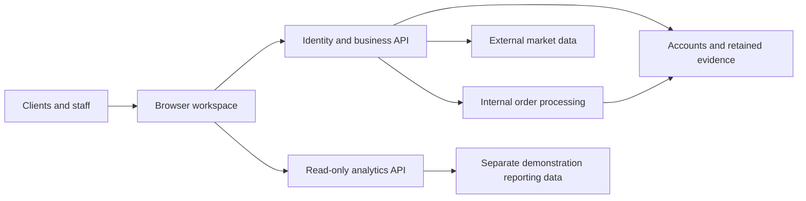
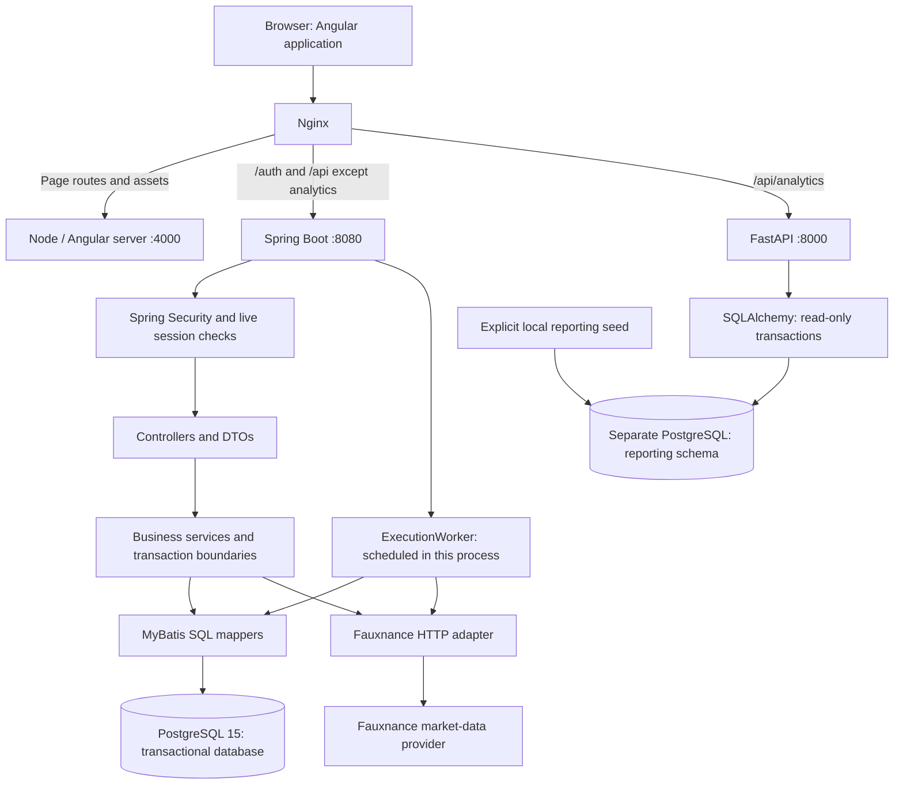
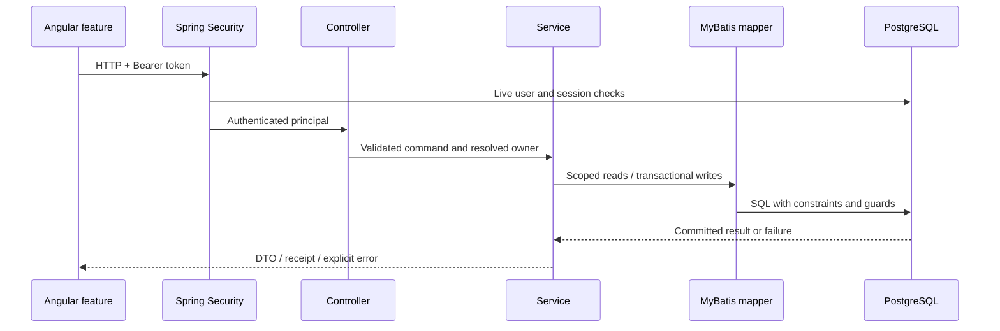

# Overall project architecture

## High-level explanation

Think of Tadpoles as a financial service desk with different work areas. The client area accepts an instruction. A processing area checks it and records its result. Staff areas help explain problems and control what is available. A separate reporting area presents historical demonstration charts.

The website is the interface; the server decides what is permitted; the database keeps durable records. Closing the browser does not cancel an accepted order because processing belongs to the server.

**Speaker note:** “The important separation is between a screen showing an estimate and the server committing a financial result.”

## Technical explanation

### Runtime topology

There is **no implemented live data pipeline** between the transactional database and reporting database in this topology. Transactional outbox records exist, but external delivery and the authoritative reporting loader are not configured.

### Component responsibilities

| Component | Responsibility and implementation |
| --- | --- |
| Angular | Standalone components, lazy routes, signals and RxJS; feature APIs; guards; recovery UI; Chart.js analytics and Lightweight Charts candles. Package manifest declares Angular 22.2, RxJS 7.8 and TypeScript 6.0 ranges. |
| Node/Angular server | Serves the built application. Although SSR tooling is configured, `app.routes.server.ts` sets all routes to `RenderMode.Client`; do not describe personalized pages as server-rendered. |
| Nginx | Sends `/api/analytics/` to Python, other `/api/` and `/auth/` requests to Java, and page requests to Node. Browser APIs use relative URLs. |
| Spring Boot | Version 3.3.5 in the POM; authentication, business APIs, staff workflows, trading and banking. Java source target is 17; the Docker build/runtime use Java 21. |
| MyBatis | Explicit SQL and mappings. This implementation does not use JPA repositories despite the older conceptual UML. |
| PostgreSQL | Account projections, immutable evidence, jobs, workflow state, grants, schema versions and database guards. |
| FastAPI | Independently authenticates Analysts, validates filters and reads the separate reporting schema. |
| Provider adapters | Obtain quotes/candles and informational FX rates. Fauxnance supplies data; it is not an exchange router. |

### The layered request pattern

Order submission adds an external quote fetch before the locked transaction and a durable job afterward; see [the lifecycle](03-Buy-and-Sell-Lifecycle.MD). The worker lives inside the backend service, rather than in a separate deployed microservice.

### Why this design matters

- Explicit service and SQL boundaries make ownership checks, lock order and transactions inspectable.
- One client row lock serializes the important financial mutations for that account. It prevents competing orders or withdrawals from spending the same available resources, at the cost of per-account contention.
- Current cash and positions are projections, checked against retained journals and fill relationships. They are not calculated from a browser's paginated order list.
- Database-backed jobs and request keys survive process/browser failure. No message broker is needed for the current internal worker.
- Separate analytics storage keeps Analyst report queries away from operational tables. Completing a live reporting pipeline remains additional work.

## Show and discuss

Show this topology, then one client order receipt and its timeline. Ask the audience to identify which component owns the outcome: PostgreSQL commits through the Spring transaction, while Angular displays it.

Avoid describing the architecture as a large microservices platform: most business capabilities are modules in one Spring application, with analytics as a separate service.

## Evidence and further reading

- [Compose services](../docker-compose.yml), [Nginx routes](../nginx/nginx.conf), [backend dependencies](../backend/pom.xml), [frontend dependencies](../frontend/package.json).
- [Angular server rendering policy](../frontend/src/app/app.routes.server.ts), [API URL construction](../frontend/src/app/core/api/api-url.ts).
- [Trading orchestration](../backend/src/main/java/com/neueda/leap/service/impl/TradingServiceImpl.java), [transactions](../backend/src/main/java/com/neueda/leap/trading/TradingTransactions.java), [worker](../backend/src/main/java/com/neueda/leap/trading/ExecutionWorker.java).
- [Analytics boundary](../analytics-service/README.md), [database guide](../database/README.md).
