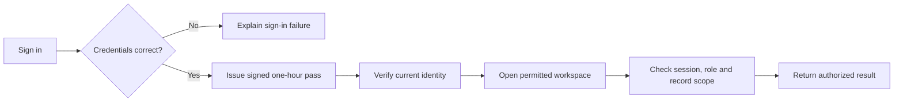
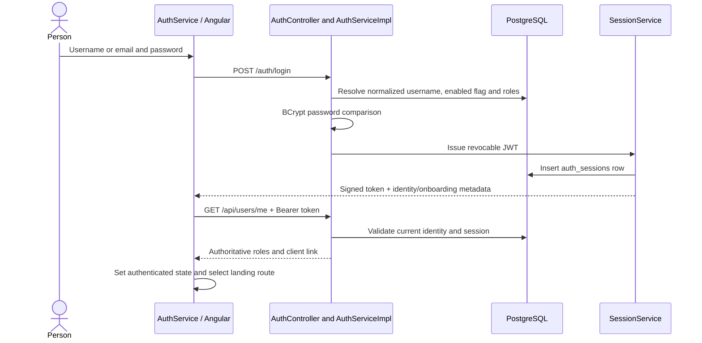

# Authentication and authorization

## High-level explanation

Authentication answers **“Who are you?”** Authorization answers **“What may you do, and whose information may you see?”**

After a successful sign-in, Tadpoles gives the browser a signed, time-limited pass. The server checks that pass, the current account, and the session on protected Java API requests. The browser also asks the server for the current identity before displaying a signed-in workspace.

A role opens the appropriate kind of workspace. It does not automatically open every account. Clients access their own records; Advisors access assigned clients; Operations and Compliance need additional account grants for protected evidence.

**Speaker note:** “Hiding a menu helps navigation. The server must still reject a forbidden request even if someone manually types its URL.”

## Technical explanation

### Sign-in and identity bootstrap

`AuthServiceImpl` trims login identifiers and lowercases email-like usernames. `UserServiceImpl` hashes stored passwords with BCrypt and handles registration. Normal signup creates CLIENT identity/profile state; onboarding creates or links the business account later.

`SessionService.issue()` signs a JWT using the shared HMAC key. Claims include `sub`, `iss`, `aud`, `iat`, `exp`, `jti`, `sid`, `userId`, `clientId` and `roles`. The token and database session expire after **3,600 seconds**. `SecurityConfig` requires at least 32 bytes of signing-secret material.

### What the Java API checks

1. Spring's resource-server decoder checks signature and timestamps, with the configured clock and zero timestamp leeway.
2. `LiveIdentityValidator` reloads the user by subject, requires enabled status, compares the complete persisted role set with the token's role set, and checks `userId` when supplied.
3. `SessionService.valid()` checks issuer, audience and the persisted session's owner, expiry and revocation status.
4. Method authorization such as `@PreAuthorize` checks required roles and explicit mixed-role exclusions.
5. Controllers/services derive ownership and account scope from persisted identity. Knowing another order ID does not establish ownership.
6. Sensitive staff reads additionally check purpose contexts, live account grants and required audit persistence.

Spring uses stateless HTTP security (`SessionCreationPolicy.STATELESS`), but **session validity is persisted in `auth_sessions`**. “Stateless” here means no servlet login session; it does not mean logout relies only on browser storage.

### Browser behavior and logout

The Angular service stores the access token/session in `localStorage`, validates `/api/users/me` on login/restoration, and loads a client profile when entering client context. Tokens in JavaScript-accessible storage make XSS prevention and a deployment security review material concerns; this is not an HttpOnly-cookie design.

The interceptor attaches the token only to intended application/analytics origins, avoids public login/signup calls, cancels requests when the session changes, and handles a matching-token `401` by signing out. A `403` can mean a valid identity lacks permission and does not automatically log the user out.

`POST /api/auth/logout` revokes the database session. Angular clears local state immediately and reports when server revocation could not be confirmed. An offline sign-out cannot prove that another copy of the token has been revoked. Cross-tab storage changes clear the current identity.

The identity used for browser menus is initialized at login/restoration, not continuously reloaded on a role-change timer. Server checks remain authoritative on the next Java request.

### Important boundaries

| Item | Actual implementation |
| --- | --- |
| Refresh tokens | Hashed token storage and administrative issuance exist. `refreshAccessToken()` deliberately returns `503`; automatic refresh is unavailable. The current UI asks the user to sign in again. |
| Auth stub | No auth-stub service is defined in current Compose. Historical environment names and setup notes do not make it the current login provider. |
| Analyst API | Python independently checks HS256 signature, expiry, subject and ANALYST role. Issuer/audience checks depend on optional analytics settings. It does **not** consult Java's live identity or `auth_sessions`; do not promise immediate cross-service revocation. |
| CSRF/CORS | Java disables CSRF for the current Bearer-header API and configures explicit CORS origins. CORS is not a replacement for authentication or record authorization. |
| MFA / SSO | No complete MFA or external identity-provider sign-in flow is implemented in the reviewed paths. |

### Explain errors accurately

`401` means authentication failed or is no longer valid; `403` means permission is unavailable; a scoped `404` can deliberately avoid disclosing a foreign record. Some generic security messages are less specific than the underlying cause, so use HTTP behavior and tests when explaining a scenario.

## Demonstration

Sign in as a Client and open an order. In a prepared test, request another client's order and show denial. Sign out and replay the old token against a Java protected endpoint in an isolated environment. Use [the test guide](04-Test-Suites-and-TDD.MD) to explain why a mocked JWT controller test alone cannot prove real signature/session revocation.

## Evidence

- [SecurityConfig](../backend/src/main/java/com/neueda/leap/config/SecurityConfig.java), [LiveIdentityValidator](../backend/src/main/java/com/neueda/leap/config/LiveIdentityValidator.java), [SessionService](../backend/src/main/java/com/neueda/leap/service/SessionService.java).
- [Login implementation](../backend/src/main/java/com/neueda/leap/service/impl/AuthServiceImpl.java), [refresh limitation](../backend/src/main/java/com/neueda/leap/service/impl/RefreshTokenServiceImpl.java).
- [Angular auth service](../frontend/src/app/core/auth/auth.service.ts), [interceptor](../frontend/src/app/core/auth/auth.interceptor.ts), [guards](../frontend/src/app/core/auth/auth.guard.ts).
- [Python token checks](../analytics-service/app/auth.py), [analytics settings](../analytics-service/app/config.py).
- [Signed-token identity tests](../backend/src/test/java/com/neueda/leap/config/LiveIdentityValidatorTest.java), [session tests](../backend/src/test/java/com/neueda/leap/service/SessionServiceTest.java), [browser auth tests](../frontend/src/app/core/auth/auth.service.spec.ts).
