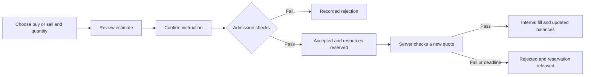
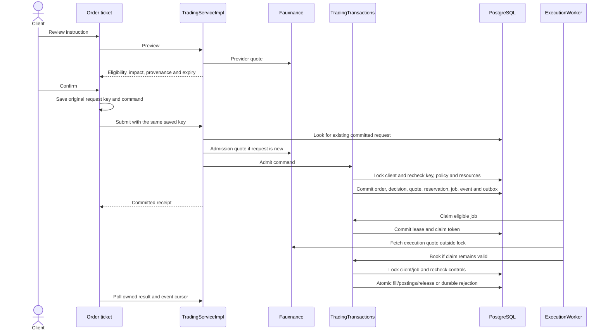
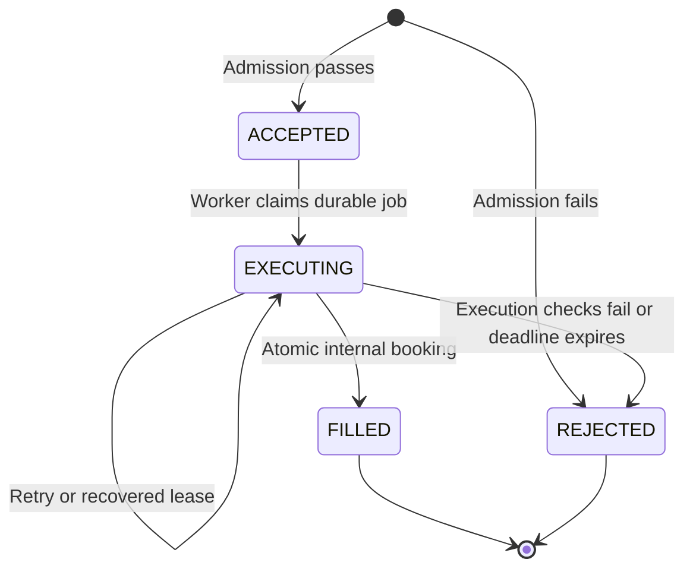

# How buying and selling work

## High-level explanation

A client chooses an instrument, a direction and a quantity. Tadpoles first shows an estimate. Confirming submits the instruction for fresh checks; an accepted instruction reserves resources while the server processes it. A later transaction either records the completed internal trade or releases the reservation with an explanation.

A **buy** exchanges internal cash for units at the provider's ask price. A **sell** exchanges owned units for internal cash at the provider's bid price. Project fees are currently zero. Selling more than the available owned quantity is rejected.



An estimate is not a guaranteed execution price or maximum-spend order. Acceptance is not a fill. A missing browser response is not proof of failure.

### What does admission mean?

**Admission is the server's check after you press Confirm: “Can we accept this instruction for processing right now?”** Think of it as checking an order at the entrance to the processing queue.

The server checks whether your account is ready, the instrument and trading direction are allowed, the price information is usable, and you have enough available cash to buy or available units to sell.

- **If the checks pass:** the server records the order as ACCEPTED, sets aside the cash or units it needs, and saves a processing job. That is a successful admission.
- **If a business-rule check fails:** the server records a REJECTED order with a reason, such as insufficient cash. It does not reserve resources or queue that order for execution. Invalid requests or a provider outage can instead fail before an order is recorded.

For example, suppose you have USD 500 available and request 2 shares at an admission ask price of USD 100 each. Admission can accept the instruction and reserve USD 200, leaving USD 300 available for other actions. You still own no new shares at this stage. The worker later checks an execution quote and either completes the internal trade or rejects it and releases the hold.

| Stage | In everyday terms |
| --- | --- |
| Preview | “Here is an estimate of what your instruction would do.” |
| Admission | “We have checked and accepted your instruction for processing, and set aside its resources.” |
| Execution and booking | “We checked again and recorded the completed internal trade, or recorded why it could not complete.” |

## Technical explanation

### Command and API boundary

The command contains exactly four fields. Monetary/quantity inputs use decimal strings rather than binary floating-point values.

```json
{
  "instrumentId": 123,
  "side": "BUY",
  "quantity": "2",
  "orderType": "MARKET"
}
```

`123` is illustrative; select a real catalog ID in a demonstration. The server accepts BUY/SELL and MARKET only, validates positive quantities with at most 12 decimal places, and then enforces the instrument's quantity step and limits. A decimal-capable data model does not mean every instrument permits fractional orders; startup policies use a step of one.

| Endpoint | Purpose |
| --- | --- |
| `POST /api/orders/preview` | Read-only eligibility/impact estimate; creates no reservation. |
| `POST /api/orders` + `Idempotency-Key` | Submit or replay a command. |
| `GET /api/orders/by-request/{key}` | Recover the owning client's committed request result. |
| `GET /api/orders/{id}` | Owned receipt, fill, decisions and bounded evidence. |
| `GET /api/orders/{id}/events` | Paged lifecycle history. |
| `GET /api/workspace/client/order-events/stream?cursor=...` | JSON cursor polling; despite the name, this is not SSE or WebSocket transport. |

`WorkspaceClientController` resolves the client from the authenticated user's persisted link, rather than trusting a client ID supplied by the browser. Admission rejection returns a retained receipt with HTTP `422`; pending ACCEPTED/EXECUTING returns `202`; a replayed terminal result can return `200`. Invalid input, request-key conflicts and outages have separate error responses.

### Transaction and provider sequence



The diagram follows a new instruction that passes admission. An existing request returns its retained receipt, while a failed admission records a rejection without creating a reservation or execution job.

The external fetch occurs outside the client lock. Admission rereads the policy under lock and rejects a changed policy instead of silently applying the old observation to new rules.

### Rule checks

`TradingRules` verifies active/enabled policy, session setting, USD currency and units, allowed side, quantity step/maximum, quote completeness, provider freshness flag, metadata timestamp/source, supported modelled spread, symbol mapping, bid/ask validity, future skew, age, precision and maximum notional.

Current policy storage supports quote ages **1–1,800 seconds**. Startup uses 1,800; shorter customized limits remain possible. An explicit `stale: true` always rejects, even inside the age allowance. A received-now response can contain an old provider quote and still fail.

When the provider explicitly reports `unknown`, `TradingSession` allows its checked-in 2026 core-session fallback only for supported venues, Eastern-time hours, holidays and early closes. Explicit closed/pre/post states are not overridden. It is a schedule fallback, not a live exchange-status service.

`TradingTransactions.resources()` then checks onboarding, current account/trade access, a saved active bank reference, eligible USD cash/position state, and unreserved funds/units. Cutover-quarantined history cannot become spendable merely because a quote is valid.

### Reservations, execution and recovery

For a buy, admission reserves the admission gross cost. For a sell, it reserves the quantity. Available cash is posted cash minus reserved cash; available units are posted units minus reserved units.

The worker polls by default every second, claims a job with a 30-second lease and random fencing token, and fetches an execution quote. Current halts, account eligibility and resources are rechecked before booking. Accepted policy snapshots supply execution parameters; current controls can still block a pending instruction.

Transport failures receive bounded retries within the retained deadline and maximum-attempt policy. Current startup policies use a 120-second deadline window and three attempts. Expired/stale claims cannot book. A transaction failure rolls back its writes, after which lease recovery can retry the original job.



A successful booking transaction updates cash and units, inserts one fill, appends signed cash/position journals, consumes the reservation, records the terminal event/outbox fact, records the attempt and completes the job. A rejected execution releases only that order's reservation and retains its reason. The reviewed path does not implement partial fills, limit orders, a client cancellation flow, or external settlement.

### Worked accounting example

Illustrative prices only, assuming no other holds or activity:

| Stage | Posted USD | Reserved USD | Available USD | Owned units | Reserved units |
| --- | ---: | ---: | ---: | ---: | ---: |
| Starting account | 1,000.00 | 0.00 | 1,000.00 | 0 | 0 |
| Buy 2 admitted at ask 100 | 1,000.00 | 200.00 | 800.00 | 0 | 0 |
| Buy fills at ask 101 | 798.00 | 0.00 | 798.00 | 2 | 0 |
| Sell 1 accepted | 798.00 | 0.00 | 798.00 | 2 | 1 |
| Sell fills at bid 99 | 897.00 | 0.00 | 897.00 | 1 | 0 |

The buy can spend 202 because this order's 200 hold plus 800 unreserved cash covers it. It cannot consume cash reserved by another order. Gross consideration is quantity × applicable price, rounded with `HALF_UP` to the policy currency scale (currently two for USD).

### Duplicate and uncertain requests

The server canonicalizes the command, hashes it, and associates it with a client-scoped key. Replaying the same key and equivalent command returns the existing result before a new quote fetch. Reusing a key for a different instruction returns `409`.

Angular persists the pending order in per-user `sessionStorage` **before** sending it. It blocks a replacement instruction while the outcome is uncertain. Recovery lookup and retries retain the original key/payload. A lookup `404` is not permission to invent a new key: the original request might still commit.

This gives one durable financial result under the implemented transaction, uniqueness and claim checks; it is not a promise of exactly-once delivery across external systems. External notifications are not configured.

## Evidence

- [HTTP contract](../backend/src/main/java/com/neueda/leap/controller/WorkspaceClientController.java), [service](../backend/src/main/java/com/neueda/leap/service/impl/TradingServiceImpl.java).
- [Rules](../backend/src/main/java/com/neueda/leap/trading/TradingRules.java), [session schedule](../backend/src/main/java/com/neueda/leap/trading/TradingSession.java), [transactions](../backend/src/main/java/com/neueda/leap/trading/TradingTransactions.java), [mapper and locks](../backend/src/main/java/com/neueda/leap/mapper/TradingMapper.java), [worker](../backend/src/main/java/com/neueda/leap/trading/ExecutionWorker.java).
- [Order ticket](../frontend/src/app/features/trade/order-ticket.component.ts), [pending request storage](../frontend/src/app/features/trade/pending-order.service.ts), [polling](../frontend/src/app/core/api/order-status.service.ts).
- [PostgreSQL trading tests](../backend/src/test/java/com/neueda/leap/trading/TradingPostgresTest.java), [UI recovery tests](../frontend/src/app/features/trade/order-ticket.component.spec.ts), [quote-age migration](../database/migrations/021_quote_stale_after_thirty_minutes.sql).
