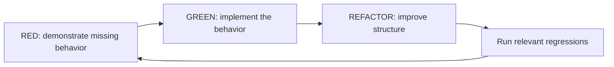
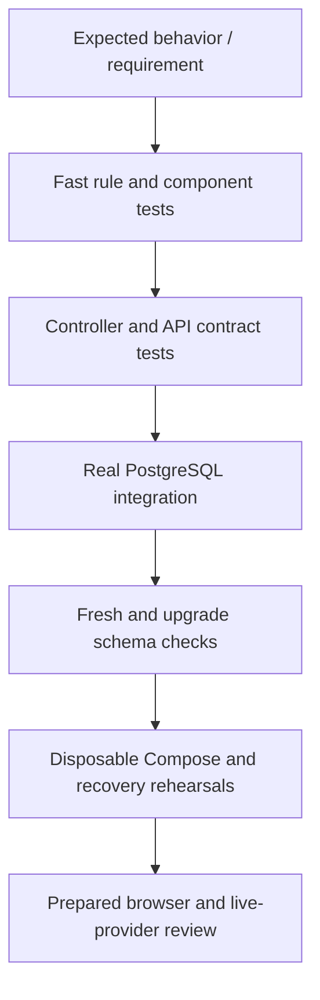

# Test suites and the role of TDD

## High-level explanation

Tests are rehearsals at different scales. A small test checks one rule; a database test checks real storage behavior; an HTTP test checks how components cooperate; a recovery rehearsal checks what happens after a restart or restore.

The strongest presentation example is a failure: if booking stops halfway, money and units must not end up in different states. The PostgreSQL suite deliberately injects failures and checks rollback and recovery. Another example submits competing orders to show that both cannot spend the same reserved cash.

Test-driven development (TDD) means defining expected behavior in a failing test, implementing enough to pass, and then improving structure while keeping tests green. The repository records that process for some features. It also explicitly records tests added after implementation. Both are useful, but only the former support a test-first claim.



## Technical explanation

### Test layers and their limits

| Suite | How it works | What it establishes | What it does not establish |
| --- | --- | --- | --- |
| Angular unit/component specs | Angular TestBed, Vitest and simulated DOM/HTTP/service dependencies | Routing, forms, state, exact-string preservation, request construction, cancellation, accessibility markup and recovery interactions | A real browser rendering/accessibility audit or a running full stack |
| Java unit/service tests | JUnit 5 and Mockito, often with fixed clocks | Business validation, normalization, side-price selection, expiry boundaries and dependency interactions | PostgreSQL SQL/triggers or real provider availability |
| Java controller/security slices | MockMvc and Spring Security test principals, commonly mocked services | Role gates, wire shapes, error mapping and intended owner delegation | Real JWT signature verification when `.with(jwt())` bypasses decoding |
| MyBatis mapper tests | `@MybatisTest`, mostly H2 in PostgreSQL compatibility mode and SQL fixtures | SQL mapping, CRUD, filtering/count/page agreement and isolated joins | PostgreSQL locking, PL/pgSQL, complete production schema behavior |
| Backend PostgreSQL integration | Disposable PostgreSQL 15 via Testcontainers or guarded isolated DB variables; Spring plus real mappers | Transactions, concurrency, immutable evidence, HTTP ownership, signed sessions, scope, grants, rollback and job recovery | Live exchange/bank execution; a mock provider is still a mock |
| Separate `testing/` module | Rebuilds disposable schemas from historical/fresh SQL and migrations | Constraints, migration preservation, upgrade/fresh structural parity | Every application API and runtime deployment path |
| Python analytics tests | Pytest, FastAPI TestClient and local token configuration | Authentication/role checks, filter validation and explicit unavailable states | Populated PostgreSQL query correctness or a live reporting loader |
| Scripted deployment/recovery checks | Disposable Docker networks/containers, HTTP fixture provider, real API calls, dump/restore and permission checks | Startup, repeatability, retained outcomes and export-byte/privilege behavior | Production capacity, production RPO/RTO or real-provider acceptance |



These layers complement each other; the diagram is a suggested verification order, not a claim that Jenkins implements every arrow.

### Key integration suites

- `TradingPostgresTest`: exact buy/partial-sale/full-sale arithmetic, duplicate-key races, competing reservations, execution price changes, stale worker claims, failure injection at booking/movement writes, banking, policy halts, current valuation, Finance totals, reconciliation, readiness, Operations evidence and exports.
- `SupportWorkflowPostgresTest`: public/private separation, structured intake, private-key replay, live grants, category checklists, atomic resolution, referrals, managed-context invalidation and audit-failure rollback while financial evidence remains intact.
- `AdvisorWorkspacePostgresTest`: assigned-client isolation, owned-quantity eligibility, guidance/recommendation versions, immutable history, concurrent writes and non-owner runtime protections.
- Compliance's PostgreSQL/query/HTTP suites: actual scoped SQL sections, matching counts and deterministic pagination, evidence exports, receipt recovery and archive preservation. `CompliancePostgresTest` is narrower schema/guard coverage; it is not the whole Compliance journey.

Some test classes still exercise **legacy services against historical fixtures**, particularly `OrderFillServiceImplTest` and `OrderFillServiceIntegrationTest`. They do not mean the removed legacy fill HTTP endpoint is the current client trade writer. Current trading behavior is in `TradingTransactions` and its PostgreSQL tests.

The [complete inventory](13-Test-Suite-Inventory.MD) maps individual test files to their checked behavior, including all seven concrete `testing/` classes and their shared base fixture.

### Running the suites

Commands below start at the repository root. Java integration tests need Docker unless using their supported disposable external-database setup. Schema fixtures reset databases: never point test variables at a retained application database.

```sh
# Spring unit, controller, mapper and PostgreSQL integration tests
mvn -B -f backend/pom.xml test

# Dedicated schema / migration tests
mvn -B -f testing/pom.xml test

# Frontend (run these from frontend/)
cd frontend
npm ci
npm test -- --watch=false
npm run test:qof-styles
npm run build
```

Analytics, in a separate shell from the repository root:

```sh
cd analytics-service
python3 -m venv .venv
. .venv/bin/activate
pip install -e '.[test]'
python -m pytest
```

The analytics test expectations assume no connected reporting database. Run in a clean test environment rather than inheriting a live `ANALYTICS_DATABASE_URL`; those tests intentionally expect readiness/report routes to return `503`.

Focused examples from the root, followed by frontend's directory:

```sh
mvn -B -f backend/pom.xml -Dtest=TradingRulesTest,TradingSessionTest test
mvn -B -f backend/pom.xml -Dtest=TradingPostgresTest test
mvn -B -f testing/pom.xml -Dtest=FreshTradingSchemaTest test
cd frontend
npm test -- --watch=false --include='src/app/features/trade/order-ticket.component.spec.ts'
```

`bash scripts/test-role-workspaces.sh` runs backend and schema tests against its disposable PostgreSQL and runs frontend install/tests/style/build in containers. It does **not** include Pytest, all standalone scripts or a full real-browser E2E suite. Compliance query/HTTP fixtures also support their dedicated `COMPLIANCE_W1_*` variables; leave these unset for Testcontainers or follow the harness's isolated setup.

Additional scripts and their prerequisites appear in [the inventory](13-Test-Suite-Inventory.MD). The restore/Compose rehearsals require packaged artifacts or images and free fixture ports; they should be reviewed and run as explicit rehearsals.

### TDD evidence that can be presented

| Claim | Repository evidence | Careful wording |
| --- | --- | --- |
| Model portfolio/holding work was test-first | `HoldingPortfolioAndModel.MD` describes controller/service/mapper tests and the red phase | “The implementation record describes a test-first slice across three layers.” |
| Quote adapter work was test-first | `Fauxnance/Quotes.md` records tests for forwarding, normalization, response parsing and upstream errors | “Tests specified the provider adapter contract before implementation.” |
| A missing freshness flag produced a demonstrated regression | Client refactor commentary records expected unknown metadata, failing behavior, then passing changes | “One recorded red/green example stopped absent metadata from being treated as fresh.” |
| Banking storage and ownership gates were driven by failing checks | Client refactor commentary records missing-table, endpoint and BANK_REQUIRED failures | “The record includes failures that drove the banking schema/API/gate changes.” |
| All tests were written first | The same commentary explicitly identifies failure-injection/concurrency checks added later and tests first executed after implementation | **Do not claim this.** Distinguish test-first work from regression hardening. |

Rehearse a small public example: add an assertion that a provider-marked stale quote is ineligible, observe it fail against a deliberately broken local copy, implement the correction, then rerun. This is a **proposed teaching demonstration**, not a change made during preparation or proof of the original development chronology.

### CI and confidence limits

The current Jenkinsfile runs backend `clean verify -Djacoco.skip=false`, frontend checks, schema integration tests, image builds, selected startup/recovery scripts, and an HTTP smoke stage. It does not run the analytics Pytest suite. JaCoCo reporting is enabled there, but no coverage threshold is configured in the reviewed POM. Checkstyle is skipped by default and SpotBugs is non-blocking; do not claim an enforced quality gate.

No dedicated checked-in Playwright/Cypress browser test suite was found. DOM tests, scripted HTTP checks and historical browser observations are distinct forms of evidence. Load, chaos, independent penetration testing and broad analytics database tests are opportunities for further verification, not completed acceptance claims.

**Preparation validation:** the documents and source references were checked; the application suites were not rerun for this documentation-only task. Existing historical totals are intentionally not promoted into a new “all tests pass” claim.

## Evidence

- [Backend POM](../backend/pom.xml), [schema test POM](../testing/pom.xml), [Angular test builder](../frontend/angular.json), [Python test configuration](../analytics-service/pyproject.toml), [Jenkinsfile](../Jenkinsfile).
- [Trading integration tests](../backend/src/test/java/com/neueda/leap/trading/TradingPostgresTest.java), [support integration tests](../backend/src/test/java/com/neueda/leap/support/SupportWorkflowPostgresTest.java), [fresh/upgrade tests](../testing/src/test/java/com/neueda/leap/db/FreshTradingSchemaTest.java).
- [Documented TDD: portfolios](../ImplementationDocumentation/Backend/HoldingPortfolioAndModel.MD), [quotes](../ImplementationDocumentation/Fauxnance/Quotes.md), [client refactor with explicit process qualifications](../ImplementationDocumentation/Frontend/ClientPageImplementation/ClientRefactorCommentary.MD).
