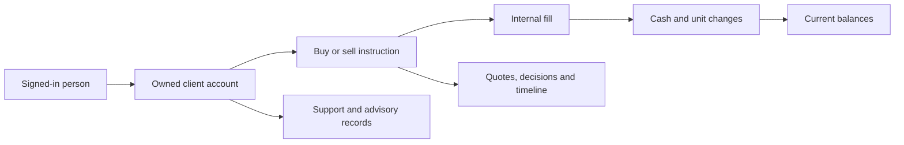
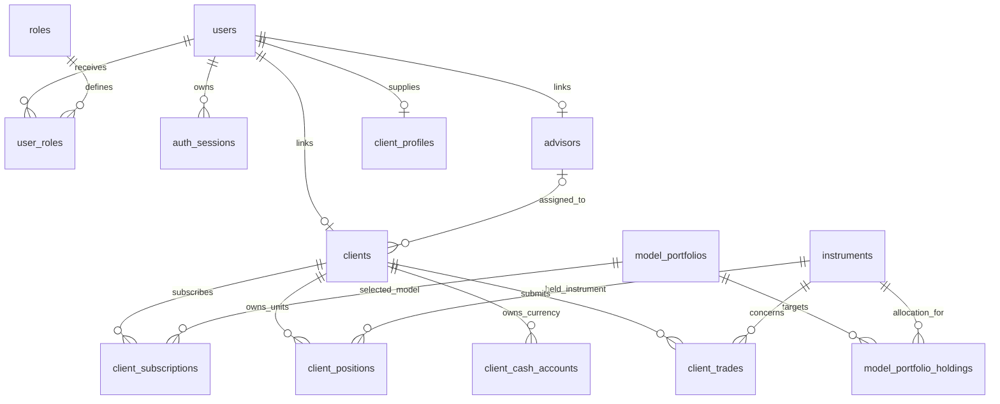
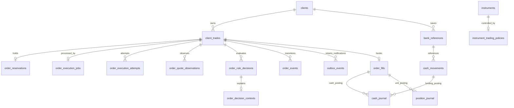
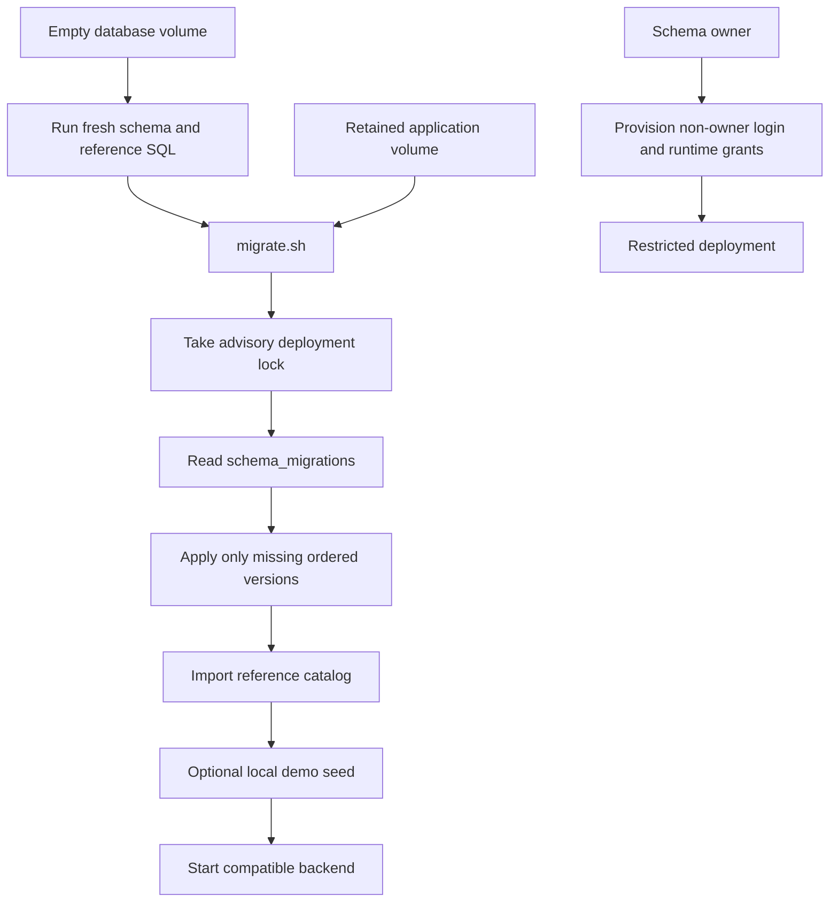

# Schemas and data integrity

## High-level explanation

A schema is the database's blueprint. It describes what can be stored, how records connect and which combinations are invalid. Tadpoles separates people, accounts, market instruments, orders, financial changes and staff work so each has a clear meaning.

An order is an instruction. A fill records its completed internal execution. A position records owned units. A journal records the signed change that explains a balance. Keeping these separate makes it possible to answer both “What do I have?” and “How did I get it?”

## Technical explanation

### Which schemas and SQL directories matter?

There are two runtime databases: transactional tables predominantly in PostgreSQL's `public` schema, and a separate database with a `reporting` schema. The repositories' multiple SQL folders are not separate runtime trading engines.

| Path | Meaning |
| --- | --- |
| `database/fresh/001_schema.sql` | Canonical fresh transactional structure; the current snapshot includes versions through **021**. |
| `database/fresh/002_reference.sql` | Current role reference data and migration markers for versions represented in the snapshot. |
| `database/migrations/003_...` through `021_...` | Ordered retained-volume upgrade path. Historical 001 base is loaded separately in upgrade tests. |
| `database/schema/` | Original schema and historical data used by regression/upgrade tests. Not the normal fresh Compose initialization directory. |
| `database/catalog/seed.sql` | Repeatable reference catalog import from the three root JSON manifests. |
| `database/demo/` | Optional local identity, grant and historical simulation fixtures; not production source data. |
| `database/runtime-grants.sql` | Owner-run permissions for a separately provisioned non-owner application login. |
| `analytics-service/migrations/` | Separate reporting structure, reader grants and explicit demo data. |
| `schema/portfolio_schema.sql` | Older design artifact with incompatible/incomplete assumptions. It is not mounted by normal Compose. |

Some database-guide prose still says the snapshot stops at 019/020. Inspect the actual fresh file and migration markers: current fresh SQL records 020 and 021 as well.

### Identity and investment relationships

This is a deliberately trimmed ERD; it omits many columns and audit relationships.

`users` is authentication identity; `clients` is business ownership; `client_profiles` is onboarding information. One user can have multiple roles through the join table. `instruments.exchange` is listing metadata; `instrument_trading_policies.venue` is a control input. Listing on an exchange does not imply this project routes orders there.

`model_portfolio_holdings` stores target percentages; these are not owned units or spendable cash. `client_holdings` preserves dated historical snapshots; current trading ownership is in `client_positions`.

### Trading evidence and current projections

`client_trades` carries both historical `LEGACY` and current `SELF_DIRECTED` records. The lifecycle constraint separates their status/price meanings. Current execution price belongs to `order_fills`; the old `client_trades.price` remains null for SELF_DIRECTED orders. Do not use the legacy price column to explain current fills.

| Table family | Why it exists |
| --- | --- |
| `client_cash_accounts`, `client_positions` | Current posted/reserved projections, versions and trading-availability flags. |
| `order_reservations` | Identifies the individual order's hold and whether it is active, consumed or released. |
| Jobs and attempts | Mutable scheduling/claim state versus retained attempt history. |
| Quote observations, decisions and decision contexts | Retained input prices, provenance, rule results and resource/control facts. |
| Fills and journals | Immutable internal fill and signed changes linked by posting group. Cash journal requires exactly one fill/setup/movement source. |
| Events and outbox | Versioned lifecycle facts and retained notification payloads; external delivery is not configured. |
| Migration exceptions | Preserves uncertain historical balances/provenance instead of inventing available USD. |
| Reconciliation runs/findings | Stores checks of internal accounting relationships and their exceptions. |

Financial projections and fills generally use PostgreSQL `numeric(28,12)` with Java `BigDecimal`. HTTP command/financial DTOs preserve exact values as strings where the current APIs require them. Not every legacy or reporting field has this same shape. Formatting values to two decimals in the UI must not change the stored quantity.

### Support, access and advice tables

Operations and Compliance have separate `*_access_grants`, `*_grant_events`, `*_access_contexts`, `*_access_events` and `*_evidence_exports`. Those model who may access which account, the current purpose, audit history and retained export bytes.

Support uses `support_cases` and public `support_case_events`, plus private notes, request receipts, workflow projections/events/tasks/resolutions, read watermarks and export associations. Compliance referrals link Support to separate `compliance_investigations` and review events/receipts. A support resolution is not a financial posting.

Advisory records use `advisor_guidance`, `advisor_recommendations` and their dedicated immutable history tables. Database triggers validate author, assignment, version progression and recommendation eligibility, and append attributed snapshots. See [advisory behavior](09-Advisory-Valuation-and-Reporting.MD).

### Enforcement below the API

- Foreign keys and uniqueness rules prevent orphaned/duplicate relationships; client-scoped request keys support replay.
- Cash/position constraints require `posted >= reserved >= 0`.
- Order-intent guards preserve accepted instruction identity. Reservation guards prevent reopening an ended hold.
- A deferred lifecycle constraint requires a matching event/version/status and an immutable fill for a FILLED order at commit.
- Evidence-change triggers and restricted runtime privileges prevent normal application mutation/deletion of source facts. These are not tamper-proof guarantees against a privileged database owner.
- Support/review projection-history checks and advisory history triggers keep permitted state changes attributable.
- Legacy financial guards stop the older scalar/dated-holding paths from becoming another writer for migrated accounts.

The cash and position journals are **not a balanced double-entry general ledger**. Internal reconciliation does not establish real bank balances, custody or external settlement.

### Fresh install versus upgrade

The migration runner holds one advisory lock across the chain and records applied versions; it is not a rollback engine. Individual files differ in transaction wrapping, so do not assume the entire chain is one atomic transaction. Never manually mark an incomplete upgrade as applied. Fresh snapshots and incremental migrations need parity tests when structural changes are made.

### Reporting schema

`dim_instrument` and `dim_client_segment` describe dimensions; `fact_order_event` and `fact_fill` hold source-style facts; `agg_activity_period` supports report queries. `reporting_watermark`, `metric_definition` and `reconciliation_run` describe freshness/definitions/checks. Demo SQL also creates portfolio-performance and holding-snapshot tables and `is_demo` flags. The API uses a SELECT-only reader and read-only transactions. No runtime query joins back to the Java database.

## Evidence

- [Fresh transactional SQL](../database/fresh/001_schema.sql), [reference roles](../database/fresh/002_reference.sql), [migration runner](../database/migrate.sh), [runtime grants](../database/runtime-grants.sql).
- [Banking migration](../database/migrations/005_client_banking.sql), [advisory migration](../database/migrations/018_advisor_workspace.sql), [trade-access migration](../database/migrations/020_user_trade_access.sql), [quote-age migration](../database/migrations/021_quote_stale_after_thirty_minutes.sql).
- [Reporting schema](../analytics-service/migrations/001_reporting_schema.sql), [demo additions](../analytics-service/migrations/003_demo_reporting_data.sql).
- [Parity test](../testing/src/test/java/com/neueda/leap/db/FreshTradingSchemaTest.java), [constraint tests](../testing/src/test/java/com/neueda/leap/db/SchemaConstraintValidationTest.java). These provide bounded evidence, not proof that every possible schema behavior is equivalent.
