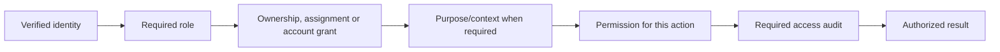

# Role types and permission boundaries

## High-level explanation

People need different tools. A client manages their own account; an Advisor gives guidance; Operations handles service and trading availability; Compliance reviews evidence; Finance checks internal totals; an Analyst studies reports. Administrators manage selected platform records.

Roles describe a job. Account scope describes which records that person can use. Purpose and case context explain why they are accessing sensitive information. A staff badge alone is not access to every client's details.

The exact checks differ by endpoint; a catalog query does not require the same evidence purpose as a protected order investigation.

## Technical explanation

### Current role matrix

| Role | Browser home | Main current capabilities | Boundaries |
| --- | --- | --- | --- |
| `CLIENT` | `/app/overview` | Own portfolio/valuation, markets, MARKET buy/sell, banking, Support, own advice/profile | Persisted client ownership and onboarding; no staff evidence access from CLIENT alone. |
| `TRADING_OPS` | `/operations/overview` | Readiness, scoped orders/exceptions/reconciliation, managed cases, instrument controls, client trade-access controls, selected staff creation | Operations endpoints exclude identities also holding CLIENT. Protected account evidence/cases require explicit grants; policy controls do not imply grant administration. |
| `COMPLIANCE` | `/compliance/investigations` | Scoped evidence searches/sections/exports and independent review cases | Live Compliance account grants, allowed purpose and context; managed reviews bind reviewer/version. Does not place trades or publish Support replies. |
| `ANALYST` | `/analytics/overview` | Separate reporting API: summary, trends, instruments, performance and holdings | Read-only demonstration reporting by default. Python's token checks differ from Java live-session checks. |
| `ADVISOR` | `/advisor/clients` | Assigned-client portfolios, holding guidance, recommendations and own workspace catalog | Linked, enabled Advisor identity and current client assignment. Advisory writes cannot execute or fund trades. |
| `FINANCE` | `/finance/reconciliation` | Date-filtered all-client USD summary; latest/run internal reconciliation | Backend requires FINANCE **without CLIENT**. Does not provide a general account investigation/export contract. |
| `ADMIN` | No dedicated home in current workspace policy | Selected user/role, advisor, model and legacy administrative APIs | No universal bypass. CLIENT-only trading, Operations-only controls and Finance rules remain endpoint-specific. ADMIN alone has no browser workspace in the current role list. |

The seven roles are inserted by `fresh/002_reference.sql`. There is no separate `SUPPORT` application role: client Support is owned; staff case handling belongs to TRADING_OPS.

### Role assignment and navigation

`user_roles` supports multiple memberships. Angular `WORKSPACES` recognizes six workspace roles in this priority order: CLIENT → TRADING_OPS → COMPLIANCE → ANALYST → FINANCE → ADVISOR. The first recognized role determines the default landing page; other permitted links may still appear.

Unknown labels and ADMIN-only sessions land at `/unauthorized`. Operations navigation and guards explicitly deny mixed CLIENT+TRADING_OPS sessions. A mixed CLIENT+FINANCE session can reach a Finance route through current browser policy but the Finance Java API rejects it. Treat that UI/API mismatch as a current limitation, not a successful permission grant.

Java live identity validation rejects an old token when its complete role set differs from the persisted set. Reauthentication is necessary after a membership change. Browser menus can remain based on their initialized identity until a new check/request occurs.

### Permissions below the role

| Boundary | Examples |
| --- | --- |
| Client ownership | `/api/orders/{id}` and banking derive the account from the current user. |
| Advisor assignment | Workspace queries combine the linked Advisor, assigned client and current eligibility. |
| Operations account grants | `EVIDENCE_READ`, `CASE_READ`, `CASE_UPDATE`, `ACCOUNT_DIAGNOSTICS`, reconciliation/export permissions where required. |
| Compliance account grants | Evidence/export permissions plus independent `INVESTIGATION_READ` / `INVESTIGATION_UPDATE`. |
| Purpose context | Opaque expiring context bound to requester/policy and optionally a managed case/review. It is not itself a grant. |
| Database runtime role | PostgreSQL login privileges restrict SQL mutations separately from the user's application role. |

A private case assignment does not create an evidence grant. A saved export association does not create download authority. Ordinary runtime credentials cannot provision staff access grants through an application API.

### Operational account controls

Operations can create ANALYST, ADVISOR, COMPLIANCE or FINANCE staff through `/api/operations/users/staff`; that route rejects CLIENT, TRADING_OPS and privileged role creation. The ADMIN registration route is separate.

`PATCH /api/operations/users/{clientId}/trade-access` can revoke access indefinitely or for supported durations and restore it. Events retain the actor/action/reason/time. `TradingMapper.accountEnabled()` checks enabled identity and whether the revocation has expired; trading admission and execution use this gate. Banking movements also call that account gate, so this control affects the reviewed cash-movement path as well. It does not disable login or delete evidence.

### Historical labels and APIs

`AUDITOR` and `OPERATIONS` appear in older schema fixtures, older documents or some retained controller authorization expressions. They are not the current seeded workspace list. Migration 003 preserves historical OPERATIONS assignments; it does not silently rename them into TRADING_OPS. Some legacy audit/read endpoints accept AUDITOR, but there is no AUDITOR browser workspace in the current policy.

Do not say that COMPLIANCE is a global auditor alias, that ADMIN inherits every role, or that every legacy API uses the same assignment policy as the dedicated Advisor workspace. The scoped workspace endpoints are the presentation's primary paths; broader retained APIs need their own authorization review before production use.

## Demonstration and discussion

Show the same task from two workspaces: the Client sees their own receipt; Operations sees only the account scope granted for investigation. Then explain why a case reference, a menu link and an account grant are three different things.

Use separate staff/client accounts during rehearsal. Combining roles can intentionally make staff APIs unavailable.

## Evidence

- [Role reference data](../database/fresh/002_reference.sql), [workspace policy](../frontend/src/app/core/auth/workspace-policy.ts), [route guards](../frontend/src/app/core/auth/auth.guard.ts).
- [Operations user controls](../backend/src/main/java/com/neueda/leap/controller/OperationsUsersController.java), [account gate](../backend/src/main/java/com/neueda/leap/mapper/TradingMapper.java).
- [Operations access](../backend/src/main/java/com/neueda/leap/service/OperationsAccessService.java), [Compliance access](../backend/src/main/java/com/neueda/leap/service/ComplianceAccessService.java), [Advisor service](../backend/src/main/java/com/neueda/leap/service/impl/AdvisorWorkspaceServiceImpl.java).
- [Finance controller](../backend/src/main/java/com/neueda/leap/controller/StaffWorkspaceController.java), [reconciliation authorization](../backend/src/main/java/com/neueda/leap/controller/TradingOperationsController.java).
- [Workspace authorization tests](../backend/src/test/java/com/neueda/leap/controller/WorkspaceAuthorizationTest.java), [routing policy tests](../frontend/src/app/core/auth/workspace-policy.spec.ts).
