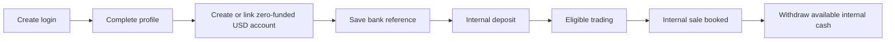
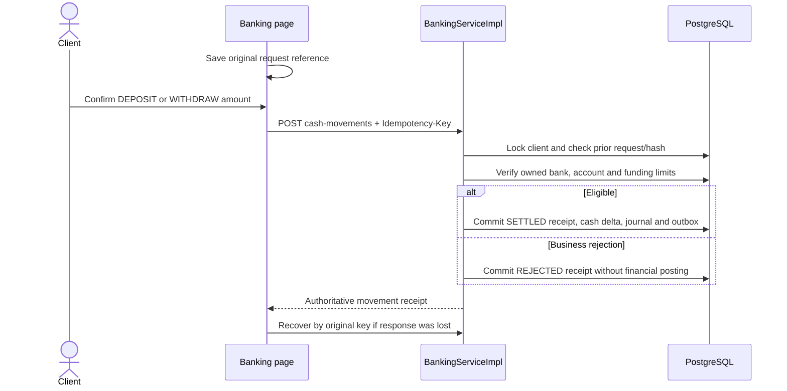

# Onboarding, bank references and internal cash

## High-level explanation

A login and an investment account are different things. A new client first creates credentials, then completes a profile. The profile includes declared personal information, investment preferences and net worth. Declared net worth is not money deposited into Tadpoles.

Clients can save a bank reference and use internal funding actions. The reference is stored securely and displayed in masked form, but the project does not contact a bank, verify bank ownership or perform a real transfer.

**Speaker note:** “Funding in this demonstration changes the application's ledger. The bank reference is a project workflow requirement, not a bank connection.”

## Technical explanation

### Signup and onboarding

`POST /auth/signup` uses the normalized email as the username, assigns CLIENT and creates placeholder profile state. It returns a revocable login token. A client can authenticate before onboarding is complete.

`ClientOnboardingServiceImpl` validates required profile fields, a past birth date and nonnegative declared net worth. It creates the client if missing and initializes zero USD cash through `TradingAccountSetup`; repeated onboarding must not refill the account.

When an unassigned client completes onboarding, `AdvisorMapper` serializes assignment with a PostgreSQL advisory transaction lock. Its actual ordering prefers eligible **non-demo Advisors first**, then the client count and stable Advisor ID. Demo Advisors are a fallback pool. If no enabled linked ADVISOR exists, assignment remains pending. This is more specific than a global “least-loaded Advisor” claim.

`POST /auth/register/client` remains a separate registration API with different input/creation behavior; the normal browser story uses signup followed by onboarding.

### Ordinary clients versus local fixtures

| Account path | Funding behavior |
| --- | --- |
| Normal signup/onboarding | Zero-funded USD account; profile net worth is never converted to account cash. |
| Local `demo.client` | `DemoAccountSetup` can grant a one-time USD 10,000 opening and fictitious bank reference when opted into local demo setup and eligibility/history checks pass. |
| Local second demo client | Does not receive the primary demo opening automatically; can fund through internal movements. |
| Historical migrated account | Uncertain/nonzero old balances and positions can be quarantined for review; the upgrade does not infer a valid USD opening. |

Demo reseeding/startup preserves spent cash and existing controls; it is not a reset/refund button.

### Saved bank references

Owned routes under `/api/workspace/client/banks` support listing, creation, versioned editing and deactivation. The API accepts text to preserve leading zeros. The project checks a nine-digit routing number and a 4–17 digit account number, but those are format checks.

`BankingServiceImpl` uses AES-256-GCM, a configured base64 32-byte key, random nonce, and additional authenticated data bound to client/record identity. Responses expose masked metadata such as nickname, last four, default flag and version, not the encrypted/full details. Audit data uses safe metadata.

Edits use a version check. Pending orders block replacing bank details or removing a bank reference. Soft deactivation preserves movement references and their retained bank-description snapshots.

### Movement transaction

Movement commands contain `bankId`, `direction` and exact-string `amount`. Currency is USD; direction is DEPOSIT or WITHDRAW. The API permits positive amounts up to USD 10,000 with at most two decimal places. Deposits additionally have a USD 10,000 total per UTC day, checked under the same client lock as trading.

Withdrawals require posted-minus-reserved cash. They reserve and consume the amount within the same transaction; movements settle synchronously. There is no asynchronous bank settlement worker or delayed T+ settlement simulation. Invalid/missing prerequisites can return an error before any receipt; retained SETTLED/REJECTED movement outcomes should be distinguished from transport uncertainty.

The service canonicalizes request contents and hashes them. An identical key/content replays; a conflicting reuse fails. Successful writes include the movement receipt, cash projection, journal and movement outbox event in the transaction. Bank-reference create/edit/deactivation has separate audit writes. The PostgreSQL suite injects failure at intermediate writes to check rollback and same-key recovery.

### Example worth showing

An account has USD 500 posted and USD 200 reserved for a buy. Available cash is USD 300. A USD 400 withdrawal must fail even though the posted balance is 500. After a sale commits, its proceeds become immediately available under this project's internal settlement rule. A browser estimate or pending sale cannot be withdrawn.

## Evidence

- [User creation](../backend/src/main/java/com/neueda/leap/service/impl/UserServiceImpl.java), [onboarding](../backend/src/main/java/com/neueda/leap/service/impl/ClientOnboardingServiceImpl.java), [Advisor selection SQL](../backend/src/main/java/com/neueda/leap/mapper/AdvisorMapper.java).
- [Zero-account setup](../backend/src/main/java/com/neueda/leap/trading/TradingAccountSetup.java), [demo opening](../backend/src/main/java/com/neueda/leap/trading/DemoAccountSetup.java).
- [Banking API](../backend/src/main/java/com/neueda/leap/controller/ClientBankingController.java), [service and encryption](../backend/src/main/java/com/neueda/leap/service/impl/BankingServiceImpl.java), [mapper](../backend/src/main/java/com/neueda/leap/mapper/BankingMapper.java).
- [Banking UI tests](../frontend/src/app/features/client/banking-page.component.spec.ts), [financial integration tests](../backend/src/test/java/com/neueda/leap/trading/TradingPostgresTest.java), [banking schema test](../testing/src/test/java/com/neueda/leap/db/ClientBankingMigrationTest.java).
