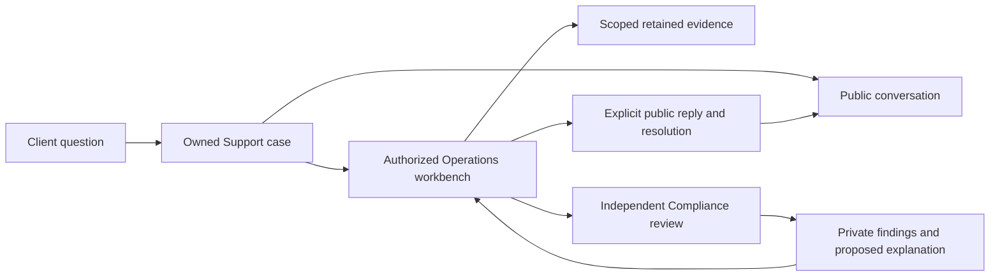
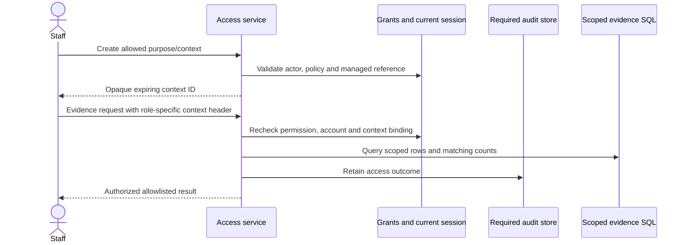
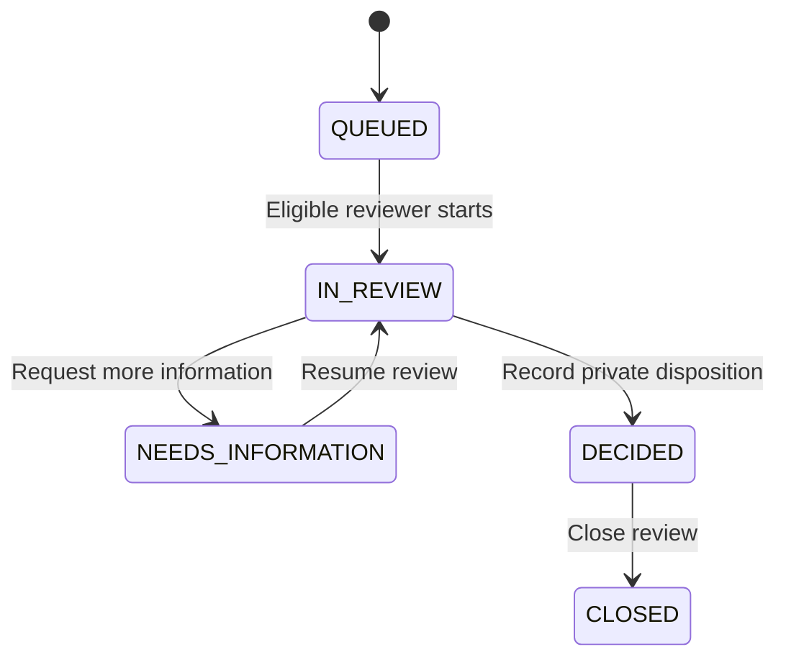

# Support, Compliance and retained evidence

## High-level explanation

When a client asks about an order, the answer should come from what the application actually recorded. Tadpoles keeps the order's checks, quotes, timeline, reservations and internal postings. Clients can open a durable Support conversation; authorized staff can investigate without changing the original trade.

Public messages and private staff investigation are separate. Compliance can review a referred issue independently, but its private findings do not automatically become a public reply. Operations publishes an appropriate explanation when resolving the Support case.

**Speaker note:** “A support resolution explains what happened. It does not rewrite a trade or manufacture a refund.”

## Technical explanation

### Public and private models

Clients use their own account/session to create cases and read public activity. References use `CASE-...`; requests retain original-key receipts so uncertain writes can be recovered. Public events and per-user read watermarks support conversation activity/unread state.

Operations case reads require live `CASE_READ`; updates require `CASE_UPDATE` as well. The private workbench stores effective category, owner, priority, next action/due date, checklist revision, private events and resolution facts. Private activity does not advance client-visible conversation activity. Public and private versions are distinct.

| Category | Intended investigation |
| --- | --- |
| `ORDER_QUESTION` | Retained owned instruction, outcome, quote/decision and posting relationships. |
| `ACCOUNT_REVIEW` | Account/setup/movement diagnostics with independent diagnostic permissions. |
| `HISTORICAL_RECORD` | Provenance and quarantined history with reconciliation permission. |
| `TRADING_AVAILABILITY` | Account/instrument/side eligibility and current versus historical control facts. |
| `OTHER` | Bounded clarification, reproduction, duplicate or specialist handoff. |

Category handlers live under `service/support/`. A completed checklist needs authorized evidence and a reasoned disposition; it cannot invent unavailable facts. Reclassification/reopening creates a fresh checklist revision. Explicit due dates and priorities are workflow data; no contractual response-time target is configured.

### Sensitive evidence authorization

Operations and Compliance use separate grants, contexts and audit histories. Protected endpoints use opaque context headers; tokens and purpose details should not be inserted into browser download URLs. Exact header names are role-specific (`X-Operations-Context` and `X-Compliance-Context` in their respective controllers).

Purpose is drawn from configured allowed values. MANAGED contexts bind an actual Support case or Compliance review; EXTERNAL contexts refer to approved external case metadata. Contexts do not widen account scope. Queries apply authorized scope before pagination and counts, avoiding leakage through totals. Required audit failure causes protected operations to fail rather than silently returning unaudited data.

Managed Compliance contexts additionally bind reviewer/version; a review change invalidates the old context. Starting a new external context must not be used to bypass a managed review boundary. Role membership, case assignment and evidence permission remain independent.

### Independent Compliance lifecycle

An authorized Operations referral creates a separate `REVIEW-...` record linked to the verified source account and optionally its order. Eligible Compliance reviewers need their own grants. Reviews move through QUEUED, IN_REVIEW, NEEDS_INFORMATION, DECIDED and CLOSED as permitted by the service.

This diagram is the main narrative, not the complete transition/permission table; `ComplianceCaseService` is authoritative. Mandatory referrals that remain undecided block Support resolution. Account-only cases do not fabricate an order. Review actions do not place trades, alter cash or publish public client text.

### Atomic resolution and command recovery

Resolution validates current public/private versions, owner, checklist, category-specific prerequisites and required referrals, then commits the public transition, private resolution/history, receipt and audit together. Repeated or uncertain private commands keep their original actor/resource/action/key; browser storage retains opaque metadata while the original body remains in memory.

A missing recovery receipt is not proof that a prior request failed. After reload, an uncertain command may need the original content re-entered, rather than automatically submitting a replacement command/key. This differs from order recovery storage, which retains the order command in the tab.

### Evidence exports and integrity claims

Exports retain authorized content, exact archive bytes, digest, requester/context and expiry. Recovery uses the original request reference. Download authority is checked again, including live scope/context requirements; having the URL or a private case association is insufficient.

`verify-operations-export.py` verifies the Operations ZIP's fixed expected entries, archive SHA-256 and manifest content digests. That is an integrity check against the supplied digest, not independent proof of truth, legal admissibility, externally anchored time or a complete chain of custody. The recovery harness checks exported-byte preservation through backup/restore.

Clients receive an allowlisted view of their order evidence, not the whole private staff archive. A retained quote/check is evidence of what the application used; it is not evidence of an exchange fill. An empty scoped search cannot prove that no record exists elsewhere.

## Demonstration

Open a prepared order case as its Client; add a public message. Switch to a separately authorized Operations account and show its private workbench. Explain how a Compliance referral remains private and how the public explanation is explicitly published. Use fictitious data and prepared grants in an isolated demo.

## Evidence

- [Support workflow service](../backend/src/main/java/com/neueda/leap/service/SupportWorkflowService.java), [category registry](../backend/src/main/java/com/neueda/leap/service/support/SupportCategoryRegistry.java), [Compliance case service](../backend/src/main/java/com/neueda/leap/service/ComplianceCaseService.java).
- [Operations access](../backend/src/main/java/com/neueda/leap/service/OperationsAccessService.java), [Compliance access](../backend/src/main/java/com/neueda/leap/service/ComplianceAccessService.java), [export implementation](../backend/src/main/java/com/neueda/leap/service/OperationsExportService.java).
- [Managed Support guide](../ImplementationDocumentation/Frontend/OperationsPageImplementation/OperationsRefactorCrashCourse.MD), [incident runbook](../docs/operations-runbook.md).
- [Workflow integration tests](../backend/src/test/java/com/neueda/leap/support/SupportWorkflowPostgresTest.java), [Compliance HTTP journey](../backend/src/test/java/com/neueda/leap/compliance/ComplianceHttpJourneyTest.java), [Operations archive verifier](../scripts/verify-operations-export.py).
