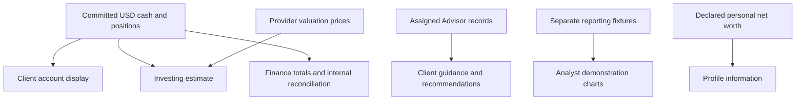
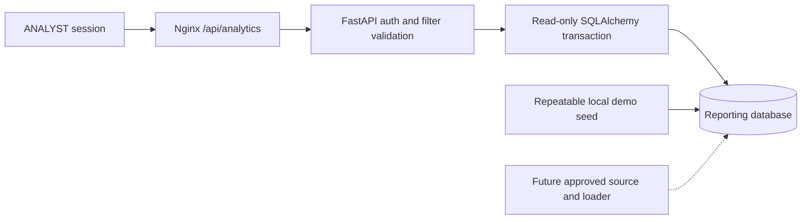

# Advisory guidance, valuation and reporting

## High-level explanation

Several screens contain numbers or recommendations, but they answer different questions:

- **Cash and positions:** what the application has committed to the client's account.
- **Investing value:** an estimate of posted cash plus owned units valued using acceptable provider prices.
- **Advisor guidance:** recorded advice that the client may consider; it does not place an order.
- **Finance summary:** totals of internal settled movements and booked fills.
- **Analyst charts:** separate demonstration reporting data, visibly labeled as such.
- **Declared net worth:** personal information entered during onboarding, not an account balance.

**Speaker note:** “A missing market price should make the estimate unavailable, not make an owned asset appear worthless.”

## Technical explanation

### Advisory workspace

The dedicated `/api/workspace/advisor` APIs derive the Advisor from the current user, require a linked enabled ADVISOR account, and scope reads/writes to assigned clients. Writes take the same client-first lock order used by trading, so eligibility is reread after concurrent financial changes.

Guidance is NONE, HOLD or SELL for held instruments. NONE is an explicit versioned clear, not deletion. New recommendations concern approved active USD catalog instruments the client does not currently own. Recommendation reasoning is required and bounded to 2,000 trimmed characters. Changes use `expectedVersion`; conflicting versions return a conflict rather than overwriting another edit.

Held eligibility uses exact **posted ownership**, not posted-minus-reserved availability. A fully reserved holding is still owned. Acquisition hides an active recommendation from eligible client views; history remains, and archiving stays possible after ownership or catalog status changes.

Database guards validate author/assignment/version; an owner-executed fixed-search-path trigger appends immutable history. Runtime cannot directly insert/erase advisory history. Recommendations are archived rather than deleted. Client reads use session-owned `/api/workspace/client/advisor` and `/advisory` without trusting a browser client ID.

The older `trade_suggestions`, model portfolios and subscriptions remain separate concepts. Guidance/recommendations do not automatically rebalance a portfolio, create an order, transfer cash or grant trading permission.

### Portfolio valuation

`PortfolioValuationService` takes a repeatable-read snapshot of committed cash and owned units, ends that database snapshot transaction, then fetches provider prices. It sums exact quantity × provider `price` products and rounds final display money to two decimals using HALF_UP.

The total uses **posted cash plus owned holdings**, including resources currently reserved. Subtracting reservations again would understate wealth; available-to-spend is a different measure.

Price validity checks include USD units/mapping, positive price, nonblank source, explicit nonstale metadata and acceptable provider/metadata timestamps. The age ceiling is the policy age capped at 1,800 seconds. Trading-side halts or closed markets do not themselves erase an owned asset's value if valuation-price checks pass.

Missing cash or any unpriced holding produces `UNAVAILABLE` with a null total and an unpriced-instrument list, rather than a deceptively complete partial total. Cash remains separately displayable. Returned ledger and quote timestamps describe different observations; they are not a single globally atomic provider/database instant.

### Display currencies and market charts

Display conversion uses informational ECB reference rates. For target currency per USD, the implementation divides target-per-EUR by USD-per-EUR. EUR/GBP/INR estimates retain source and publication date; stale, future, missing or unsafe XML data fails closed. Conversion does not create foreign-currency cash or enable FX trading.

Daily candles use the Fauxnance adapter, date/OHLC/currency validation and Lightweight Charts. An accessible OHLC table remains alongside the visual. Missing volume can be unavailable; adjusted close is not substituted for raw OHLC. Provider source/synthetic metadata should be explained as returned; charting a synthetic bar is not proof of an executed trade or live exchange feed.

### Finance source and definitions

`GET /api/finance/summary?from=YYYY-MM-DD&to=YYYY-MM-DD` requires FINANCE without CLIENT. `FinanceSummaryServiceImpl` reads an all-client aggregate from primary PostgreSQL under repeatable read, returns source/definition version and timestamps, and includes no account identifiers or transaction rows.

| Metric | Source and time rule |
| --- | --- |
| Settled deposits/withdrawals | SETTLED `cash_movements`, using `recorded_at`. |
| Gross buy/sell consideration | `order_fills` joined to side, using `booked_at`; positive gross totals by side. |
| Booked fill count | Eligible booked fill rows in the selected period. |

Inclusive UTC dates become a half-open timestamp window `[from at 00:00, day after to at 00:00)`. Range is at most 366 inclusive days and cannot end in the future. Openings, reservations and rejected movements are not treated as settled movement totals. Source failure returns unavailable rather than invented zeros.

Finance can explicitly run/store internal reconciliation via `/api/finance/reconciliations`. Operations has a separately scoped read view; it cannot run/repair that report through its workspace. A clean internal report is not external custody reconciliation or a balanced general ledger.

Existing Finance handoff notes leave production owner approval, representative-volume query-plan review and deployment verification open. Source availability does not establish that the running presentation environment has the latest Finance implementation.

### Analyst service and reporting boundary

The API exposes summary, trends, instruments, freshness, portfolio performance and holdings. Responses include filters, definition version, data-as-of, last load/watermark and warnings. Queries separate demonstration flags/streams; quantities with mixed units are not blindly summed into one comparable metric, and notionals are separated by currency.

Local Compose selects `ANALYTICS_DATA_MODE=demo` and seeds fixed pseudonymous fixtures. Performance charts normalize each series to 100 at the first selected point, with portfolio and S&P 500, Dow Jones, Nasdaq 100 and Russell 2000 series. The UI groups holdings beyond the largest five into Other, keeping currencies separate.

`authoritative` mode selects authoritative flags/watermark. With the checked-in deployment there is no approved live publisher/loader or authoritative watermark/data, so reporting is unavailable. This is data/source-dependent failure, not a hardcoded unconditional mode rejection. Do not suggest toggling the environment variable completes a live reporting integration.

Spring retains placeholder `/api/analytics/*` routes, but normal Nginx traffic goes to FastAPI. Reaching Java directly can therefore give a different unavailable response. The exploratory notebook is not the API's runtime source.

## Evidence

- [Advisory service](../backend/src/main/java/com/neueda/leap/service/impl/AdvisorWorkspaceServiceImpl.java), [advisory mapper](../backend/src/main/java/com/neueda/leap/mapper/AdvisorWorkspaceMapper.java), [advisory integration tests](../backend/src/test/java/com/neueda/leap/advisor/AdvisorWorkspacePostgresTest.java).
- [Valuation service](../backend/src/main/java/com/neueda/leap/service/impl/PortfolioValuationService.java), [valuation tests](../backend/src/test/java/com/neueda/leap/service/impl/PortfolioValuationServiceTest.java), [display rates](../backend/src/main/java/com/neueda/leap/trading/DisplayRates.java), [candle validation](../frontend/src/app/features/trade/daily-candles.ts).
- [Finance service](../backend/src/main/java/com/neueda/leap/service/impl/FinanceSummaryServiceImpl.java), [aggregate SQL](../backend/src/main/java/com/neueda/leap/mapper/FinanceSummaryMapper.java), [Finance handoff](../ImplementationDocumentation/Frontend/FinancePageImplementation/plan_backend.md).
- [Analytics routes](../analytics-service/app/api.py), [queries](../analytics-service/app/reporting.py), [read-only connection](../analytics-service/app/db.py), [analytics UI](../frontend/src/app/features/analytics/analytics-page.component.ts).
