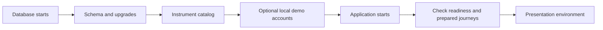

# Deployment, operations and current limitations

## High-level explanation

Starting a trustworthy demo means more than loading a webpage. The database must be ready, its structure must match the application, the required catalog/accounts must exist, and the processing worker must be running. The market-data provider must also supply acceptable data for a trade to pass.

The project includes repeatable local startup, isolated deployment checks and recovery rehearsals. Those are useful engineering foundations; they do not mean that production performance, availability, privacy policy and external integrations have all been completed.

## Technical explanation

### Local startup and configuration

The root README's local path is `.env.template` → private `.env` → `docker compose up --build -d`. Choose the public Nginx port from configuration rather than hardcoding an older guide's URL. The README example uses 8087; Compose's inline fallback is 8080 when its variable is absent.

Normal service dependency order is database health → migration job → catalog seed → role demo seed → backend. Nginx also waits for the frontend/backend to start and analytics readiness. Database initialization SQL runs only for an empty data directory; retained volumes rely on the migration job.

Default local Compose enables admission, worker, demo setup and local staff policy/Support workflows. Base application configuration defaults the principal trading/access switches to false; do not assume launching Java without the Compose environment reproduces local-demo behavior.

The local demo seed and application setup are different steps: SQL creates fictitious identities/grants/reference rows; application startup validates provider identity and controls the one-time demo opening. Catalog import alone does not make an instrument executable.

Ordinary `docker compose down` keeps volumes. Removing volumes destroys that local persisted data and is not a routine migration/recovery technique. The preparation did not start, reset or modify a running application database.

### Hardened override

`docker-compose.hardened.yml` disables demo setup, removes inherited development environment files for relevant services, excludes default backend dependency on the demo seed, and requires a separately provisioned runtime login/encryption key. Operations/Compliance/Support policies default to disabled or empty there.

The database owner must provision a non-owner login and apply `database/runtime-grants.sql`; Compose does not do that automatically. Runtime cannot provision staff account grants or mutate protected source evidence. Reapply intended permissions when new tables are introduced.

This override is one deployment control, not a complete production environment. Base Compose still exposes configured service/database ports. TLS termination, network exposure, credential rotation, production backups, monitoring and policy ownership need environment-specific configuration and review.

### CI pipeline

The Jenkinsfile has a 45-minute timeout and disables concurrent builds. It collects Java JUnit/JaCoCo outputs and builds tagged runtime images. It also retains some duplicate backend build/archive stages. The final smoke stage checks `/health` and `/login`; an HTTP success there does not prove every authenticated role journey.

Analytics Pytest is absent from Jenkins. The pipeline does not define a passing coverage minimum, blocking Checkstyle policy, complete dependency/container security scans or a production release/rollback system. Some analytics services have fixed `container_name` values; do not assume Compose project naming alone eliminates every concurrent-environment collision.

### Readiness versus current health

`GET /health` is a basic Java endpoint. Operations readiness reports schema, reference data, runtime permission/evidence protection, admission/worker flags, passive provider observations and process-local worker timing. Configuration or recent transport success does not prove an executable quote.

FastAPI `/health/live` checks the process; `/health/ready` connects to the reporting database. Database readiness does not prove authoritative report content or an approved live loader exists.

The client order updater polls every three seconds with a bounded number of checks, signals stale/exhausted state and supports resume. A stopped browser updater does not stop the backend job. No external alerting or outbox delivery is configured.

### Failure scenarios to explain

| Scenario | Implemented behavior / responsible next step |
| --- | --- |
| Browser loses a submission response | Preserve and recover/replay the original request key. Do not infer failure or submit a replacement instruction. |
| Provider transport fails before admission | A new order may receive unavailable without acceptance; recover/retry its original key. |
| Provider transport fails after acceptance | Durable worker retries within policy, then retains the outcome and releases resources if rejected. |
| Price becomes stale or market closes | Freshness/session rules reject; no fabricated fallback fill. |
| Worker crashes during booking | PostgreSQL rolls back incomplete booking; expired lease can be reclaimed with a new claim token. |
| Instrument is changed to sell-only | Pending buys can be rejected at execution; sells still need valid quotes/resources. Full halt can prevent exits too. |
| Audit storage fails for a protected staff operation | Operation fails closed; restore the dependency before investigating through the application. |
| Internal reconciliation finds a mismatch | Persist and investigate the finding. There is no general automatic financial repair/refund endpoint. |
| Application rollback after a migration | Preserve schema/evidence and deploy compatible software; binary rollback does not undo database writes. |

### Backup and restore

`scripts/test-client-recovery.py` uses disposable resources to exercise process restart, `pg_dump`/restore, pending-order recovery, evidence/export-byte preservation and restricted-role protections. Its timings describe the fixture, not a production recovery objective. Changes committed after the captured snapshot and point-in-time recovery require separate infrastructure.

The incident runbook instructs operators to preserve original references, UTC times and retained commitments. Do not fix a stuck order by manually deleting jobs, resetting attempts, releasing reservations or editing immutable postings.

### Limits and next decisions

| Area | Current boundary | Plausible next work to discuss |
| --- | --- | --- |
| Execution | Internal MARKET bookings, validated USD policies, zero project fees | Design broker routing, custody, external settlement and additional order types before claiming real execution. |
| Markets | Broad catalog browsing; execution policy has narrower USD units/session rules | Define and verify UK/India/non-USD/FX/crypto execution and calendars separately. |
| Session calendar | Explicit unknown-state fallback contains 2026 dates only | Verify and extend the calendar; define response to unscheduled closures. |
| Authentication | Revocable Java sessions; no auto refresh/MFA; Python does not check live Java revocation | Agree cross-service revocation, token storage, MFA and identity requirements. |
| Reporting | Analyst demo data; Finance operational aggregates in source | Approve metric/scope policies and build an authoritative publisher/loader; verify Finance deployment/performance. |
| Evidence | Database protections, retained archives/digests | Define retention/redaction/export policies and any independent integrity anchoring. |
| Reliability | Durable jobs and fixture recovery tests | Measure capacity, recovery objectives, alert ownership and multi-instance behavior. |
| UI verification | Extensive component tests and historical manual reviews | Add repeatable real-browser, keyboard, narrow-screen and accessibility acceptance. |

These are discussion points derived from the implementation and handoffs, not a funded roadmap or promises made by the team.

## Evidence

- [Startup README](../README.md), [Compose](../docker-compose.yml), [hardened override](../docker-compose.hardened.yml), [Jenkinsfile](../Jenkinsfile).
- [Application switches](../backend/src/main/resources/application.yml), [readiness controller](../backend/src/main/java/com/neueda/leap/controller/TradingOperationsController.java), [provider health](../backend/src/main/java/com/neueda/leap/service/ProviderHealthService.java).
- [Recovery rehearsal](../scripts/test-client-recovery.py), [runbook](../docs/operations-runbook.md), [migration runner](../database/migrate.sh).
