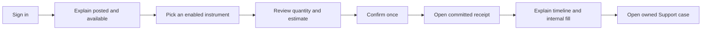

# Presenter walkthrough and rehearsal

## High-level explanation

Use one story: **a client signs in, understands their account, submits an instruction, sees its result, and gets an accountable explanation if something goes wrong**. Introduce staff roles when the story needs them. Use public-facing language first, then offer technical detail.

The presentation should make it clear which records are committed, which numbers are estimates, which charts are demonstration data and which features are future work.

## Suggested 20-minute presentation

| Time | Topic / display | Suggested narration |
| --- | --- | --- |
| 0–2 min | Purpose and Client account screen | “Tadpoles connects the client experience to controlled processing and explainable outcomes. Trading and funding are internal to this project.” |
| 2–4 min | [Architecture diagram](01-Project-Architecture.MD) and [roles](06-Roles-and-Permissions.MD) | “The browser displays the workspace, the server authorizes the action, and PostgreSQL commits the records. Staff have different jobs and account scopes.” |
| 4–6 min | Sign-in/onboarding and [auth diagram](02-Authentication-and-Authorization.MD) | “A valid login is followed by live identity/session checks. A new client account starts with zero internal funds.” |
| 6–11 min | [Buy/sell flow](03-Buy-and-Sell-Lifecycle.MD), preview and receipt | “Review is an estimate. Acceptance reserves resources. A server worker records a fill or a reasoned rejection using a fresh quote.” |
| 11–14 min | Owned Support case and scoped Operations workbench | “We can explain what checks ran without rewriting the trade. Public replies and private review remain separate.” |
| 14–16 min | Finance summary/reconciliation and Analyst warning | “Finance checks actual internal facts; Analyst charts use a separate demonstration dataset. Those sources are labeled.” |
| 16–18 min | [Tests/TDD](04-Test-Suites-and-TDD.MD) and trimmed [ERD](05-Schemas-and-Data-Integrity.MD) | “Tests cover rules, permissions, races, rollback and recovery. Documented test-first slices coexist with later regression work.” |
| 18–20 min | [Current limits](10-Deployment-Operations-and-Limitations.MD) and Q&A | “The next work depends on agreed scope, production controls and approved external/reporting integrations.” |

For 10 minutes, show purpose → architecture/roles → one order → recovery/tests → current limits. Keep full schema and deep security diagrams available as backup material.

## Technical explanation and demo script

### Before presenting

1. Choose an **isolated, fictitious-data demonstration environment** and record the commit/image and configured Nginx URL. Do not reset a retained volume as a presentation shortcut.
2. Verify actual startup, schema version, admission/worker settings and current role access. Keep secrets and environment contents out of shared screens.
3. Use separate Client, Operations, Compliance, Finance, Analyst and Advisor accounts as needed. Current demo credentials live in the existing database guide/seed; do not put them on public slides.
4. Verify scope grants and allowed purpose contexts for the exact fictitious case/account. Having a staff role is insufficient for evidence. Do not widen real grants for a demonstration.
5. Rehearse live-provider eligibility at the presentation time. Price age, metadata, market session, funds and quantity-step checks still apply.
6. If using the explicit HTTP fixture override, label it **test-provider data**. Fixture results demonstrate application mechanics, not live market availability.
7. Prepare a completed receipt and screenshots/notes from the **actual rehearsal**. This folder supplies diagrams and illustrative arithmetic, not screenshots or a newly verified execution.
8. Record the test command/results actually rerun, including failures/skips. Do not repeat an old document's totals as today's result.

### Follow one client instruction

1. Show declared profile net worth separately from posted cash, available cash and Investing estimate. Point out timestamps/unavailable states rather than hiding them.
2. If starting from ordinary signup, complete onboarding, save a fictitious bank reference and perform internal funding. Explain the zero-funded starting rule and UTC deposit cap.
3. Select an instrument actually enabled by the current policy/provider setup. Explain that catalog visibility alone does not prove eligibility.
4. Choose a small valid quantity and review. Read the applicable ask/bid, source time, gross amount, project fee and projected balances. Explain the estimate can change.
5. Confirm once and show ACCEPTED/EXECUTING if visible. If it fills too quickly, use the retained event timeline to explain the stages accurately.
6. Open the owned receipt and show the fill price, quantity, reservation outcome and retained decisions. A rejection is a useful demonstration too: explain its actual stage and reason.
7. If selling, use an owned available quantity. A full sale should leave a zero current position without reviving an older dated snapshot.
8. Open Support from the receipt and show the generated reference. Use a prepared staff case for deeper workflow review if time is limited.

### Staff and insight sequence

Show Operations readiness and one scoped order investigation. Show a private note alongside its public conversation to explain visibility. If demonstrating Compliance, use an existing authorized referral and explain that findings remain private until Operations chooses a public reply.

Show an Advisor's assigned-client list and one versioned guidance/recommendation. State explicitly that the action does not place an order.

Show Finance's selected UTC period/source and most recent reconciliation time. A stored report is a past snapshot. In the Analyst workspace, read the demonstration warning and source freshness before showing charts.

### Prepared failure demonstrations

| Event | Presenter response |
| --- | --- |
| Quote stale, missing or closed | Show the actual ineligible explanation, retained rejection if one exists, and the relevant rule/test. Continue with a prepared completed receipt. |
| Response lost | Keep the original key; demonstrate status recovery in a prearranged fixture scenario. Do not create a fresh order to make the screen move. |
| Evidence denied | Explain live scope/purpose checks; use a correctly provisioned fictitious case. Do not describe denial as an empty global result. |
| Report unavailable | Explain source isolation and show the diagram/actual rehearsal artifact; do not invent replacement totals. |
| Reviewer asks for production readiness | Use [the limitations document](10-Deployment-Operations-and-Limitations.MD) and separate implementation evidence from measured deployment acceptance. |

### Team narrative to prepare with contributors

The root README names the team and states Git-Flow was chosen. Confirm actual responsibilities, design decisions, review practices, conflict-resolution examples and lessons with contributors before presenting. Commit history and implementation notes are evidence to discuss, not enough to invent a complete collaboration story.

Assign a presenter, a demo operator and a technical Q&A lead if the team agrees. Practice a handoff from public explanation to developer detail. For each major design decision, prepare: the problem, alternatives, chosen tradeoff, relevant test/evidence, and a limitation.

## Presenter language guide

| Say | Meaning |
| --- | --- |
| “The instruction is accepted.” | A committed order exists for processing. |
| “The trade filled internally.” | The booking transaction committed a fill and postings. |
| “This is available cash.” | Posted cash minus current reservations. |
| “This is an estimate with these timestamps.” | Provider-priced/display-derived information, not a guaranteed amount. |
| “This check covers retained internal relationships.” | It does not independently certify bank/exchange/custody events. |
| “This was documented as test-first.” | Supported by a specific implementation record; not a claim about all development. |

Use [the audience questions](12-Audience-Questions.MD) for rehearsal. Prepare honest “we have not measured/implemented that yet” answers when the repository supplies no evidence.
