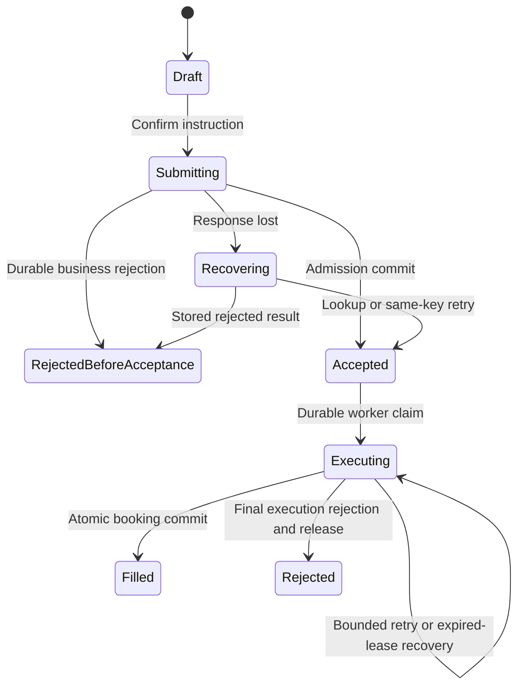
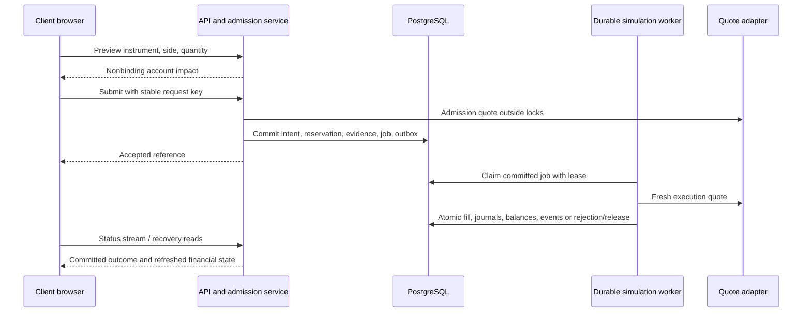

# Client workspace and buy/sell implementation instructions

## 1. Execution brief

Implement the remaining Client experience in this repository, including secure self-service buy/sell orders, durable processing, authoritative cash and positions, order history, execution evidence, and session recovery. This document is self-contained: it supplies the requirements, current implementation findings, proposed contracts, delivery sequence, and acceptance criteria needed to execute the work without another requirements document.

Read this entire document before editing. Then inspect the current code, applicable repository instructions, working-tree changes, controllers, DTOs, SQL, and tests. The baseline below was inspected on **14 October 2026**; verify it against the checkout before making changes. Preserve unrelated work. A source inspection establishes existing behavior and test coverage, not a claim that tests currently pass.

The immediate deliverable described here is a working, explicitly labelled **simulation** of self-directed trading. Real broker execution is not implemented. Keep live execution disabled unless its provider, execution semantics, and operational requirements are separately specified. Continue work on deterministic simulation and client components while unresolved live-market decisions remain isolated.

Use the existing Angular standalone components, signals/RxJS, routing, shared workspace styling, Spring controller → service interface → service implementation → MyBatis mapper structure, DTOs, and PostgreSQL conventions. Keep the existing Java package namespace. Do not replace the application architecture or introduce an ORM, state-management framework, identity provider, or microservice split merely to implement this feature.

**Implementation documentation is a separate execution artifact.** When implementation begins, create or append to `impDocs/Frontend/ClientPageImplementation/Implementation.MD`. Record actual steps there as they happen using section 12. Do not put a retrospective execution diary in this instruction file, and do not prepopulate the implementation log with work that has not happened.

## 2. Business outcome and scope

A retail client must register, sign in, choose an eligible instrument, submit a buy or sell without a staff member placing it, and understand whether the order was accepted, filled, or rejected. Cash, positions, and history must remain correct through duplicate requests, concurrent orders, lost responses, and restarts. An investigator must be able to explain an outcome from retained facts. Historical analysis must eventually run independently of the live trading workload.

The following identifiers are local acceptance references. **Must** means required behavior. **Should** means expected behavior whose omission must be recorded, with rationale, rather than silently marked complete.

| ID | Priority | Required outcome and connection to this work |
| --- | --- | --- |
| BR-01 | Must | Register and securely sign in; preserve the existing identity and onboarding journey. |
| BR-02 | Must | Clients read and act only on their own accounts, including orders, recovery lookups, and event streams. |
| BR-03 | Should | Sessions expire and can be revoked; accepted orders survive logout. |
| BR-04 | Must | Submit buys and sells for configured supported instruments. |
| BR-05 | Must | Validate tradability and sufficient unreserved cash/units before acceptance, including concurrent requests. |
| BR-06 | Must | Commit accepted intent before execution starts; return a durable reference. |
| BR-07 | Should | Status changes appear without a manual page refresh, with reconnect recovery. |
| BR-08 | Must | Use a fresh execution-time quote, choosing ask for buy and bid for sell; preserve the decision. |
| BR-09 | Must | Fill, cash, position, and permanent evidence commit together or all roll back. |
| BR-10 | Must | Cash and positions reflect the latest committed fill, with posted, reserved, and available amounts distinguished. |
| BR-11 | Must | Chronological, account-scoped order and fill history includes rejected outcomes. |
| BR-12 | Must | Demonstrate configured UK, US, and Indian equities, FX pairs, and crypto; identify simulated versus provider data. |
| BR-13 | Should | Show a timestamped indicative price before submission and explain that it may change. |
| BR-14 | Must | Retain attributed orders, decisions, prices, and financial movements through restarts and deployment failures. |
| BR-15 | Must | Reconstruct original instruction, checks, acceptance, pricing, and outcome without diagnostic-log archaeology. |
| BR-16 | Must | Historical analytics uses separate storage/compute; committed trading events must support downstream ingestion. |
| BR-17 | Should | Internal reports show volumes, active instruments, and trends with explicit metric definitions and freshness. |
| BR-18 | Should | Deliver a pre-trade impact preview: estimated cash and position changes, not just a quote. |

BR-16/17 are platform dependencies, not permission to expand this Client task into all staff dashboards. Supply durable, versioned events and preserve staff access boundaries; record reporting as outstanding until an independent reporting store, ingestion, and reporting tests exist. Likewise, retaining evidence for BR-15 does not by itself finish an authorized staff investigation interface.

The impact preview is the selected proposed extra capability because it helps clients avoid insufficient-cash and oversell mistakes using data already needed for trading. It provides more account-specific value here than a watchlist and avoids introducing advisory scoring or notification infrastructure. Record product acceptance of this choice; distinguish estimated impact from booked outcomes.

Exclude delegated/advisor trading, unrestricted cash top-ups, real deposits/withdrawals, full identity verification, native apps, margin, shorting, automatic currency conversion, cancellations, amendments, partial fills, taxes, and invented fees. Existing advisory tables and endpoints do not make those features part of this Client flow. Account profile completion is not proof of regulated identity verification.

## 3. What is implemented now

### 3.1 Frontend baseline

| Area | Existing code and behavior | Remaining work |
| --- | --- | --- |
| Authentication and routing | `frontend/src/app/core/auth/` bootstraps identity from `/api/users/me`, checks roles, handles expiry, and routes by workspace. `app.routes.ts` uses an authenticated shell and Client guards. | Complete server-side session revocation; preserve clearing of requests and account data on identity changes. |
| Registration/onboarding/profile | `signup.ts`, `login.ts`, `onboarding.ts`, `profile.ts`, and `user.service.ts` provide actual API-backed identity/profile flows. | Verify persisted profile refresh, accessible retry/error behavior, and repeated onboarding without duplicate client creation. Do not invent profile editing requirements or use administrative client PATCH for it. |
| Overview/portfolio | `features/client/account-page.component.ts` loads portfolio and recent orders through `WorkspaceApi`. | It currently labels cash currency and spendable cash unavailable and holdings as snapshots. Replace those limitations only for accounts with verified new financial state. |
| Market catalog | `features/client/markets-page.component.ts` provides API-backed search, filtering, and pagination. | Add eligibility and market/currency context from explicit metadata; active catalog entries are not automatically tradable. |
| Instrument/details | `features/client/instrument-page.component.ts` resolves instrument IDs, displays availability, and embeds market data. | `/app/trade/:instrumentId` currently displays disabled buy/sell controls. Add a real order ticket and preview. |
| Quotes/charts | `features/trade/trade.component.ts`, its template/styles, `candle-chart.component.ts`, and `core/api/market-data.service.ts` display quotes and daily candles. | Despite its name, `TradeComponent` is currently a market-data viewer, not order submission. Reuse the viewer/chart; create a separate ticket component. |
| History/details | `orders-page.component.ts`, `order-detail.component.ts`, and `shared/workspace/orders-table.component.ts` read scoped legacy records and disclose incomplete evidence. | Add new order states, fill and event data, automatic updates, and durable receipt/recovery behavior. Keep honest legacy limitations. |
| Shared presentation | `layout/authenticated-shell.component.ts`, `shared/workspace/page-resource.ts`, `request-state.component.ts`, and `styles.css` provide navigation, state handling, and visual conventions. | Extend these patterns; keep requests cancelled and stale account data cleared on logout. |
| Old/demo views | `dashboard.ts`, `trades.ts`, and `trades.service.ts` remain in the tree; the latter contains fabricated trade examples. Active client routes use the workspace components. | Do not reconnect those fixtures as authoritative balances/history. Remove unused code only after checking references and tests. |

Retain routes `/app/overview`, `/app/portfolio`, `/app/markets`, `/app/instruments/:id`, `/app/trade/:instrumentId`, `/app/orders`, `/app/orders/:id`, and `/profile`. Preserve `/register` → `/signup`, `/trades` → `/app/orders`, and the catalog-based legacy symbol route. If duplicate symbols become valid across venues, change the symbol resolver to offer disambiguation instead of choosing the first match.

### 3.2 Backend and database baseline

Locate Java classes by filename beneath `backend/src/main/java`; retain their existing packages.

- `WorkspaceClientController` derives client ownership from persisted authenticated identity. It returns actual account-scoped read data. Its trading-availability response is always disabled, and `POST /api/orders` always returns **503** without recording an order.
- `WorkspaceReadServiceImpl`/`WorkspaceReadMapper` paginate and filter `client_trades`, return the latest dated holding row per instrument, and flag order detail `INCOMPLETE_LEGACY`. They do not supply reservations, fills, lifecycle events, or confirmed spendable balances.
- `ClientTradeServiceImpl` supports legacy administrative CRUD, including caller-selected status. It is not a safe client admission workflow. `ClientTradeController` restricts create/update/fill to `ADMIN` without `CLIENT`; do not broaden this permission to enable trading.
- `OrderFillServiceImpl` has a useful `@Transactional` booking pattern and row locks. It updates a client's scalar cash balance, a latest holding snapshot, and the trade status together. However, it accepts a supplied or stored price, uses two-decimal consideration, deletes a fully sold snapshot, and lacks acceptance reservations, retained execution quotes, journals, and replay-return semantics. It accepts only legacy `PENDING`/`APPROVED` and writes `EXECUTED`. It is not the new execution engine.
- `clients.cash_balance` has no currency. `client_holdings` is unique by client/instrument/date, permits only positive quantities, and is historical rather than one authoritative current row. Deleting the newest row can expose an older snapshot as current. Do not migrate this behavior into new positions.
- `client_trades.price` is mandatory `NUMERIC(10,2)`; quantity is `NUMERIC(18,6)`; lifecycle status is constrained to `PENDING`, `APPROVED`, `REJECTED`, `EXECUTED`. Existing execution timestamps lack time zones. There is no durable acceptance timestamp, request key, independent fill table, or financial journal.
- `instruments` has name, globally unique ticker, currency, asset/security class, and active flag. It lacks venue mapping, unit/precision rules, calendars, and separate trading eligibility.
- `audit_logs` exists, but its existence does not prove that order/financial operations write complete immutable evidence. There are no order outbox/reservation tables in the inspected schema.
- `FauxnanceQuoteServiceImpl` proxies educational quotes and supplies default metadata, including `stale=false` when absent. Execution validation must not interpret that default as proof of freshness. Retain raw timestamp/source validity and validate independently.
- `SecurityConfig` verifies signed JWTs and `LiveIdentityValidator` rejects disabled users or obsolete roles. Login/signup issue expiring JWTs. Frontend logout clears local state; the current refresh service generates an opaque `access-...` string rather than a JWT accepted by the resource server. Do not describe refresh/logout as fully integrated.
- The backend uses Spring Boot, MyBatis annotations, and `BigDecimal`; the frontend uses Angular standalone components and Vitest. Compose has PostgreSQL, backend, frontend, and an auth fixture service. It does **not** currently define Kafka or a separate analytics database, and the backend has no Kafka dependency.

### 3.3 Current endpoints to preserve or deliberately evolve

These are current contracts, not the proposed endpoints in section 7. Verify DTO fields in source before coding consumers.

| Method and path | Current behavior / access |
| --- | --- |
| `POST /auth/login`, `POST /auth/signup` | Public credential login/client signup; issue expiring JWT response. |
| `POST /auth/register/client` | Public client-registration variant; preserve its existing contract. |
| `POST /auth/register` | Administrative registration; never use for client self-registration. |
| `GET /api/users/me` | Authenticated persisted identity and roles. |
| `GET /api/users/me/profile` | Client's profile/onboarding state. |
| `PUT /api/users/me/onboarding` | Client completes own onboarding. |
| `POST /api/auth/refresh` | Public refresh-token exchange; currently not a usable signed-JWT renewal path. |
| `POST /api/auth/logout` | Authenticated refresh-token revocation; currently not browser access-session revocation. |
| `GET /api/workspace/client/portfolio` | Client-scoped scalar posted cash, null currency/availability, historical positions, retrieval time, limitation. |
| `GET /api/workspace/client/instruments` | Client catalog page: `page`, `pageSize`, `search`, `assetClass`. |
| `GET /api/workspace/client/trading-availability` | Client; always `{ enabled: false, reason: ... }`. |
| `GET /api/orders` | Client's legacy records; `page`, `pageSize`, `status`, `side`, `instrumentId`, `from`, `to`. |
| `GET /api/orders/{id}` | Client-owned legacy detail; another client's record is not found. |
| `POST /api/orders` | Client; disabled with 503 and no persistence. |
| `GET /api/instruments`, `GET /api/instruments/{instrumentId}` | `ADMIN` or `CLIENT`; existing catalog DTOs. |
| `GET /quotes/{symbol}`, `GET /api/quotes/{symbol}` | Authenticated quote aliases, including bid/ask, currency, times, source, and disclaimer. |
| `GET /candles/{symbol}`, `GET /api/candles/{symbol}` | Authenticated daily candle aliases; historical chart data, not execution prices. |
| `GET /api/clients/{clientId}`, `GET /api/clients/{clientId}/balance` | Legacy Client/admin reads with ownership enforcement for Client. |
| `GET /api/clients/{clientId}/holdings[/{holdingId}]` | Legacy Client/admin holding reads; Client ownership required. |
| `GET /api/clients/{clientId}/trades[/{tradeId}]` | Legacy Client/admin trade reads; Client ownership required. |
| `POST/PATCH /api/clients/{clientId}/trades[/{tradeId}]`, `POST /api/clients/{clientId}/trades/{tradeId}/fill` | Legacy administrative mutations, not client order APIs. |
| `POST/PATCH /api/clients[/{clientId}]`, holding and instrument mutation routes | Administrative mutations; prevent these becoming a bypass around new account invariants. |
| `/api/operations/orders[/{id}]` | Trading operations read surface; currently unavailable. |
| `/api/compliance/investigations`, `/api/compliance/orders/{id}/evidence`, `/api/compliance/evidence` | Compliance read surface; currently unavailable. |
| `/api/analytics/summary`, `/trends`, `/instruments`, `/freshness` under `/api/analytics` | Analyst read surface; currently unavailable. |
| `/api/finance/summary`, `/api/finance/reconciliations` | Finance read surface; currently unavailable. |

Bracket notation above abbreviates collection/detail paths; it is not a literal URL. Existing user/role/token administration, audit-log reads, advisor, subscription, model-portfolio, and suggestion endpoints remain outside the Client implementation. Preserve their authorization; suggestions must not become an alternate route to execute a client order.

Existing pages use `{ items, page, pageSize, total }`. Current errors have `{ timestamp, status, error, message, path }`. Extend these conventions rather than inventing a competing envelope. Current pagination accepts page 0–100000 and size 1–100; retain bounded queries. Existing CORS allowed headers omit `Idempotency-Key`; add it and any event resume header used, and expose `Location` where needed. Use configured allowed origins rather than widening origin access.

## 4. Decisions and consistent implementation boundaries

### 4.1 Explicit simulation policy

Implement a configurable, versioned simulation policy with all-or-nothing market-style orders, one fill per order, positive quantities, no borrowing/shorting, no automatic funding conversion, and zero simulated fees clearly displayed. These are implementation choices for this delivery, not assumptions about live markets.

Choose **reservation at the admission estimate with execution-time recheck** for the initial simulation. A buy reserves `quantity × admission ask`, rounded under the configured currency rule. At execution, a higher price may use additional currently unreserved cash only after locking the same cash row and rechecking affordability; it cannot use another order's reservation. Reject when insufficient. This is not a guaranteed price or client maximum-spend order. Disclose that final consideration can change. If a price-movement cap is required, introduce it as a recorded, centrally configured policy before enabling the relevant instruments; never invent an unexplained percentage.

Require explicit per-instrument quantity step/scale, price unit, currency precision, allowed session, maximum quantity/notional, quote maximum age, and retry deadline. Ship named, deterministic **test configuration** for automated scenarios; do not turn fixture thresholds into undocumented production policy. Missing required policy disables the instrument with a useful reason. Snapshot the policy version and relevant limits on acceptance so later configuration changes do not silently rewrite the contract; emergency trading halts still prevent new execution and are recorded.

Use fixtures for at least one instrument from each required market/class. If actual provider coverage cannot be verified, display that limitation and keep affected instruments unavailable under provider mode. For GBP/pence, normalize units explicitly while retaining raw quote units. For simulated FX pairs, define quantity as base units and price as quote-currency units per base unit; model a position in that pair rather than quietly converting account cash. Document that this is simulation position accounting, not spot currency settlement. Crypto pairs require the same explicit base/quote and precision rules.

### 4.2 Why backend/database changes are necessary

The missing financial and lifecycle semantics cannot be supplied by frontend state. Add only structures that protect these requirements. Keep one authoritative PostgreSQL transaction boundary for booking.

| Proposed change | Why it is necessary and why this approach fits |
| --- | --- |
| Extend `client_trades` into an explicit legacy/new order registry | Reuses current numeric order IDs, routes, ownership queries, and relationships without ID collisions between old and new histories. Add `record_kind` (`LEGACY`/`SELF_DIRECTED`) and preserve old rows honestly. |
| New `client_cash_accounts` and `client_positions` | Currency-specific cash and one current quantity per client/instrument avoid an ambiguous scalar balance and dated-snapshot resurrection. Historical tables remain evidence, not the new source of truth. |
| Reservations and immutable fills/journals | Prevent overspending/overselling before execution and explain each booked movement after execution. |
| Quote/rule/event/attempt records | Preserve what was accepted, what was checked, what price was used, and why an order failed or filled. |
| Durable execution jobs and outbox | Recover accepted work after a crash and publish committed facts without a database/message dual-write gap. |
| Instrument trading metadata | `is_active` alone cannot establish market, precision, price units, or eligibility. |
| Revocable authentication sessions | Local logout does not revoke a copied access token; use the existing JWT approach with persisted session identity. |

Do not make these schema changes while merely drafting instructions. During implementation, log every actual backend/schema change, alternatives, migration impact, and evidence of correctness in the execution log.

## 5. Data model and migration plan

### 5.1 Order registry and immutable intent

Extend `client_trades` using a forward migration. Backfill all pre-existing rows as `LEGACY`; new submission inserts explicitly as `SELF_DIRECTED`. Keep existing numeric `trade_id` exposed as `orderId`, avoiding route/guard changes solely to change ID format.

For new orders add `idempotency_key`, canonical `request_hash`, `submitted_at`, nullable `accepted_at`, `updated_at`, lifecycle version, policy version, order type, currency/unit snapshot, admission quote reference, rejection stage/code, and reservation references as appropriate. Use timestamp-with-time-zone columns and injected clocks for new facts. Quantity, instrument, side, account, actor, and accepted instruction are immutable after acceptance. A status projection can change only through the lifecycle service with a matching append-only event.

Extend the database status constraint with `ACCEPTED`, `EXECUTING`, and `FILLED`; constrain combinations by record kind. `REJECTED` is valid for either kind. New orders must not use `PENDING`, `APPROVED`, or `EXECUTED`. Do not rename legacy states or manufacture `accepted_at` for old rows.

New orders must not require a fictitious execution price. Relax the old `price NOT NULL` requirement conditionally: preserve positive recorded prices for legacy rows, and keep new admission/execution prices in explicit quote/fill fields. New price evidence must use sufficient decimal precision; copying into the old two-decimal field is not authoritative. Keep legacy DTO reads working without treating a null new recorded price as a rendering failure.

Widen the shared order quantity column if the configured new instrument precision exceeds its existing six decimal places; preserve existing values exactly. Populate the required legacy `trade_date` field for new rows from the server's documented UTC submission date, while using `submitted_at` for precise chronology. Keep separate nullable execution instants for legacy and new records, or migrate only timestamps whose original zone can be established; never reinterpret unknown local timestamps as UTC.

Enforce a unique `(client_id, idempotency_key)` for new keyed submissions. Compare the normalized request hash on replay, including instrument, side, exact canonical decimal quantity, type, and any accepted policy-consent inputs. Equivalent decimal spellings must canonicalize consistently. Hashing must not include a changing server quote. Retain keys for as long as their orders can be retried; do not expire them while replay could duplicate a commitment.

Persist well-formed authenticated business-rule rejections as new `REJECTED` records with `accepted_at = null`, reason/stage, and no reservation. Malformed payloads and authentication failures need not become order records. A rejection is not an acceptance.

### 5.2 Authoritative financial state and evidence

| Table (proposed) | Required keys, fields, and invariants |
| --- | --- |
| `client_cash_accounts` | Unique client/currency; exact posted and reserved values, version; posted ≥ reserved ≥ 0. |
| `client_positions` | Unique client/instrument; posted and reserved quantity, version, updated time; posted ≥ reserved ≥ 0. Keep a zero row after full liquidation. |
| `order_reservations` | Unique order; resource type, currency/instrument, amount/quantity, active/consumed/released state and timestamps. Exactly one terminal consume/release; never both. |
| `order_fills` | Unique order for this single-fill release and unique execution reference; quote, quantity, price, gross, fee, currency, posting group, execution and booking times. Append-only. |
| `cash_journal` | Unique posting identity; client/currency, signed delta, fill/opening reference, posting group, actor and timestamp. Append-only. |
| `position_journal` | Same linkage for client/instrument quantity deltas. Append-only. |
| `order_quote_observations` | Raw and normalized bid/ask, instrument/provider mapping, unit/currency, provider/receipt times, source, disclaimer, spread origin, validity decisions; local evidence ID even without provider quote ID. |
| `order_rule_decisions` | Order, rule/version, stage, pass/fail, reason, references to relevant validated facts. |
| `order_events` | Unique order/sequence and event ID; from/to state, occurred/recorded times, actor/service, correlation, reason, fill and quote references. Append-only. |
| `order_execution_jobs` / `order_execution_attempts` | Unique job per accepted order; claim token, lease expiry, attempt count, next attempt, deadline; attempts retain start/outcome and quote/execution references. |
| `outbox_events` | Stable event ID, order/version, type/schema version, minimal payload, created time, delivery state and retry metadata. Written in the business transaction. |

Reservations reduce availability, not posted ownership. Define `availableCash = postedCash - reservedCash` and `availableQuantity = postedQuantity - reservedQuantity`. Enforce the same constraints in services and PostgreSQL. Use stable lock ordering and a unique position key to handle simultaneous first buys when no position row exists yet.

Use `BigDecimal`, decimal strings in new monetary/quantity API fields, and suitable `NUMERIC` precision (for example `NUMERIC(28,12)` as a capacity proposal, validated against configured instruments). Reject excess scale or overflow instead of rounding requested quantities silently. Define rounding at consideration and fee posting by currency; never use a universal two-decimal rule for all assets. Browser numeric conversions are acceptable for chart plotting, not authoritative financial calculations.

Opening balances and positions need explicit journal entries with a unique setup reference. Journal reconciliation means opening entries plus booked deltas equals posted state per currency/instrument. A delta journal is not a full double-entry general ledger; do not claim otherwise. If full accounting is required later, add balancing accounts and enforce zero-sum posting groups per currency.

Protect immutable intent, quote facts, events, fills, and journals from ordinary UPDATE/DELETE using database grants and/or narrowly scoped triggers, with separate migration privileges. The application must not run as the database owner in the hardened environment. No ordinary admin CRUD action may rewrite evidence or set a new order to `FILLED`. Corrections require explicit compensating records, outside this initial UI scope.

### 5.3 Migration, legacy boundaries, and deployment

1. Add the next numbered SQL migration under `database/migrations/` and a corresponding fresh-install path under `database/schema/`. Use the repository's current SQL workflow; add an explicit migration runner/service if required, with version tracking and failure stopping startup. Do not assume mounting a new init script upgrades an existing volume.
2. Test both an empty database and an existing database with representative legacy history. Apply migrations before enabling new application code. Update schema-test setup to execute all required migrations; it currently loads the base schema directly.
3. Preserve all historical records, timezone uncertainty, and unknown currency. Never guess that legacy scalar cash is USD, or sum dated holding snapshots. Migrate a legacy account only from a verified opening-state specification with recorded provenance and reconciliation; otherwise leave it read-only/unfunded for new trading.
4. New clients start with explicitly configured currency accounts at zero. Local simulated funding belongs in an opt-in setup script using opening journals and a unique seed key. Re-running it must not refill spent cash or duplicate positions. Keep default demo credentials/zero balances unchanged.
5. Mark accounts when the new financial model becomes authoritative. Legacy administrative cash/holding/trade/fill mutations must reject writes for these accounts, and reject any new-style order even if invoked directly. Preserve old read contracts or return clearly documented legacy-only views; never offer two writable sources of truth.
6. Snapshot instrument currency/venue/unit on orders/fills. Editing the catalog must not reinterpret past history or convert existing currency accounts. Block unsafe instrument currency edits with open orders/positions.
7. Test backup/restore and application rollback while preserving acknowledged orders. A code rollback must not route new accounts back through old fill logic. Disable admission and retain/drain durable jobs as appropriate; do not drop populated evidence tables to roll back.

## 6. Buy/sell behavior and transaction boundaries

### 6.1 Lifecycle



Draft, Submitting, and Recovering are UI states, not proof of database acceptance. Persist business states `ACCEPTED`, `EXECUTING`, `FILLED`, `REJECTED`. Use `rejectionStage` and `acceptedAt` to distinguish pre-admission rejection from rejection of an accepted order. Never infer a fill from a status label alone for legacy data. Terminal new states do not change on retries.

### 6.2 Preview and admission

1. Resolve an instrument ID from the catalog. Load own balances/positions, eligibility, and a fresh indicative quote. Show side, exact quantity, currency/unit, quote time, estimated consideration, fees, available resources, and projected post-fill impact.
2. Run preview through the same policy/calculation components as admission. Preview is read-only: it does not reserve, create an order, promise acceptance, or freeze a price. Input changes invalidate the preview. Quote expiry requires a new preview before confirmation.
3. On confirmation generate one random idempotency key and preserve the exact submitted payload. Disable additional confirmation while the request is unresolved. A deliberate second order gets a new key only after the first outcome is resolved or explicitly identified as a separate instruction.
4. Authenticate and resolve the persisted client on the server. Reject browser-supplied client/user identity, prices, statuses, approval identities, execution times, or reserved balances as command fields. Check onboarding/account eligibility.
5. Look up a prior request key before fetching a new quote; a committed result must remain recoverable even if the provider is now down. Fetch admission quote outside financial locks, then begin a short transaction. Resolve any duplicate race inside this transaction using a unique-key-safe insert strategy and re-read of the winning record. Do not catch a PostgreSQL uniqueness exception and continue within an aborted transaction.
6. Under consistent locks, recheck quote age, instrument policy, market/session, quantity precision/limits, account state, and unreserved resources. Reject missing, future-dated beyond allowed clock skew, stale, wrong-symbol, wrong-currency, nonpositive, or crossed bid/ask quotes. Missing market state or required metadata fails closed. For internal bookings, an explicit provider `unknown` state may use the verified scheduled U.S. core session described in `docs/market-data-session.md`; explicit closed/pre/post states still fail closed.
7. Buy: reserve the rounded admission estimate in the instrument's currency. Sell: reserve exact available instrument units. Commit order, acceptance time, actor, quote/rule evidence, reservation, first event, execution job, and outbox record together. If a rule fails, commit only the keyed rejection and its evidence. Throwing an exception that rolls back the rejection evidence is not an implementation of durable rejection.
8. Return an order reference only after transaction commit. An admission persistence failure must never return “Accepted.” A worker cannot read/process uncommitted acceptance.

### 6.3 Durable asynchronous simulation

Use a database-backed scheduled worker for the first vertical slice because the current deployment has no messaging infrastructure. Jobs inserted in admission transactions are the durable work queue; in-memory executors and `@Async` alone are insufficient. Keep an outbox for downstream committed events. If messaging is later added, reuse stable job/event IDs and idempotent consumers rather than creating a second execution authority.

Claim a job in a short transaction using row locking/skip-locked semantics or equivalent conditional updates. Store a lease, attempt ID, and fencing/claim token; transition to `EXECUTING` with an event. Commit before requesting an execution quote. A crashed worker's lease can expire and be reclaimed. An old worker whose lease was superseded must fail the token/version check before booking.

Fetch a **new** execution quote outside locks. Buy uses ask; sell uses bid. Historical candles and preview prices cannot substitute for an unavailable quote. A provider adapter supplies prices, not proof of a real venue fill. The simulation execution adapter returns a stable execution reference linked to the order/attempt; the booking core owns financial writes.

Transport/timeouts may retry only within configured bounded attempts/deadline, with durable attempt evidence and backoff. Definitive invalid prices, insufficient resources, unsupported sessions, and expired deadlines produce a final rejection and release. Since this is local simulation with no remote financial side effect, an expired claim can safely retry before a fill commits. Future real execution requires querying the venue by a stable external request ID; uncertain external execution must never be blindly resubmitted or treated as safely rejected.

### 6.4 Atomic booking and rejection

Use one public transactional service boundary invoked through the Spring proxy. Adopt a single lock order across admission, booking, and release (for example persisted client → order/job → currency accounts sorted by key → positions sorted by key). Admission can serialize briefly on the client row; quote calls must stay outside that lock. Test the actual SQL for deadlocks and first-position insertion races.

For a successful fill, in one transaction:

1. Re-resolve the order, its active reservation, expected state/version, and worker fencing token. If an identical fill is already booked, return it without another financial write. Reject a conflicting execution identity/payload.
2. Validate current execution quote and snapshotted policy, with current hard trading halts/account restrictions. Recheck freshness after waiting for locks.
3. For a buy, require `executionGross + fee <= postedCash - reservationsForOtherOrders`. Debit that currency and increase owned units. Consume this order's reservation, freeing any excess; additional cost may use only unreserved headroom under the selected simulation policy.
4. For a sell, require the original reserved quantity and enough owned units; subtract quantity and credit proceeds minus fee in quote currency. Consume the quantity reservation. Preserve a zero position row after a full sale.
5. Insert the unique fill, exact quote/decision evidence, cash/position journals with one posting group, updated balances/position versions, `FILLED` event/state, and outbox event; complete the job.
6. Commit, then notify. A failure at any write rolls back **all** financial and terminal-state effects; retry local booking with the same identifiers.

Final rejection is also one transaction: validate nonterminal state/claim, retain decision/quote evidence when present, release its reservation exactly once, mark `REJECTED`, complete the job, and append events/outbox. Posted cash and owned units remain unchanged. A rejected pre-admission attempt has nothing to release.

Example under explicit USD test policy with zero fees: start with posted cash 1,000 and no shares; buy 10 with admission ask 50 reserves 500, leaving 500 available. If execution ask is 51 and no other order uses the headroom, book a 510 debit and 10 shares, leaving posted/available cash 490. If only 505 cash remains usable after other reservations, reject without debiting or adding shares and release this reservation. Selling 4 shares later at bid 52 credits 208 and leaves 6 shares and cash 698 in the no-other-orders case. These are fixture calculations, not current prices.



## 7. Target API contracts

Implement these as explicit changes to existing controllers or new focused controllers following current conventions. Do not register duplicate `POST /api/orders` mappings. Update backend DTOs and `WorkspaceApi` together, with contract tests.

| Endpoint | Target contract |
| --- | --- |
| `GET /api/workspace/client/trading-availability?instrumentId=...` | Keep `enabled`/`reason`; add mode, stable reason code, applicable policy version and instrument/account eligibility. Evaluate real configuration rather than return a constant. Global availability does not imply every instrument is eligible. |
| `POST /api/orders/preview` (new) | `{ instrumentId, side, quantity: "10", orderType: "MARKET" }`; returns eligibility, reasons, quote/time, estimate, currency, projected cash/quantity, fees and policy version. No state-changing financial writes. |
| `POST /api/orders` (replace stub) | Same intent fields plus required `Idempotency-Key` header. Server derives account, actor, currency, price, and status. |
| `GET /api/orders/by-request/{key}` (new) | Own account only. Returns existing accepted/rejected outcome, or 404 if not currently committed. A concurrent request may still be in flight; 404 alone is not permission to generate a new key. |
| `GET /api/orders` (evolve) | Preserve page envelope and filters; include legacy/new marker, new lifecycle statuses, nullable acceptance/fill timestamps, rejection stage, and evidence completeness. |
| `GET /api/orders/{id}` (evolve) | Existing `order` envelope plus immutable intent, reservation summary, fills, client-safe quote/decision summary, and evidence classification. |
| `GET /api/orders/{id}/events` (new) | Paginated ordered events scoped by owner; stable sequence/event ID, times, readable reasons; no internal secrets or staff-only metadata. |
| `GET /api/workspace/client/order-events/stream` (new) | Authenticated, account-scoped committed events; resumable cursor and event ID; heartbeats and expiry. |
| `GET /api/workspace/client/portfolio` (evolve) | Add `balances[]` with currency/posted/reserved/available; positions with owned/reserved/available quantities, committed timestamps/version; distinguish legacy snapshots and unresolved accounts. |

Use 202 for a newly accepted asynchronous order and `Location: /api/orders/{id}`. Use 422 with stored order ID, `REJECTED`, `acceptedAt: null`, and reason for a well-formed admission rejection. Same-key/same-payload retry returns the stored order identity without new work: 202 while pending, 200 for a previously accepted terminal order, or the original 422 for a pre-admission rejection. A status/recovery GET returns 200 for any stored outcome. Document this distinction in tests and the API contract.

Use 400 for malformed input/missing key, 401 for invalid/expired/revoked identity, 403 for a role without Client permission, non-disclosing 404 for another client's order, 409 for conflicting key reuse, and 503 when admission cannot be durably offered. A 503 before acceptance is not a fictitious business rejection; a lost response after acceptance requires recovery.

Example request:

```http
POST /api/orders
Idempotency-Key: <one-random-key-for-this-confirmation>
Content-Type: application/json
Authorization: Bearer <access-token>

{"instrumentId":101,"side":"BUY","quantity":"10","orderType":"MARKET"}
```

Example accepted body (illustrative identifiers/times):

```json
{
  "orderId": 501,
  "recordKind": "SELF_DIRECTED",
  "status": "ACCEPTED",
  "acceptedAt": "2026-10-14T14:00:00Z",
  "statusUrl": "/api/orders/501",
  "executionMode": "SIMULATION",
  "message": "Order accepted for processing. It has not filled yet."
}
```

Extend the current error body with `code`, `correlationId`, and nullable order/rejection details. Keep existing fields for compatibility. Explain domain failures without leaking SQL, tokens, vendor keys, or another account's existence. Do not blindly retry mutation requests with a new key in an HTTP interceptor.

New APIs should serialize exact decimal strings explicitly; existing numeric fields need a coordinated compatibility decision, not a silent type change. For portfolio, retain legacy fields while adding the new arrays and migrate Angular usage deliberately. Never display an unlabelled sum across currencies. Use deterministic history ordering: new submission instant plus ID, and preserve legacy date-only uncertainty with a documented sort key; accepted/fill timestamps remain separate.

## 8. Complete the Client components

### 8.1 Overview and portfolio

Replace hardcoded “not enabled” and “currency not recorded” copy only when the response supplies supported new state. Show each currency's posted, reserved, and available balance; show owned/reserved/available units per instrument. Present last committed update separately from retrieval time. Pending buys must not add holdings; pending sells reduce availability, not ownership.

Offer Buy from eligible instruments and Sell from owned available positions, routing by instrument ID with side as a validated UI hint. An empty funded portfolio explains how to browse instruments. A zero-cash account explains that simulated funds are provisioned through setup, with no client top-up mutation. Market valuation is optional and must carry its separate quote timestamp; do not invent performance/gain figures from missing cost basis or combine currencies without a defined conversion source.

Keep account data useful if a recent-orders request fails: use independent resources or an explicit partial-result state rather than one failed `forkJoin` hiding all portfolio information. On fill/rejection, reload authoritative balances, positions, and recent orders. Ignore stale responses using request cancellation/session generation and response versions.

### 8.2 Markets, instrument details, and order ticket

Preserve catalog search/filter/pagination, charts, provider disclaimer, and independent quote/chart errors. Display venue/asset, units, currency, eligibility, market state, quote age, and stale/unavailable explanations. Keep unpriced instruments browseable while trading is disabled for them.

Add a focused ticket under `features/trade/` with side, exact-decimal quantity, input validation, impact preview, final confirmation, receipt, and recovery panel. Reuse the instrument viewer without duplicating it. Add only components/services with distinct responsibilities, such as a ticket, preview, receipt, timeline, and order-status service; do not create a parallel application shell.

Show the selected bid/ask, estimated gross/fee/net, available cash or units, projected post-fill amounts, quote timestamp, simulation label, and “execution price may change.” Sell preview shows expected cash proceeds and remaining owned units. Show server rejection reasons next to the appropriate control and in the receipt. Availability in the browser is advisory; the server always revalidates.

Persist a minimal pending-command recovery record scoped to the signed-in user: key, immutable submitted payload, and returned order ID if known. Use a bounded session-storage strategy for same-tab reload recovery, with browser/SSR guards; no tokens in this record. Cancel/reset active state on logout/account switch and never render another user's draft. After reauthentication use own order history and a safely retained own key where available; never automatically resubmit under a different identity.

On timeout show “Checking whether your order was received.” Resolve by request-key GET or retry the identical payload/key. A failed lookup or offline state does not imply the order failed. Disable a second confirmation while unresolved; explain recovery and keep order references accessible. Navigate to detail after durable acceptance, retaining receipt context. Announce filled only when the server returns a booked fill.

### 8.3 History, detail, and status updates

Add `ACCEPTED`, `EXECUTING`, `FILLED`, and rejection-stage filters while retaining legacy statuses. Preserve query parameters and pagination on navigation. Show actual execution price/net only from fill data, never from `recordedPrice` alone. Detail must show original instruction, acceptance time, quote decision, final reason/fill, cash/position effects, and client-safe event timeline.

For legacy records continue showing missing evidence and unknown timezone; do not create synthetic lifecycle steps. For new records show a complete timeline only when evidence actually exists. A missing journal/fill link is an operational error, not an excuse to hide the warning.

Use an authenticated fetch-based SSE client compatible with the existing bearer-token model, or an equivalently authenticated transport. Native `EventSource` cannot simply reuse an Authorization header from Angular's interceptor. Never put access tokens in stream URLs. Implement bounded reconnect with server-issued cursors, deduplication, reauthorization, and full HTTP reload when a cursor expires or a gap is detected. Close on logout, expiry, and destruction.

Use a per-client durable cursor allocated in commit order under the same client serialization lock; a naïve global sequence can skip a lower-numbered uncommitted event. If the server cannot guarantee cursor continuity, send an explicit reset and make the client reload current orders/portfolio. Ignore older order versions. Stream delivery is not authoritative storage and may duplicate messages.

Provide bounded polling fallback while push is unavailable, stopping at terminal state or session end. The fallback should refresh pending receipts/detail and relevant account summaries without a manual page refresh. Test a committed fill while disconnected and verify convergence after reconnect.

### 8.4 Identity, profile, and accessibility

Preserve identity resolution and route-role policy. Staff-only users cannot submit, preview account impact, read a client's private data, or subscribe to their stream. A mixed-role identity with `CLIENT` still resolves only its own client account; staff roles add no impersonation option. Retain negative tests for `ADMIN`+`CLIENT` on legacy administrative mutation routes.

Complete bounded, revocable sessions using a persisted session ID in JWTs and a shared token issuer for login/signup/refresh. Validate session owner, expiry, and revocation with the existing live-identity checks. Make refresh rotation atomic with replay protection and issue a resource-server-valid JWT, or omit automatic refresh explicitly while retaining expiry/relogin; never return opaque strings labelled as usable JWTs. Extend existing logout to revoke the authenticated session, including any associated refresh token, with ownership checks. Send the request using the current token before clearing local state, then clear local state even if the network fails; do not falsely report server revocation when offline. Multi-tab logout/expiry must clear private state across tabs. Add issuer/audience configuration and tests consistently to token production and validation.

Keep the profile readable, refreshable, and scoped; verify onboarding updates do not recreate funded accounts or reset financial data. Use shared request-state behavior for retry/expired access. No extra profile mutations are needed merely to finish trading.

Use existing colors, spacing, typography, panels, and responsive layout. Provide associated labels, keyboard navigation, visible focus, field-level errors, loading/empty/offline states, focus on meaningful status headings, and polite live announcements. Never rely on color alone. Clearly distinguish input invalidity, business rejection, provider failure, and unknown submission outcome.

## 9. Implementation sequence and checkpoints

Deliver vertical slices with passing evidence rather than enabling a form over incomplete financial behavior.

1. **Baseline and contracts.** Read the relevant source, record routes/endpoints/permissions and baseline test results, identify fixture-only versus genuine data, and create the execution log. Record simulation policy and exact request/response schemas. Keep trading disabled.
2. **Schema and opening state.** Add forward/fresh-install migrations, metadata, currency accounts/current positions, order fields, reservations, journals, events, jobs, and outbox. Verify legacy preservation, isolated setup idempotency, and guarded legacy mutations.
3. **Rules and preview.** Implement exact calculations, instrument eligibility, quote normalization/validation, account impact, and read-only preview. Add boundary/negative unit and API tests.
4. **Durable admission.** Replace the stub behind configuration with ownership-derived, keyed, transactional admission/rejection. Prove concurrent reservation and duplicate-request behavior in PostgreSQL while the worker is stopped.
5. **Execution and atomic booking.** Implement leased jobs, execution quotes, fenced/replay-safe booking and release, failure injection, and restart recovery. Keep externally offered trading disabled until this slice is verified.
6. **Authoritative reads and ticket.** Evolve portfolio/history/detail contracts, implement the ticket/preview/receipt/recovery flow, and retain legacy disclosures. Enable only fully configured simulated accounts/instruments.
7. **Status and Client completion.** Add authenticated live updates with fallback, refresh account views, finish session revocation/recovery, and verify registration/profile/accessibility.
8. **Reconciliation and regression.** Reconcile openings/fills/journals/current state, verify restart/restore and migrations, execute browser and permission checks, and capture actual evidence. Record reporting/staff/live-provider dependencies without claiming them complete.

No release gate should be a boolean flipped merely to satisfy a UI test. Admission availability requires configured currency state, policy, eligible instrument, provider/simulator configuration, compatible schema, and a functioning durable-processing/recovery strategy. A brief worker outage after acceptance leaves orders durable and visibly pending; it must not discard commitments.

## 10. TDD and verification

### 10.1 Red → green → refactor

For each behavioral slice, define the invariant and acceptance case first. Write the smallest meaningful failing test, run it to verify that it fails for the intended missing behavior, implement the minimal correct behavior, then refactor while it stays green. Record test name, failing reason, command/result, changed behavior, and final verification in the execution log. Do not call a compilation error or missing database the expected behavioral red phase.

Use real services and PostgreSQL for money, locking, constraints, and transaction boundaries. Existing `OrderFillServiceIntegrationTest` uses H2 and proves only its specific legacy commit/rollback cases; it does not establish PostgreSQL concurrency or the new lifecycle. Keep useful old tests and add new service-level PostgreSQL coverage. The separate `testing/` module currently tests schema/JDBC behavior and does not automatically exercise Spring booking services.

| Layer | Required evidence |
| --- | --- |
| Domain/unit | BUY ask / SELL bid; exact decimals; quantity step, min/max, overflow; currency/units; stale/future/crossed/missing quotes; market rules; projected balances; terminal transition rules. |
| Controller/contract | Ownership from persisted identity, forbidden command fields, HTTP/error semantics, same-key replay/conflict, filters/pagination, disabled mode, not-found policy, decimal string contract. |
| PostgreSQL/service integration | Competing buys/sells, same-key races, missing position insertion, failure after each financial write, reservation release/consume once, immutable evidence, unique fills, fencing and restart recovery. |
| Frontend | Ticket states, input invalidates preview, duplicate click, lost-response recovery with the same key/payload, reconnect/out-of-order events, expiry and account switching, partial page failures, honest legacy rendering. |
| End-to-end | Real browser → API → isolated PostgreSQL → deterministic quote/worker → actual persisted outcome → portfolio/history/detail. Test mocks alone are insufficient. |
| Migration/recovery | Fresh installation and upgrade, repeat application where supported, original history retained, backup restore, no spent-cash reseeding, no old snapshot reappearance. |

### 10.2 Essential scenarios

- Register, complete onboarding once, logout/login, and confirm the same owned account; malformed/expired/revoked tokens fail.
- Buy then partially sell and fully sell with exact fixture balances, expected journals, and zero remaining position without old snapshot resurrection.
- Reject insufficient cash, oversell, unsupported currency/instrument, invalid precision, closed market, and stale/missing quote; assert zero incorrect postings and clear reasons.
- Execute against a different quote than preview/admission; assert execution ask/bid and either valid headroom use or rejection with released reservation.
- Two simultaneous buys exceed one cash account's total capacity; at most affordable reservations commit. Repeat for sells and concurrent first buys. Use separate connections and barriers, not arbitrary sleep-based races.
- Parallel identical submissions create one order/job/reservation. Same key with changed quantity returns conflict. Lost response after commit recovers the same order; no duplicated fill.
- Stop worker after acceptance; restart and process once. Kill worker after claim; lease recovery succeeds while stale claimant cannot book. Inject provider timeout and deadline exhaustion.
- Fail after position, cash, fill, journal, event, and outbox writes separately; prove all-or-nothing rollback, then exactly one successful retry. Exercise rejection-release rollback too.
- Replay completed booking with matching execution reference; return existing result. Conflicting callback or forbidden terminal transition does not mutate state.
- Try Client A's order/detail/events/request-key against Client B, staff-only roles, mixed roles, and anonymous access. Attempt direct legacy admin mutations of migrated accounts. Verify raw HTTP and stream access, not just hidden buttons.
- Switch identity while requests/streams are pending; old results, chart/order state, and pending commands must not appear under the new client.
- Restore accepted and filled records from a test backup; reconcile journals, active reservations, jobs, and source outbox without duplication. Capture restore limits rather than claiming untested zero-loss recovery.
- Demonstrate each required market/class under its declared simulation/provider mode. Retain separate currencies and instrument precision throughout.
- Queue downstream events while reporting is absent/unavailable; booking continues. Do not mark reporting isolation complete without a separate reporting deployment/load test.

### 10.3 Commands and environment

Run from repository root unless noted:

```bash
mvn -f backend/pom.xml test
mvn -f testing/pom.xml test
```

Run inside `frontend/`:

```bash
npm ci
npm test -- --watch=false
npm run test:qof-styles
npm run build
```

Existing container-based aggregate verification:

```bash
bash scripts/test-role-workspaces.sh
```

The aggregate script uses disposable PostgreSQL and runs backend, database, frontend tests, style checks, and build. New lifecycle and browser scenarios must actually be added; this command does not magically cover them. Inspect `scripts/smoke-role-workspaces.py` before running its environment-dependent checks.

`testing/` resets its target schema. Use only Testcontainers or the explicitly isolated test database supported by its harness; never point it at the user's development/shared database. The test harness currently splits SQL on semicolons; if adding procedural triggers/functions, replace this with a migration-capable execution method rather than corrupting function bodies. Compose currently uses PostgreSQL 15 while the isolated harness uses 16; align the declared supported version or run migration/concurrency tests against both.

Use an injected fixed clock and deterministic quote adapter in CI; no dependence on market hours, provider secrets, or external current prices. Container runtime, Maven/Node versions, dependency downloads, and ports are environment prerequisites; record blocked prerequisites separately from failed assertions. Do not erase persistent volumes to get a test green.

### 10.4 When regression or implementation tests go in the wrong direction

1. Stop expanding the affected slice and preserve the failure output, test seed, policy, request/event IDs, and expected versus actual values. Check whether it reproduces on the baseline without touching unrelated changes.
2. Classify the failure: real behavior regression, newly exposed pre-existing defect, incorrect test expectation, fixture/schema drift, environment failure, or nondeterministic race. Do not treat all red tests as obsolete tests.
3. Reduce to one invariant and a small reproducible case. For concurrency, control interleavings with barriers; for rounding, use exact decimal examples; for time, use a fixed clock. Inspect persisted rows and transaction boundaries rather than only mock interactions.
4. If code is wrong, repair the implementation and retain the regression test. Never weaken ownership, remove reservation checks, skip rollback assertions, or replace a real database test with a mock to restore green.
5. If the test represents intentionally superseded behavior, explain the contract change and replace it with stronger enabled **and disabled** coverage. For example, the existing always-503 submission test becomes a disabled-mode test alongside admission tests; it must not disappear entirely. Preserve legacy read/role tests where behavior remains supported.
6. If a fixture is invalid, correct the fixture from the declared policy and test the boundary explicitly. Do not modify expected balances until they match broken output. If a policy is genuinely unresolved, keep that instrument/path disabled and continue independent components; record the exact decision needed.
7. If a design repeatedly violates atomicity or requires bypasses, revert only that slice's uncommitted changes or replace it with a smaller coherent transaction design. Preserve unrelated user work and committed financial evidence. Use a compensating/forward migration after persisted changes, not destructive schema rollback.
8. Re-run the focused failing test, neighboring contract/security tests, and then the required complete suites. Record the root cause, fix, red/green evidence, and residual limits. Label skipped/unavailable checks honestly; a build is not a substitute for a failing regression suite.

## 11. Local demonstration and roles

The existing Compose demo seed creates the following reserved local identities. With the default template ports, run `docker compose up --build` and open `http://localhost:8086/login`. Sign in by username. These credentials are local development fixtures only.

| Username | Password | Role | Destination |
| --- | --- | --- | --- |
| `demo.client` | `RoleDemo2026!` | CLIENT | `/app/overview` |
| `demo.client2` | `RoleDemo2026!` | CLIENT | `/app/overview` |
| `demo.operations` | `RoleDemo2026!` | TRADING_OPS | `/operations/orders` |
| `demo.compliance` | `RoleDemo2026!` | COMPLIANCE | `/compliance/investigations` |
| `demo.analyst` | `RoleDemo2026!` | ANALYST | `/analytics/overview` |
| `demo.finance` | `RoleDemo2026!` | FINANCE | `/finance/overview` |

`database/demo/role_workspaces.sql` creates missing records, zero-balance clients, and completed onboarding. It preserves existing users/passwords/role assignments on rerun and does not fabricate holdings/trades. `docker compose run --rm database-demo-seed` applies the seed to an existing local stack but does not reset an existing different password.

Create separate opt-in simulated financial setup with explicit currency and opening journals for buy/sell demonstrations. Never alter the default seed to silently credit all users. Use the two client identities for isolation, and all four staff identities to verify they cannot access client commands. Existing staff pages intentionally display unavailable states; retain them until their real contracts are implemented. Other legacy database roles have no dedicated frontend workspace.

## 12. Implementation log required during execution

Create `impDocs/Frontend/ClientPageImplementation/Implementation.MD` when actual implementation starts. Append a factual entry after each meaningful step and update blocked/incomplete work explicitly. Include:

1. Step number, date, objective, and affected requirement IDs.
2. What was present before the change, with actual file/class/function names.
3. What changed and why this is needed; describe how data moves and which layer is authoritative.
4. Backend/schema/config/API changes, alternatives considered, why the chosen approach fits existing patterns, migration and rollback consequences.
5. TDD evidence: test written first, expected behavioral failure, actual result, implementation, passing result, and regression scope. Record commands and counts only when observed.
6. Failure analysis and corrective steps, including incorrect initial assumptions; do not rewrite the history as if failures never occurred.
7. UI behavior and relevant screenshots or diagrams, including receipt → status → portfolio flow and financial transaction boundaries.
8. Current completion state, unresolved dependencies/decisions, and the next step. Never label a simulation as real execution or a skipped test as passing.

The final log must include an endpoint before/after table, schema changes with rationale, configuration/seed instructions, verified role matrix, acceptance-test mapping, reconciliation evidence, and remaining reporting/live-provider scope. Keep credentials/tokens and confidential request data out of logs/screenshots. Document actual work there; leave this file as execution instructions.

## 13. Completion criteria

- [ ] Existing registration, onboarding, role routing, profile reads, market data, and shared styling remain functional.
- [ ] Eligible simulated Client accounts can buy and sell through the existing routes without administrative endpoints.
- [ ] Preview accurately explains indicative account impact and has no financial side effects.
- [ ] Acceptance is durable before execution and before the response claims it occurred.
- [ ] Duplicate clicks, lost responses, concurrent orders, worker restart, and stale leases cannot duplicate or overcommit funds/units.
- [ ] Execution uses a validated new quote and records its source, time, unit/currency, policy, and decision.
- [ ] Fill, journals, cash, positions, reservations, lifecycle evidence, and outbox commit together; failures prove rollback.
- [ ] Every final rejection releases only its own reservation and leaves no incorrect posted effect.
- [ ] Portfolio/history/detail display authoritative new data and honest legacy limitations, with automatic status recovery.
- [ ] Per-client ownership, staff restrictions, session expiry/revocation, and cache/stream clearing are verified through real API tests.
- [ ] Supported market/class fixtures, fresh/upgrade migrations, test setup, full liquidation, and financial reconciliation are demonstrated.
- [ ] Legacy mutation paths cannot bypass the new financial model or rewrite immutable new evidence.
- [ ] Required suites and browser scenarios pass, with any environment-blocked checks explicitly listed.
- [ ] The implementation log records actual steps, explanations, failures/fixes, backend/database rationale, and evidence.
- [ ] Remaining staff investigation, independent analytics, and live-provider requirements are explicitly tracked; Client completion is not represented as whole-platform completion.
