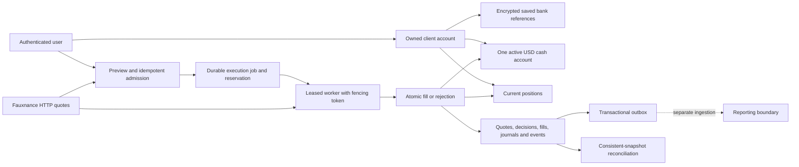
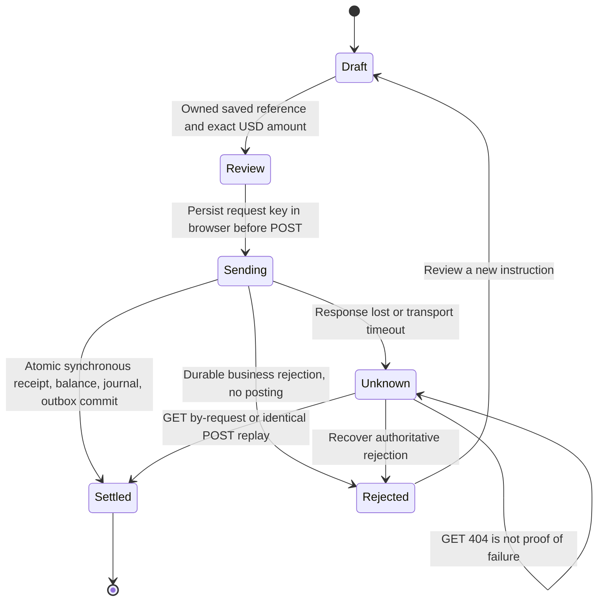
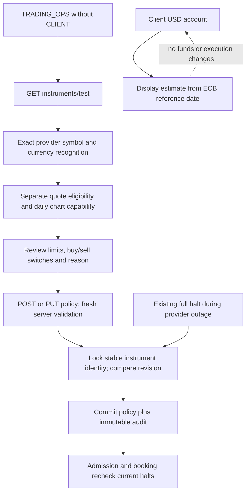
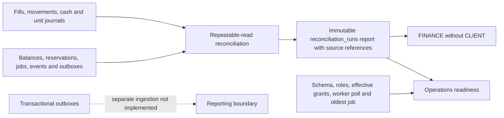

# Provider-backed USD trading: developer and demo guide

Status: USD implementation delivered and automated acceptance passed, 16 October 2026. Consult [Commentary](ClientRefactorCommentary.MD) for exact results, process deviations and the remaining real-provider limitations. The governing scope is [the refactor brief](ClientRefactorInstructions.MD). Older client guides describe historical behavior.

## What this application does

Fauxnance supplies quotes and daily candles. This application's backend owns order admission, reservations, execution decisions, positions, internal cash movements and posting evidence. A fill means an internal transaction committed. It does not mean a real exchange executed an order, an external custodian owns securities, or a real bank transferred money.

There is one runtime financial model. Every ordinary registered client starts with zero USD and no saved bank reference. The optional local demo initializer grants exactly USD 10,000 once to `demo.client`. There is no customer account-mode choice, runtime deterministic quote adapter, chart-price execution fallback, or active synthetic ticker catalog. Historical synthetic evidence remains attributable and read-only.

**Scope decision:** the user selected USD-only initial delivery. Non-USD securities, broader UK/India markets, FX and crypto execution from BR-12 are deferred. Informational display currency does not implement these markets. Analyst reporting remains outside this change; transaction outboxes preserve the separate reporting boundary.

## Running a fresh local demo

Install Docker Engine and Compose with support for the `!reset`/`!override` tags used by isolated tests and the hardened override. The application uses Java 21/PostgreSQL 15/Node 22 in containers. From the repository root:

```bash
cp .env.template .env  # Only when .env does not already exist.
# Edit .env locally: configure Fauxnance credentials and your local port choices.
docker compose config --quiet
docker compose up --build -d
```

Do not overwrite an existing `.env`. Do not paste its contents into issue reports. Required names include `DB_URL`, `DB_USERNAME`, `DB_PASSWORD`, `POSTGRES_USER`, `POSTGRES_PASSWORD`, `POSTGRES_DB`, `SERVER_PORT`, `JWT_SECRET`, the host/container port variables, `FAUX_SERVER_URL`, `FAUX_API_KEY`, `FAUX_DEFAULT_INTERVAL=1d`, and provider connection/read timeout settings. Default template ports are UI 8086 and API 8082. The current frontend API URL helper expects API port 8082; changing that port requires coordinating the existing frontend URL configuration.

Normal local Compose enables `TRADING_ADMISSION_ENABLED`, `TRADING_WORKER_ENABLED` and `TRADING_LOCAL_DEMO_SETUP`. Standalone backend defaults leave these controls off. Admission and worker processing are independent: an admission halt must not stop accepted commitments from draining. These are operational controls, not account modes.

`BANKING_ENCRYPTION_KEY` is base64 encoding of 32 random bytes. The checked-in all-zero example is for fictitious local references only. Retained/shared deployments need a separately provisioned key, protected backup and rotation planning. Losing the key makes full saved details unrecoverable; never change it casually. No key or full bank detail is returned by the API.

The database entrypoint runs `database/fresh/001_schema.sql` and then `002_reference.sql`. The reference file marks migrations 3 through 8 as applied, preventing replay of historical ALTER statements. `database-migrate` checks versions under a PostgreSQL advisory lock; `database-demo-seed` creates local identities. Backend startup validates the exact 14-symbol manifest and creates the first demo opening. PostgreSQL schema creation itself never calls the provider.

Sign in at `/login` with `demo.client` and the public local-only password `RoleDemo2026!`. The same local password applies to `demo.client2`, `demo.operations`, `demo.finance`, `demo.compliance` and `demo.analyst`. These identities must not be provisioned in a retained production environment. Only the first client receives the opening grant. The second starts at zero and is useful for ownership tests.

### What the opening grant actually does

`DemoAccountSetup` locks the client, ensures a zero USD account exists, and checks for prior journal history, quarantine or a nonzero balance. Only a pristine eligible demo account receives a fictitious bank reference and a cash journal opening with unique reference `local-demo-usd-v1:<clientId>`. The posting and balance change commit together. Subsequent starts preserve spending, movements, edited banks and policy halts. Removing a demo bank later does not cause startup to replace it after financial history exists.

`CatalogSetup` validates AAPL, MSFT, GOOGL, AMZN, TSLA, VOO, AGG, JNJ, PG, NVDA, JPM, UNH, XOM and exact `BRK.B`. Existing identities keep their IDs. Fresh IDs are allocated normally; never assume old seed IDs. Existing policies are not overwritten. Provider failures produce immutable setup-check records and no invented substitute security. Recognition and current executability are different checks.

The 16 October configured-provider smoke recognized all 14 exact symbols in USD; 13 returned daily bars, while AGG had no usable candle payload. Their quotes reported `marketState=unknown` and previous-session timestamps. The application correctly refuses execution on those observations, including where the provider's stale flag says false. The later 16 October fix permits explicit unknown status during the verified scheduled U.S. core session and uses a 600-second internal-demo quote limit; previous-session timestamps still fail. See [market-data session policy](../../../docs/market-data-session.md).

## Existing-volume cutover

Do not run `docker compose down -v` against retained data. Take a database backup and verify restoration to a disposable database first. Record users/orders/journals, unresolved cash currencies, dated holdings, synthetic positions, policies, and active reservations/jobs. The existing schema files are one public schema, not separate databases.

Before deploying the new backend:

1. With the prior application, stop new admission and keep the prior worker running until all accepted commitments finish or receive a supported durable rejection. Do not execute old synthetic commitments using new provider quotes.
2. Check that no execution jobs remain incomplete and no reservations remain active. Migration 006 refuses cutover otherwise.
3. Back up the drained database, retain the encryption key separately, and record reconciliation results. Restore to a disposable environment to rehearse the upgrade.
4. Start the new migration service under the schema owner. Versions 005–008 add banking, migration exceptions, policy controls and operational evidence; 007 applies the explicit historical disposition.
5. Start the new application and inspect Operations readiness, setup checks and Finance reconciliation. Resolve quarantined historical records through an explicitly reviewed migration, not ad hoc balance updates.

Nonzero old scalar cash, all dated holdings, prior nonzero ledger balances/positions, non-USD accounts and fixture policies retain their records and exception snapshots. They do not automatically become USD buying power or sellable securities. Existing journals and order IDs are preserved. `CASH`, currency pseudo-tickers and `SIM-*` entries are inactive; model allocation references remain historical and do not credit cash. Verified opening conversions need a separately reviewed source/provenance decision; this upgrade does not guess them.

The canonical DDL and upgrade chain have a PostgreSQL equivalence test for columns, defaults, constraints and triggers. Runtime grants are applied separately to both installation paths. Rollback means admission halt, supported draining and a coordinated restore from the pre-cutover backup if necessary. Do not run an old application against the new schema or re-enable retired financial writers.

## Signing up and banking

Ordinary signup and onboarding do not require banking and never grant money. Open **Banking & cash** to add a saved reference before either buying or selling.

Use a trimmed nickname of 2–50 ASCII letters/digits, spaces, periods, apostrophes or hyphens, including at least one letter/digit. Nicknames are unique per client ignoring case. Routing must contain exactly nine ASCII digits; account numbers must contain 4–17 ASCII digits. Inline messages explain invalid input without truncation; the server repeats these checks. Numbers are strings, so leading zeros are preserved. These are format checks, not confirmation of bank existence or ownership. Full values are encrypted with AES-256-GCM; only nickname, last four digits, default and version are returned. Avoid real banking data in this educational system.

You can add multiple references, choose a default, edit metadata, replace both full number fields together, and confirm removal. Leaving both number fields empty on edit preserves the saved details. Version conflicts require refreshing and reviewing the latest record. Pending orders block number replacement/removal. Removal deactivates the reference; prior receipts retain their masked snapshot and cannot be rerouted by later edits. A default reference does not create a separate trading balance.

Without a bank, the order ticket links to Banking & cash and preserves the instrument, side and exact quantity as a user-scoped draft. Returning requires a new preview. Browser storage never contains full routing/account numbers.

## Deposits and withdrawals

Choose a saved reference, select Deposit or Withdraw, enter a positive USD decimal amount with at most two decimal places, and review the masked reference and estimated resulting available USD before confirming. The estimate uses exact cents, while the server rechecks current funds and limits. The maximum is USD 10,000 per movement; deposits also have an aggregate USD 10,000 cap per UTC day. Changing request keys cannot bypass the daily cap.

Cash movements settle synchronously inside one transaction. A settled receipt, journal, balance update and outbox event appear together. A rejected receipt has a reason and no cash posting. A withdrawal checks posted minus reserved cash, briefly reserves it under the same client lock used by orders, then consumes that reservation at commit. There is no external transfer or background bank settlement job.

The browser saves a user-scoped request key before sending. A lost response or reload triggers recovery using that key. **Check outcome** is safe; **Retry same request** submits the same payload/key. A recovery GET returning 404 does not prove the earlier POST failed. Network/unknown responses preserve the request. Definitive POST validation/not-found failures allow correction. Changing a payload under an existing key is a conflict, not another movement.

Movement history is paged and contains masked bank snapshots. Successful sales credit the internal USD account; withdrawal is always a separate confirmed movement.

## Buying, selling and exact balances

Select an instrument from Markets, then Buy or Sell. Enter units, not a cash spend. Review shows available cash/units, current bid or ask, estimated consideration, projected balances and quote time. Buy uses ask; Sell uses bid. Project fees are zero. The backend uses decimal arithmetic and rounds the final USD consideration to two decimals using HALF_UP. Frontend chart numbers never enter accounting.

Preview has no financial side effects. Confirmation submits a stable client-scoped key. Admission obtains a quote and atomically saves intent, policy/quote/decision evidence, the reservation, job and event. An accepted order is not yet filled. The worker gets a new quote, rechecks current halts, bank/account eligibility and affordability, then either atomically books or rejects/releases the order.

For a buy price rise, only this order's reserved cash plus other unreserved cash is available; other orders' holds cannot be consumed. Pending sells reserve units and do not create anticipated cash. **Sell all available** fills the quantity draft; it still requires fresh review and confirmation. A full sale retains a zero current position, preventing an old dated holding from resurfacing as ownership. Concurrent sells cannot oversell.

Immediate internal settlement means:

```text
available cash = posted cash − active reserved cash
withdrawable cash = available cash
available units = posted units − active reserved sell units
```

A filled sell immediately credits posted cash in the same commit as its units debit and evidence. Rejected work releases only its own hold. Logout stops browser polling but does not cancel accepted commitments. Lost-response/reload recovery uses the original key before checking new eligibility, including during an admission halt or provider outage.

The receipt distinguishes retained internal evidence from incomplete historical records. Booking time is the application's commit-time observation; provider quote time is a separate fact. `INT-...` is an internal reference, not an exchange-issued fill ID.

## Trading Operations

Sign in as `demo.operations` and open Instruments. The business role is `TRADING_OPS`; generic ADMIN does not bypass it. Mixed CLIENT + TRADING_OPS identities are denied this management permission. Staff registration remains unavailable.

**Test with Fauxnance** sits beside Enter ticker/instrument. It shows exact recognized symbol, USD currency, source/time and separate quote/chart/eligibility evidence. Changing input cancels earlier validation. A green check is not a promise: save validates the current provider values again on the server.

Policies include quantity step, maximum quantity/notional, quote age (1–600 seconds), venue, active flag and allowed sides. Session policy accepts provider-open or explicit unknown during the verified 2026 scheduled U.S. core session (see the market-data session policy). Missing/unknown freshness, spread classification, timestamps, unit/currency mismatch, crossed/nonpositive prices and explicitly closed or unsupported scheduled sessions reject execution. The documented provider spread classification is `modelled`; unrecognized classifications cannot authorize a fill.

Every edit requires a meaningful reason and current revision, and records before/after values, actor and time. Economic identity (ticker/currency and established provider mapping) is immutable. Use a replacement instrument for a different security. Removal is deactivation, preserving dependencies. Disable buys while allowing sells for a deliberate sell-only exit; deactivation is a full halt. Existing full halts can be saved during provider outages. Enabling a policy requires current eligibility. Accepted orders retain their policy snapshot while execution also checks current halts.

## Display currency and daily charts

Account/Portfolio defaults to USD. GBP, INR and EUR are optional estimates using the configured official ECB daily reference feed. The authoritative USD balance stays visible. Conversion uses target-per-EUR divided by USD-per-EUR, then rounds the final display amount to two decimals. The rate's publication date/source are shown; no invented intraday publication time appears. Future dates, rates older than seven calendar days, missing rates and unsafe XML make the estimate unavailable. Retry does not alter USD cash. Changing currency cancels the earlier request and logout clears visible estimates.

This is available-cash conversion, not position market valuation, FX trading or conversion of settlement funds. Position valuation is not displayed as zero when prices are missing.

Charts use Lightweight Charts 5.2.1 with the existing Fauxnance daily endpoint. 1M/3M/1Y choose the visible date range; every bar is still one daily session. Bars preserve date-only values, sort ascending, reject conflicting duplicates and invalid OHLC, and never mix adjusted close into unadjusted OHLC. Partial/stale/modelled provenance remains visible. Use **View daily price data** for the accessible OHLC table. Pan, zoom and crosshair are available; Advanced Charts, hosted widgets, intraday data and additional indicators are not included. Attribution/license material is under `/attribution.html` and `/licenses/`.

## Architecture and evidence



Keep `users`/`clients`/`client_profiles` distinct for identity, ownership and onboarding; `refresh_tokens`/`auth_sessions` for their different security lifecycles. Stable `instruments` and versioned `instrument_trading_policies` are separate. Cash/position journals, quote observations, rule decisions, fills, events, attempts and outboxes are append-only source evidence. Jobs/reservations are mutable processing state. Bank references are versioned; movement receipts/outboxes are immutable. Migration exceptions preserve unresolved historical facts. Advisory/model/subscription tables remain for their unrelated responsibilities.

The journals are single-resource posting journals, not a full double-entry general ledger. No external bank or custody statement exists to reconcile. Immediate settlement and synchronous cash movement avoid fictitious processing states; a future delayed-settlement or real-bank integration requires its own liabilities, calendar, durable jobs and reviewed economic rules.

## API map

All client ownership comes from the signed session. Never send client IDs, prices, currency, actor, status or balances in a trading/movement command. Obtain instrument IDs from the actual catalog, bank UUIDs from the owned list, and staff revisions from the current policy list.

| Route | Purpose / role |
| --- | --- |
| GET `/api/workspace/client/portfolio` | Committed USD balances, current positions, migration exceptions / CLIENT |
| GET `/api/workspace/client/instruments` | Filtered active USD catalog / CLIENT |
| GET `/api/workspace/client/trading-availability` | Account/bank/instrument gate; not a fresh quote guarantee / CLIENT |
| POST `/api/orders/preview` | Read-only exact order estimate / CLIENT |
| POST `/api/orders` | Idempotent admission; `Idempotency-Key` required / CLIENT |
| GET `/api/orders/by-request/{key}` | Recover the owned receipt / CLIENT |
| GET `/api/orders`, `/api/orders/{id}` | Owned history/detail/evidence / CLIENT |
| GET `/api/workspace/client/order-events/stream?cursor=...` | Resumable owned event polling / CLIENT |
| GET/POST `/api/workspace/client/banks` | List masked references/add / CLIENT |
| PUT/DELETE `/api/workspace/client/banks/{uuid}` | Versioned edit/deactivate; DELETE uses `?version=...` / CLIENT |
| POST `/api/workspace/client/cash-movements` | Internal USD movement; stable key / CLIENT |
| GET `/api/workspace/client/cash-movements` | History with page/pageSize / CLIENT |
| GET `/api/workspace/client/cash-movements/by-request/{key}` | Recover movement / CLIENT |
| GET `/api/workspace/client/display-currency?currency=GBP` | Informational available-cash estimate / CLIENT |
| GET/POST `/api/workspace/operations/instruments` | Search policies/create / TRADING_OPS, excluding CLIENT |
| PUT `/api/workspace/operations/instruments/{id}` | Versioned policy edit / same permission |
| GET `/api/workspace/operations/instruments/test?symbol=BRK.B` | Read-only provider capability check / same permission |
| GET `/api/operations/readiness` | Schema, roles, permissions, worker/configuration/lag, setup and reconciliation / TRADING_OPS, excluding CLIENT |
| GET/POST `/api/finance/reconciliations` | Last persisted report/run a new snapshot / FINANCE, excluding CLIENT |

Example command shapes (IDs shown as variables, not assumed fixture values):

```javascript
const order = {instrumentId: selectedInstrument.instrumentId, side: 'BUY', quantity: '1', orderType: 'MARKET'};
const movement = {bankId: selectedBank.bankId, direction: 'WITHDRAW', amount: '25.00'};
// Persist a new request UUID before the first POST. Reuse it and the exact payload for recovery.
```

Retired direct holding/trade/fill and generic instrument mutation endpoints return 403. The old scalar balance endpoint returns 410. Database guards additionally prevent old scalar/dated financial writes. Historical read APIs are evidence, never a second spendable balance.

## Operations, reconciliation and recovery

Operations readiness distinguishes configured worker enablement from this process's last poll/completed poll. It reports pending/overdue jobs and oldest accepted work, required reference roles, operational table permissions, append-only protection and the last reconciliation report. A locally owner-connected demo reports evidence protection false; hardened deployments require a non-owner role. Readiness does not call a quote executable merely because credentials exist. Cash movements are synchronous, so there is no oldest queued cash-movement job.

Finance **Run reconciliation** records a repeatable-read snapshot. Cash/units must equal journal sums; reserved aggregates must match active reservations; accepted work needs jobs/holds; terminal work must release holds; fills/movements need matching exact postings and groups; event/outbox facts must agree. The report contains run ID, checked-at time, scope and mismatch references. Migration exceptions remain separate review obligations. A failed check does not repair balances automatically.

For a mismatch, halt admission, retain evidence and investigate referenced records. Keep workers processing already accepted work unless a specific incident requires stopping them too. Never edit journals or delete inconvenient exceptions. Corrections require a separately authorized compensating workflow; none is invented here.

For least privilege, provision a non-owner runtime identity outside this repository and apply `database/runtime-grants.sql` as the schema owner, using `psql -v runtime_role=... -f database/runtime-grants.sql`. The grant script rejects privileged/owning/member roles and denies evidence UPDATE/DELETE/TRUNCATE. The hardened Compose override disables backend demo setup and avoids inheriting the development env file. Its demo-seed and development auth-stub services require the explicit `local-demo` profile and are excluded from ordinary hardened startup; this is an educational local application, not a production provisioning stack.

Backup and restore include all tables, sequences, constraints, triggers and immutable evidence, with the encryption key protected separately. Restore into a separate environment first, apply runtime grants, keep admission off and enable the worker to drain existing jobs. Verify same-key replay, one fill per order, no orphan holds and a persisted matched reconciliation before reopening admission.

## Tests and troubleshooting

```bash
bash scripts/test-role-workspaces.sh
# Package backend before the process-level rehearsal:
mvn -f backend/pom.xml -DskipTests package
python3 scripts/test-client-recovery.py
python3 scripts/test-client-compose.py
```

The first script uses disposable PostgreSQL/Maven/Node containers. Recovery uses a separately launched test-only HTTP fixture through the production adapter, restart, dump/restore and a non-owner role. Compose acceptance uses uniquely named disposable resources and a fixture override; it never touches the working Compose volume. Real-provider compatibility is a separate smoke check, not replaced by fixtures. See Commentary for exact observed totals and provider limitations.

For a disposable browser session, `bash scripts/start-client-review.sh` requires configured provider URL/key in the shell environment. `--http-fixture` explicitly selects test-only HTTP data for UI verification. `--reuse` retains that review database. `REVIEW_PREFIX=tadpoles-client-refactor-review` can isolate it from an earlier review. Pass the same prefix to `scripts/stop-client-review.sh`; stopping removes only those disposable review containers.

| Symptom | Action |
| --- | --- |
| Bank required | Add an owned reference, return to the saved draft and obtain a new preview |
| Insufficient cash/units | Review posted/reserved amounts and pending orders; sale proceeds are available only after fill |
| Quote expired/unknown session | Refresh; if the provider still returns old/unknown data, execution remains unavailable |
| Missing credentials/auth/rate limit/outage | Operations should inspect safe setup/test results and provider configuration; no fallback price is used |
| Unsupported punctuation/symbol | Test the exact symbol; do not substitute a different economic identity |
| Full halt | Operations must review the reason and whether a sell-only exit is appropriate |
| Missing response | Keep the original key; recover or retry the same payload |
| Bank edit conflict | Refresh the version; wait for pending orders before changing numbers/removing |
| Migration exception | Historical record is retained and nonspendable; seek an explicit reviewed disposition |
| Reconciliation mismatch | Halt new admission, inspect source references and retain all evidence |
| Estimate unavailable | Retry reference rates; USD funds and trade eligibility are unaffected |

## Transaction and control diagrams

```mermaid
sequenceDiagram
  actor Client
  participant API as Owned trading API
  participant Feed as Fauxnance
  participant DB as PostgreSQL
  participant Worker as ExecutionWorker
  Client->>API: POST /api/orders/preview (side, units, instrument)
  API->>Feed: Exact mapped quote
  API-->>Client: Estimate, source time, expiry and eligibility
  Client->>API: POST /api/orders + stable Idempotency-Key
  API->>Feed: Admission quote
  API->>DB: Lock client; intent + snapshot + hold + job + event
  DB-->>API: Commit accepted or rejected receipt
  API-->>Client: Authoritative receipt
  Worker->>DB: Lease job with fencing token
  Worker->>Feed: New execution quote
  Worker->>DB: Lock client/order; recheck current halt and resources
  alt Eligible buy or sell
    Worker->>DB: Atomic cash/units + fill + journals + consumed hold + event/outbox
  else Rejected or retries exhausted
    Worker->>DB: Durable reason + release own hold + event/outbox
  end
  Client->>API: Owned receipt or by-request recovery
  API-->>Client: Committed outcome and balances
```



`Sending` and `Unknown` are browser states, not stored settlement states. Within the synchronous transaction a withdrawal locks the client, checks posted minus reserved, reserves and consumes the movement amount, and commits once. No external transfer occurs. Sell proceeds are available to a later withdrawal only after the sell booking commits.





## Catalog mapping manifest

The legacy IDs below are from `database/schema/002_tadpoles_test_data.sql`. Upgrades retain each existing ID and display ticker. Fresh installs allocate IDs from the database sequence; resolve them from the catalog instead of assuming the old numeric order. Provider symbol equals the displayed ticker exactly, including `BRK.B`; no hyphen substitution is made. All mapped policies use USD per share/unit, USD settlement, step 1, maximum 10,000 units / USD 1,000,000 notional, quote age 600 seconds, provider-open sessions with the documented scheduled-session fallback, both sides allowed initially, two-decimal HALF_UP consideration and zero project fees (`startup-provider-v1`). An existing Operations revision always wins over the initializer.

| Legacy ID / symbol | Canonical identity on upgrade | Provider symbol / configured venue | Fresh asset / security class | Observed configured-provider validation | Disposition |
| --- | --- | --- | --- | --- | --- |
| 1 / AAPL | 1 / AAPL | AAPL / NASDAQ | EQUITY / STOCK | USD quote recognized; daily bars | Retain identity; add validated policy |
| 2 / MSFT | 2 / MSFT | MSFT / NASDAQ | EQUITY / STOCK | USD quote recognized; daily bars | Same |
| 3 / GOOGL | 3 / GOOGL | GOOGL / NASDAQ | EQUITY / STOCK | USD quote recognized; daily bars | Same |
| 4 / AMZN | 4 / AMZN | AMZN / NASDAQ | EQUITY / STOCK | USD quote recognized; daily bars | Same |
| 5 / TSLA | 5 / TSLA | TSLA / NASDAQ | EQUITY / STOCK | USD quote recognized; daily bars | Same |
| 6 / VOO | 6 / VOO | VOO / NYSE Arca | ETF / ETF | USD quote recognized; daily bars | Same |
| 7 / AGG | 7 / AGG | AGG / NYSE Arca | Fixed Income / ETF | USD quote recognized; no usable candle payload | Same; chart unavailable until source supplies data |
| 8 / JNJ | 8 / JNJ | JNJ / NYSE | EQUITY / STOCK | USD quote recognized; daily bars | Retain identity; add validated policy |
| 9 / PG | 9 / PG | PG / NYSE | EQUITY / STOCK | USD quote recognized; daily bars | Same |
| 10 / CASH | 10 / CASH, historical only | No execution mapping | Historical Cash / CASH_EQUIVALENT | Excluded pseudo-instrument | Inactive; preserve model weights and references; never credit cash from weights |
| 11 / NVDA | 11 / NVDA | NVDA / NASDAQ | EQUITY / STOCK | USD quote recognized; daily bars | Retain identity; add validated policy |
| 12 / JPM | 12 / JPM | JPM / NYSE | EQUITY / STOCK | USD quote recognized; daily bars | Same |
| 13 / UNH | 13 / UNH | UNH / NYSE | EQUITY / STOCK | USD quote recognized; daily bars | Same |
| 14 / XOM | 14 / XOM | XOM / NYSE | EQUITY / STOCK | USD quote recognized; daily bars | Same |
| 15 / BRK.B | 15 / BRK.B | BRK.B / NYSE | EQUITY / STOCK | Exact punctuation recognized; USD quote and daily bars | Same; never relabel BRK-B automatically |
| Existing SIM-* / currency fixtures | Original IDs, historical only | No active provider mapping | Retained historical classification | Excluded from active search/execution | Preserve evidence and quarantine unresolved economic balances |

Existing class labels are preserved on upgrades; fresh labels above describe the initializer. Venue is explicit application catalog metadata; the observed provider quote contract confirms symbol/currency, not an independent venue attestation. Existing ticker collisions cannot silently receive another economic identity. Setup failures are retained in provider checks and exposed through readiness. All 14 real quotes in [the sanitized smoke report](evidence/provider-smoke-2026-10-16.json) had previous-session timestamps and unknown market state, so **none proved current executability**. The provider/data owner must supply fresh, positively identified open-session metadata; AGG additionally needs a valid daily response. Broader BR-12 markets remain deferred by the user's decision.

## Permission and evidence boundaries

| Capability | Authorized identity | Enforced boundary |
| --- | --- | --- |
| Signup/onboarding | Public signup; owned CLIENT profile | Public signup cannot provision staff roles or grant cash |
| Preview/order/history/banking/display estimates | CLIENT, including mixed identities for their own client only | Server resolves client; cross-client resource reads disclose no foreign record |
| Test/create/edit/deactivate instrument policy | TRADING_OPS without CLIENT | Route, controller and save service checks; version and audited reason; generic ADMIN alone denied |
| Readiness and last reconciliation summary | TRADING_OPS without CLIENT | No credentials or full bank details in output |
| Run/read reconciliation | FINANCE without CLIENT | Consistent-snapshot persisted evidence; no balance repair authority |
| Identity administration | Existing controlled ADMIN permissions | No authority to manufacture fills, funding, or policy eligibility |
| Reporting / compliance investigation | Existing assigned-role boundaries | Unavailable until separate reporting source and investigation policy exist; no live-table analytics fallback |
| Evidence mutation | No ordinary runtime role | Append-only grants and database constraints; migration owner separate |

Manual Operations creation currently describes USD equities (stock metadata); the preloaded manifest also explicitly supports the two listed ETFs. It is not a general asset-class onboarding interface. Changing a referenced economic identity requires a separately reviewed replacement. No broader reporting, external settlement, or automatic correction workflow is implied by these permissions.

## Verified delivery

The final full suite passed 341 backend, 19 database and 131 frontend tests, style checks and production compilation. A final catalog-class fix additionally passed two focused PostgreSQL tests. Fresh/repeated/upgrade Compose and backup/restore/recovery rehearsals passed. [Commentary](ClientRefactorCommentary.MD) and [portable evidence](evidence/verification-2026-10-16.json) distinguish test fixtures from real-provider observations and record the uncommitted tested sources.

The real provider recognized the 14 requested USD symbols but did not provide currently executable open-session quotes during the smoke check; AGG daily bars were also unavailable. Trading correctly stays blocked on those observations. This delivery does not claim broader BR-12 markets, external bank transfers/custody, legal settlement, independent reporting or a completed Jenkins run.
