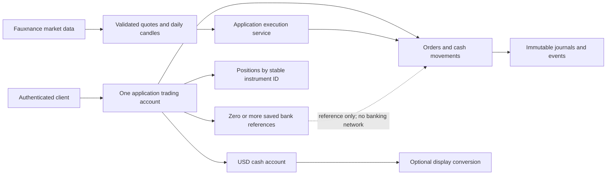
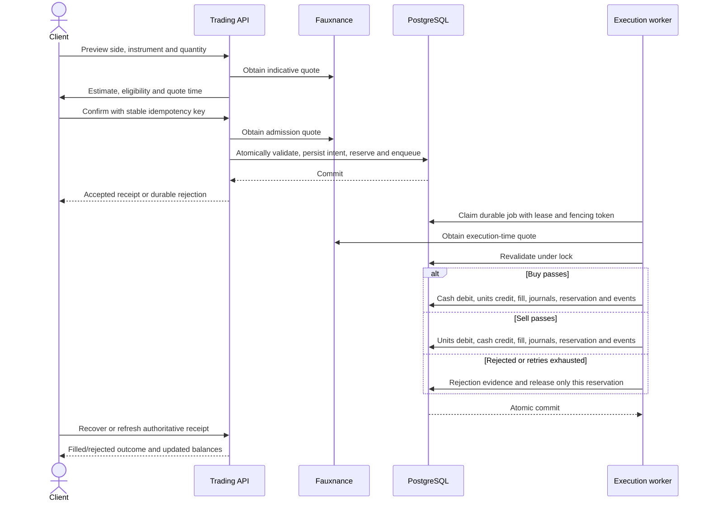
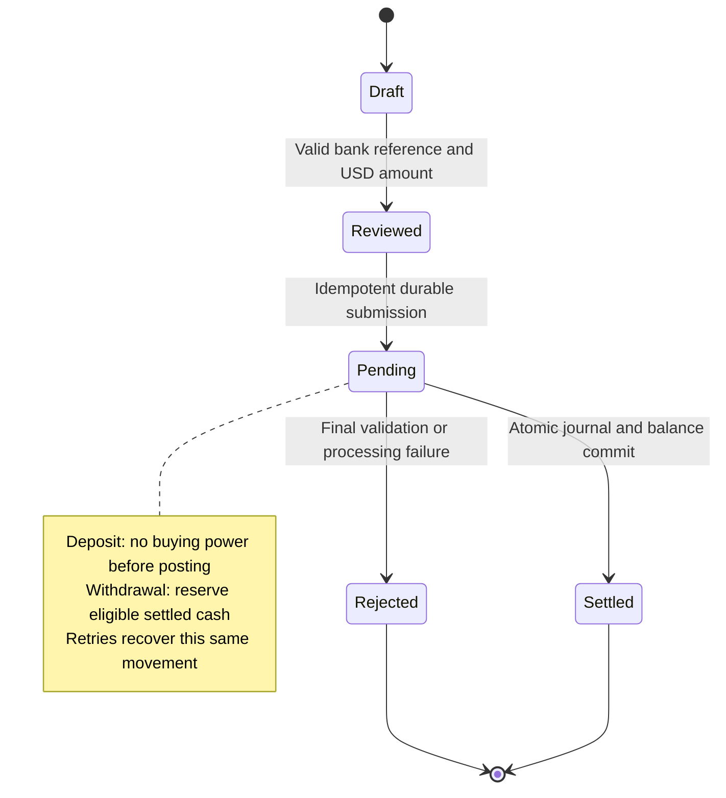
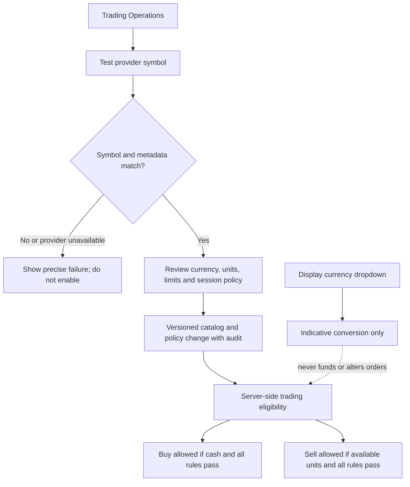
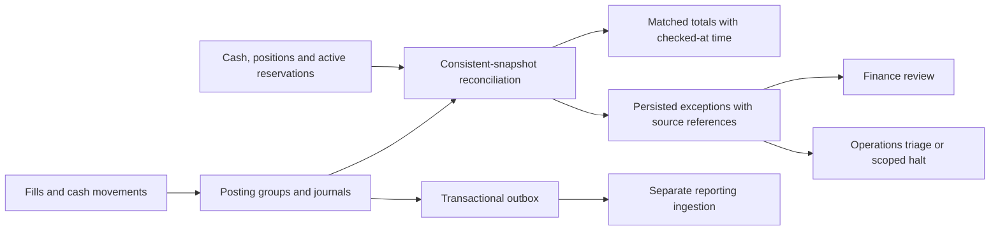

# Client refactor instructions for Codex or Copilot

Prepared against the working tree on 15 October 2026. This is an implementation brief for a future agent, not a statement that the refactor has already been implemented or tested.

## 1. Assignment and mandatory working method

Refactor this project into one coherent, self-directed trading application. Remove runtime support for synthetic instruments and the competing `LEGACY`/`SIMULATION` account modes. Use Fauxnance as the instrument market-data provider and this application's backend as the owner of order execution, cash movements, positions, internal booking, and reconciliation. Deliver the banking, instrument-management, default setup, chart, and usability changes below.

**Test, test, test. Use test-driven development (TDD; the request calls this “TTD”): RED → GREEN → REFACTOR.** Write a meaningful failing behavioral test before each functional change or bug fix, verify why it fails, implement the smallest coherent change, and refactor with tests passing. Record actual commands and results. A compile failure caused by a broken test fixture is not evidence that the intended behavior failed. Do not describe tests written after implementation as test-first work.

Analyze the **entire codebase**, including callers, database writers, initialization, migration, security, tests, deployment scripts, and documentation. Do not implement this as a collection of frontend patches or a global rename of “simulation.” Preserve existing user changes and unrelated functionality. Inspect `git status` and applicable `AGENTS.md` files before editing; this working tree already contains extensive modified and untracked implementation work.

Keep every change within the business requirements. Distinguish **source requirements**, **this user's requested changes**, **implementation proposals**, and **unresolved business decisions**. Do not quietly treat an old proposal as a requirement or claim a reduced feature set meets the full brief.

Backend and database changes are authorized and expected. Retain the existing Angular standalone-component/service structure, Spring controller/service/DTO/domain/MyBatis layering, PostgreSQL approach, shared API URL/authentication handling, and visual design language. Avoid an unrelated framework replacement, wholesale directory reorganization, or new infrastructure without a demonstrated need.

For every UI change, explicitly ask: **“Can a casual user understand this, recover from errors, and complete the task without knowing our implementation?”** If the answer is no, improve the flow before calling it complete.

### Required output paths

Use the existing directory, spelled **`ClientPageImplementation`**. The request's `ClientPageImplmentation` is a typo; do not create a parallel directory.

- Maintain this brief at `impDocs/Frontend/ClientPageImplementation/ClientRefactorInstructions.MD`.
- Create and continuously update `impDocs/Frontend/ClientPageImplementation/ClientRefactorCommentary.MD` with implementation decisions, alternatives, concise engineering rationale, evidence, and limitations.
- Create `impDocs/Frontend/ClientPageImplementation/ClientRefactorCrashCourse.MD` with an in-depth explanation of what changed, why, and how to use and operate it.

Do not finish with only a plan, screenshots, mock components, or documentation. Implement and verify the authorized scope; identify any genuinely blocked business decision separately from completed work.

## 2. Read first and establish traceability

Read these sources in full before implementation, following their relevant references:

1. `impDocs/HailMary.md`, especially its source/proposal distinction, BR-01–BR-18, role matrix, trading invariants, D-01–D-24, and release criteria. The user's HailMary link refers to this local file, not an external website.
2. **Every Markdown file** under `impDocs/Frontend/ClientPageImplementation/`, including `ClientPageCrashCourse.MD`, `Implementation.MD`, and `RolesCredentials.MD`; also review `Verification.txt` and relevant screenshots.
3. **Every Markdown file** under `impDocs/Frontend/SeparatePageImplementation/`, including `SeparatePages.MD` and `RolesCredentials.MD`.
4. `ClientAndBuySell.MD`, `HoldingsAndTradesIMP.md`, `TEST_AUTHORIZATION_CONTEXT.md`, `AUTH_QUICK_START.md`, the root/frontend/auth-stub READMEs, and relevant frontend/backend documents throughout `impDocs/`.
5. `impDocs/Fauxnance/Quotes.md`, `impDocs/Fauxnance/DailyCandles.md`, `docs/api.yaml`, available provider contracts, and the actual provider adapters/tests. Some old documents reference files no longer at their original paths; locate their replacements and record missing sources rather than inventing their contents.
6. The ERD/UML, role-support, local-deployment and Docker guides in `docs/`; all SQL under `database/` and `schema/`; Compose files, `.env.template`, Jenkins configuration, test harnesses, and review/recovery scripts. Do not print `.env`, API keys, tokens, or real account data into logs or documentation.

Treat older implementation documents as historical evidence. For example, SeparatePages describes disabled trading, while later ClientPage documents describe a functioning synthetic worker. Verify present code rather than assuming either document is the final runtime truth.

Produce a traceability table in the Commentary with: requested change → source section/BR → current behavior/files → target behavior → acceptance test → result/open decision. Include effects on BR-14/15 evidence and BR-16/17 reporting even when full reporting implementation is outside this refactor. Preserve reporting isolation; do not fill unfinished analyst screens with queries against live transaction tables.

### Known starting points to verify

| Area | Current implementation to investigate |
| --- | --- |
| Database | `001_tadpoles_schema.sql` defines the original model; `002_tadpoles_test_data.sql` is seed data; `003_workspace_roles.sql` adds role rows/indexes; `004_client_simulation.sql` extends the same PostgreSQL `public` schema. These are not four independent schemas or databases. |
| Alternate schema | `schema/portfolio_schema.sql` and test SQL fixtures may describe older structures. Find their consumers before consolidating or retiring them. |
| Account split | `clients.financial_model`, scalar `clients.cash_balance`, dated `client_holdings`, per-currency `client_cash_accounts`, and current `client_positions` coexist. |
| Trading | `backend/src/main/java/com/neueda/leap/trading/`, `TradingServiceImpl`, `TradingMapper`, and `WorkspaceClientController` implement durable admission, reservations, a synthetic worker, evidence, recovery, and scoped reads. |
| Quotes | `DeterministicSimulationQuotes` implements `SimulationQuotes`; the actual Fauxnance quote/candle services are separate. Replacing the former requires a real adapter contract, not renaming its source label. |
| Startup | `docker-compose.yml`, `database/migrate.sh`, `database/demo/role_workspaces.sql`, and optional `database/demo/simulation.sql`; normal startup currently leaves trading switches off and synthetic funding requires an extra profile. |
| Instruments | `InstrumentController` currently grants create/update to ADMIN without CLIENT. `TRADING_OPS` exists but its workspace currently centers on unavailable monitoring endpoints. |
| Client UI | `features/client/`, `features/trade/order-ticket.component.ts`, `pending-order.service.ts`, `core/api/order-status.service.ts`, workspace API/auth services, shared navigation and styles. |
| Chart | `features/trade/candle-chart.component.ts` currently draws SVG candlesticks and exposes a daily OHLC table. Provider candle metadata includes a `synthetic` flag. |
| Tests | Backend unit/HTTP/PostgreSQL trading tests, `testing/` database tests, Angular specs, `scripts/test-role-workspaces.sh`, and `scripts/test-client-recovery.py`. |

## 3. Business decisions and boundaries

### 3.1 One trading model; accurate provider and broker terminology

The target has **one runtime account/order model and one execution path**. Fauxnance supplies instrument data, quotes, and daily candles. The backend validates and books transactions internally. Do not assume Fauxnance supplies brokerage accounts, order routing, custody, bank transfers, exchange fills, or settlement confirmations.

In this architecture the application performs the broker-like **software responsibilities**. That does not establish that it is a licensed broker, owns underlying securities externally, or has live execution/custody arrangements. Keep the existing provider's educational/modelled-data disclosures accurate. A provider-derived price and a persisted internal fill are different facts.

Remove the customer-facing legacy/simulation choice, synthetic ticker catalog, and production selection of deterministic fixture quotes. Deterministic HTTP fixtures remain appropriate **inside automated tests**, exercising the same production execution service. They must not become a second deployable trading mode or an automatic fallback when Fauxnance fails.

Independent operational controls for **new-order admission**, **worker processing**, and **instrument halts** may remain. These are service controls, not account modes. Halting admission must still allow accepted commitments to drain or reach a durable terminal outcome.

### 3.2 USD versus HailMary's required market coverage

**Finding:** HailMary §1.2, BR-12, §11.1, and its E2E-11 explicitly include UK/US/India equities, FX, and crypto. It does not require exactly three customer cash balances merely because the simulator happened to seed USD/GBP/INR. Nevertheless, USD-only execution with only USD-priced instruments does **not** satisfy the complete stated market scope.

Recommended product direction: one USD funding/settlement account, with a separate **“Display currency” dropdown** for informational converted values. This is simpler for casual users and removes an unnecessary multi-balance UI. However, viewing a GBP/INR equivalent is not FX trading and does not provide settlement for a GBP/INR-priced security.

Before implementing non-USD instrument trading, record the scope decision:

| Option | Consequence |
| --- | --- |
| USD-only initial delivery | Build USD deposits, withdrawals, positions and execution for validated eligible instruments; identify excluded required markets and keep BR-12 partially unmet until an explicit scope exception is accepted. |
| One USD client account with broader required instruments | Requires a defined FX pricing/funding/settlement model for non-USD quotes, reference sources, spread/fees, rate snapshots, rounding and reconciliation; a display conversion is insufficient. |
| Multiple settlement currency accounts | Retain only if the actual approved business scope requires it; unify them under one account/order model, not legacy/simulation modes. Explain why the user's simpler alternative is insufficient. |

The user explicitly qualified USD-only with “unless HailMary says otherwise.” Therefore do not silently delete genuine required market coverage or claim full compliance. Implement the common USD foundation and independent work, identify the precise unresolved market decision, and seek a focused answer if necessary for the remaining implementation. Do not invent foreign-currency execution or silently convert existing GBP/INR balances to USD.

Remove `CASH`, standalone currency pseudo-instruments, and simulation-specific FX/synthetic fixtures from the active catalog. This does not authorize erasing historical financial records or banning all genuine FX/crypto instruments without resolving BR-12.

**Scope decision recorded 15 October 2026:** The user selected “USD-only initial delivery; explicitly defer broader markets.” Broader BR-12 coverage remains deferred; this is not full BR-12 compliance.

### 3.3 Banking and settlement scope

HailMary §1.3 explicitly excludes **real** deposit/withdrawal and bank/payment connectivity; cash movements are modelled internally. Implement the requested Deposit/Withdraw UI and backend as controlled **internal cash-movement workflows**. State clearly that no money moves through a real bank. The older proposal to fund only through seeds is superseded for this feature by the user's explicit request, while the no-real-connectivity source boundary remains.

Bank details are a user-managed funding-account reference and an eligibility requirement, not proof of bank ownership, sufficient external funds, or completed bank verification. Use “Saved” or “Format checked,” not “Bank verified.” No external bank credentials or payment integration are required.

Decide and document one internal settlement policy. Recommended bounded initial policy: **a successfully committed internal trade fill settles immediately in the application's ledger**. This is a project booking rule, not a representation of a real market's legal settlement cycle. A buy decreases cash and increases units atomically; a sell decreases units and increases cash atomically. Under this policy, sell proceeds become withdrawable only once that transaction commits.

Compare that choice against delayed settlement in the Commentary. If the approved scope requires delayed settlement, implement explicit unsettled cash/units, settlement dates/calendar and durable settlement jobs; prohibit premature withdrawal and double release. Do not add a cosmetic “pending settlement” badge while making the proceeds spendable. Do not invent T+1/T+2 or jurisdictional rules from memory.

## 4. Architecture brainstorming and required diagrams

Use the following diagrams as an initial design to validate, not as evidence of completed implementation. Update them to match final endpoints, tables, states, and transaction boundaries in both new documentation files.

### 4.1 Account arrangements



Explain identity versus trading account versus bank reference; posted/settled/reserved/available amounts; account ownership; quote versus execution authority; and where evidence lives. Bank references must not each create another trading cash balance.

### 4.2 Buy and sell execution



### 4.3 Deposits, withdrawals, and internal settlement



Explain whether processing is synchronous or a durable worker; use states consistent with that choice. A pending withdrawal reduces buying power immediately through reservation, but its cash debit occurs once at settlement. Rejection releases its reservation exactly once. A synchronous deposit may commit immediately, but the API must not expose an artificial pending state with no durable processing mechanism.

### 4.4 Instrument, currency and role controls



### 4.5 Reconciliation and readiness



Brainstorm at least immediate versus delayed settlement; cash journals versus a balanced general ledger; one USD account versus multicurrency funding; deactivation versus destructive instrument deletion; and synchronous versus durable asynchronous cash movements. Record the chosen option, rejected alternatives, and practical consequences. Do not describe the existing single-sided journal as a complete double-entry ledger. If adding a general ledger, define offset accounts and prove each posting group balances per currency.

## 5. Consolidate the database without losing evidence

### 5.1 Separate file consolidation from table consolidation

Use the schema explanation in `ClientPageCrashCourse.MD` as the inventory, then verify every table, constraint, index, trigger, mapper and consumer.

**Recommended file-level consolidation:** a coherent canonical fresh-install DDL baseline can incorporate the structural changes currently spread across 001/003/004. Keep **schema creation and insertion queries in separate files**. Move baseline/demo data out of a misleading schema-creation file; keep required reference data such as role definitions distinct from optional demo records. Use the existing `database/schema`, `database/migrations`, and `database/demo` structure, adding a reference-data location only if useful.

Do not simply concatenate SQL or delete migration files. Existing installations must retain an ordered, versioned upgrade path. Preserve already-applied historical migration files and their evidence; add new upgrade migrations. Historical files may contain mixed DDL/DML; do not rewrite applied history just to achieve cosmetic purity. Separate new schema steps, data backfills, and seeds into explicit files coordinated by the runner. Migration-version bookkeeping is metadata, not demo seeding.

Document exactly how fresh initialization and upgrades establish migration versions. Prevent a fresh consolidated baseline from replaying old `ALTER TABLE` steps. Keep advisory locking, failure propagation, transactional migration/version recording where feasible, and retry behavior. Verify the final fresh schema and upgraded schema are equivalent, including permissions and triggers. Inspect PostgreSQL entrypoint lexicographic execution and Compose mount changes.

### 5.2 Table-level decisions

Write a keep/merge/retire matrix with evidence for every candidate:

| Candidate | Expected direction and required reasoning |
| --- | --- |
| Scalar `clients.cash_balance` vs `client_cash_accounts` | Make the journal-backed account authoritative. Retire live scalar writers/readers after verified migration; never maintain two spendable balances. |
| `client_holdings` vs `client_positions` | Use current positions for tradability. Dated snapshots may remain archived/read-only but cannot override a zero current position or resurrect sold units. |
| Legacy and self-directed `client_trades` | One canonical new-order contract; retain historical provenance/IDs. Decide whether historical rows remain in the table or a read-only archive. Provenance is not a runtime trading mode. |
| `instruments` vs `instrument_trading_policies` | Usually retain separate stable identity and versioned rules. Merge only if cardinality, change history, accepted-order snapshots and authorization remain correct. |
| `users`, `clients`, `client_profiles` | Different identity, account and profile responsibilities. Do not merge merely because they relate one-to-one. |
| `refresh_tokens` vs `auth_sessions` | Different security lifecycles; preserve revocation and rotation semantics. |
| Fills, cash/position journals, rule decisions, quote observations, events, execution jobs/attempts, outbox | Distinct intent, evidence, processing and delivery lifecycles. Keep unless a specific duplication can be eliminated without losing atomicity, replay, immutability or auditability. |
| Advisory/model/subscription tables | Determine all dependencies. Do not remove unrelated features merely because self-directed trading does not use them. Do not reintroduce advised execution into the client flow. |
| Bank references, cash movements, movement reservations | Add focused entities with ownership, lifecycle, idempotency and retention rules. Decide whether reservations can share a generalized table without weakening order constraints. |

Fewer tables is not the goal; one financial truth and maintainable responsibilities are.

### 5.3 Data conversion and cutover

1. Inventory balances, holdings, trades, policies, synthetic instruments, foreign-currency accounts, pending jobs/reservations and all references to removed catalog entries. Include `model_portfolio_holdings`, subscriptions and advisory references.
2. Rehearse backup and restore on disposable copies. Produce a dry-run report and opening/closing reconciliation before applying a data migration.
3. For known demo fixtures, reset/rebuild only explicitly disposable fixture data using documented seed provenance. For retained data, never assume an unknown scalar cash balance is USD or treat a dated snapshot as verified current ownership.
4. Migrate verified balances/units through uniquely referenced opening postings. Preserve old-to-new identifiers and provenance. Do not manufacture historical quote evidence, fill times, costs, or currency conversion rates.
5. Quarantine unresolved records as read-only historical evidence with a migration exception. They are not a second active account model. Do not fund an account from them or silently write them off.
6. Synthetic positions cannot be renamed into real provider instruments. Archive their history; require an explicit reviewed disposition for their economic balances. Preserve non-USD history until a supported migration/disposition is agreed.
7. Before cutover, stop new admissions and drain old accepted jobs under their recorded semantics, or record an explicit terminal rejection and release reservations through the supported transaction path. Never execute old synthetic commitments at a new provider price silently.
8. Remove runtime `financial_model` branching, fixture pricing columns/adapters, simulation-only policy/session identifiers and obsolete mode environment variables after dependent code/data conversion. Keep truthful historical provenance and test fixtures where required.
9. Update queries, DTOs, OpenAPI, foreign keys, sequences, fixtures, scripts, runtime grants and deployment docs together. Search for stale `SIMULATION`, `LEGACY`, `SIM-`, `fixture_bid`, `fixture_ask`, `CASH`, and old configuration names; classify historical/test references rather than blindly replacing them.
10. Prove migrations and seeds are repeatable, preserve existing users/orders, and never replenish money already spent. Provide a forward-fix/restore plan without reactivating the old financial writers.

## 6. One provider-backed execution flow

Replace `SimulationQuotes`/`DeterministicSimulationQuotes` with a provider-neutral quote interface and Fauxnance adapter wired to the sole runtime execution service. Rename the worker/setup services and configuration appropriately, retaining their durability and correctness. Reuse the existing provider service where sensible, but do not assume a display-oriented proxy is already safe for execution.

### Quote and policy rules

- Map stable instrument ID, provider symbol and venue explicitly. Normalize case/whitespace only where the provider contract permits; do not guess suffixes or convert `BRK.B` to another symbol without validation.
- Use a validated ask for buys and bid for sells. Persist raw and normalized price/unit data, source, provider timestamp, receive timestamp, policy version, market state, and any stale/modelled/spread metadata.
- Keep quote observation time separate from the application's execution/booking time. A generated observation ID is not a provider-issued fill/reference.
- Validate symbol/currency/unit agreement, positive prices, bid ≤ ask, precision, staleness/future timestamps, market/session eligibility, quantity step and limits. Define an explicit policy for missing/unknown metadata rather than treating it as fresh by default.
- Inspect Fauxnance's actual quote cadence and data provenance. Its daily candle interval does not prove quotes are current or executable. If the configured freshness/session requirements cannot be met, explain and resolve that mismatch; do not stamp an old quote with the current time or relax validation secretly to make a demo pass.
- Do not invent bid/ask from daily close or fall back to chart values/fixture prices. A provider `synthetic` candle or modelled-spread disclosure is data provenance; retain it accurately even though synthetic **instruments and runtime fixture execution** are removed.
- Bound timeouts/retries, classify provider failures, and keep network calls outside balance/position locks. Recheck the fetched policy/quote after acquiring locks.
- Keep the fee/rounding policy explicit. Zero fees may be a documented project policy, but must not be described as a real provider guarantee. Use exact decimals for accounting and decimal-string API contracts.

### Preserve transaction and recovery invariants

- Preview is read-only and does not reserve or guarantee a fill price.
- Admission atomically persists immutable intent, decision/quote evidence, reservation, job and event/outbox before returning an accepted receipt.
- Resolve the client from the authenticated identity; never trust request-supplied account IDs, prices, currency, actor, balances or status.
- Preserve client-scoped idempotency, request-hash conflict detection, original-key recovery and replay during a provider outage/admission halt. A repeated request must return its existing outcome before new eligibility checks can reject it.
- A worker uses durable jobs, bounded retries/deadlines, expiring leases and fencing tokens. A restart or expired claim must not create a second fill.
- At execution, recheck account/banking eligibility, current instrument halts, recorded policy semantics, quote validity and affordability. Explain the defined treatment of policy changes after acceptance.
- For a buy price increase, reuse this order's reservation plus otherwise unreserved cash only. Never consume funds reserved for another order or withdrawal. If insufficient, reject and release exactly this reservation.
- For sells, reserve only available owned units. No shorts, margin, negative positions or currency overdrafts unless separately required and approved.
- A fill, cash/position effects, journals, reservation consumption, state transition, execution attempt, event and outbox commit together. Failure at any write rolls back all economic effects.
- Rejection is durable and releases only the affected reservation. Terminal outcomes and booked evidence remain immutable; corrections use linked compensating records through a defined authorized workflow.
- Preserve zero positions after a full sale so historical holdings cannot reappear as sellable. Provide a “Sell all available” draft action that still requires review/confirmation.
- Retain owner-scoped status/history, polling/reconnect recovery, session revocation, logout cleanup and cross-account isolation. A logout must not discard an accepted order.

### Reconciliation and readiness

Provide real, repeatable reconciliation over a consistent snapshot:

- Cash balance equals verified opening cash plus posted cash journals, including deposits/withdrawals and trade effects.
- Current units equal verified openings plus position journal movements.
- Reserved cash equals active buy and withdrawal reservations; reserved units equal active sell reservations.
- Terminal orders/movements have no active reservations; accepted pending work has durable processing state.
- Each fill/movement posting has unique source and group references; fills agree with exact quantity/price/fee/rounding rules; lifecycle events agree with outbox records.

Expose checked-at time, scope and real exception references to authorized Finance/Operations readers, or provide an explicit executable operational report if the broader dashboards remain outside scope. Never label an empty/stub report “reconciled.” This is internal ledger reconciliation; there is no external broker/bank statement to match unless a real integration exists.

Add readiness checks for schema/version, reference data, runtime permissions, provider configuration, worker health/lag, oldest pending job/movement and reconciliation exceptions. Do not expose secrets in health output. Keep recovery, admission halt, provider outage, backup/restore and pending-work runbooks. Preserve the separate reporting/outbox boundary without claiming the unfinished analytics platform is complete.

## 7. Preloaded instruments and default Docker startup

After the documented environment setup, **`docker compose up --build` must initialize a usable local application without a simulation profile, manual policy SQL, or account-mode switch**. Required Fauxnance credentials/configuration and actual provider availability remain real prerequisites; never promise successful execution during an upstream outage or closed market.

1. Inventory all preloaded symbols in `002_tadpoles_test_data.sql`, role seeds and simulation seed. Include AAPL/MSFT/GOOGL/AMZN/TSLA/VOO/AGG/JNJ/PG/NVDA/JPM/UNH/XOM/BRK.B rather than fixing only one example.
2. Produce a mapping manifest: old ID/symbol → canonical ID/display ticker → provider symbol/venue → quote currency/unit → asset/security class → validation result → trading policy → migration disposition.
3. Validate candidate provider mappings using the actual Fauxnance contract and configured API. Do not assume all equities, ETFs or punctuation variants are supported. Preserve stable IDs/references where identity is unchanged; handle collisions explicitly.
4. For every supported, in-scope seed instrument, create the complete policy and provider mapping so it is eligible immediately after initialization, subject to ordinary banking, cash, session and quote checks.
5. Unsupported or ambiguous symbols must produce a clear setup/validation report. Do not relabel a different security, grant eligibility from a chart response alone, or leave unexplained browsing-only defaults. Document any provider-dependent acceptance blocker.
6. Exclude `CASH`, currency pseudo-tickers and `SIM-*` instruments from new active seeds/search/trading. Resolve model-portfolio references to `CASH` intentionally; do not turn target allocation weights into cash credits or silently distort allocation totals.
7. Keep DDL independent from network calls. A backend/setup validation step may verify the seed manifest with bounded retries and visible results. Catalog identity validation and fresh per-order price validation are different checks.
8. Seed at least `demo.client` with **USD 10,000 settled, unreserved cash at first initialization**, via a unique opening journal reference. Include a clearly fictitious, format-valid bank reference for that demo so the required trade gate does not defeat the first-run experience. Ordinary new users start at zero and without a bank reference.
9. Keep a second demo client suitable for ownership/isolation tests. Demo funds/accounts belong only to the local demonstration setup; never fund every registered user or include development credentials in production provisioning.
10. Repeated startup must preserve spent balances, bank edits, orders, and current instrument policies. Seeds must not re-enable an operator-disabled instrument or overwrite credentials.
11. Update review/recovery scripts and hardened Compose wiring. Verify default fresh startup and existing-volume upgrade in isolated project names/volumes. Do not use `docker compose down -v` against retained user data.

## 8. USD account and display-currency dropdown

For the USD delivery, enforce USD for cash postings, deposits, withdrawals, settlement and execution policy; retain an explicit currency field rather than ambiguous dollar amounts. Do not retain GBP/INR funding accounts solely because the previous seed included them. Preserve their historical records as described in the migration section.

Add a labelled **Display currency** dropdown to the account/portfolio valuation context. Default to USD. Offer only currencies for which an approved, configured reference-rate source exists. GBP and INR are reasonable candidates if supported; do not hardcode invented rates or assume the Fauxnance FX contract supports them.

Show the authoritative USD amount alongside the converted estimate, currency code, rate direction, source and as-of time. Mark it “Estimated value” and clarify that it does not exchange funds or change the trade/withdrawal currency. Use decimal arithmetic and an explicit display-rounding policy. The backend remains the source of financial truth.

Separate quote currency, settlement currency and display currency in types and labels. Changing the dropdown must not change order payloads, affordability checks, journal amounts or cash available. Cash conversion and market valuation of positions are different calculations; unavailable valuation quotes must not become zero portfolio value.

Handle missing/stale rates honestly: retain USD, disable unavailable estimates or label their age, and provide retry. Persist a preference only within the correct user scope. Test reciprocal rates, rounding, missing rates, stale data, rapid selection changes and account switching. This feature does not satisfy BR-12 FX execution.

## 9. Bank-account management, Deposit and Withdraw

### 9.1 Account management and validation

Allow signup/onboarding to finish without banking. Clients may browse, view positions/history, and save a bank reference later. Require at least one active, complete, format-valid **owned** bank reference at both buy and sell admission; enforce it in the backend and preview/availability UI. Show a clear “Add a bank account to trade” action that preserves the draft and returns the user to review.

Implement list/add/edit/delete of owned bank references and a clear default selection when multiple references exist. Do not accept another client's reference. A completed profile is not the same as banking readiness.

Document exact, shared client/server validation. Proposed local USD/US-reference format policy, to verify against the selected contract:

| Field | Proposed validation |
| --- | --- |
| Nickname | Trimmed 2–50 characters; letters/digits/spaces and a documented small punctuation set; at least one letter/digit; no control characters or markup. Make duplicate-name behavior explicit, preferably unique per client ignoring case. |
| Routing number | Exactly nine ASCII digits stored as a string; preserve leading zeroes; implement a verified routing checksum rule if the chosen US routing format requires it. Format/checksum validity does not confirm a bank exists. |
| Account number | Digits stored as a string with leading zeroes preserved; a documented supported length range, for example 4–17 as a **project constraint**, not a universal banking standard. Require full replacement entry when changing it. |

Provide inline field messages, input modes and examples using fictitious data. Never silently truncate input or coerce routing/account numbers to JavaScript numbers. Verify specific banking-format claims against an authoritative specification before relying on them.

Store sensitive values with appropriate protected storage (application encryption/tokenization with separately configured keys); keep only masked values in ordinary responses. Do not put full banking values in URLs, browser persistence, telemetry, audit JSON, screenshots or logs. Avoid adding a real bank directory/ownership-verification claim to this internally modelled feature.

Nickname edits can be ordinary metadata updates. Routing/account changes must create a new version/reference or preserve an immutable masked snapshot for earlier movements. Deletion removes availability for future actions, while historical movement references remain valid. Define last/default-account deletion behavior. Recommended: prevent deletion of a reference in active use by a pending movement/order eligibility commitment; permit removal otherwise and clearly explain that new trades require another saved account. Coordinate edits/deletes and admission under transaction locks/version checks so races cannot bypass the gate. Existing positions alone do not authorize trading without the required bank setup.

### 9.2 Cash movement contracts

Design endpoints consistent with current `/api` conventions, for example owned bank references and cash movements under the client workspace. Final names belong in `docs/api.yaml`. Use DTOs and service boundaries, not generic map-based balance-edit endpoints.

Deposit/withdraw requests include an owned bank-reference ID, exact positive USD amount, and a stable idempotency key. The server derives client, direction authorization, currency, actor, status and timestamps. Define decimal scale, per-movement limits and a documented local test-funding cap/rate policy; the feature must not be an unrestricted arbitrary balance editor.

Show selection → amount → review → explicit confirmation → receipt/history. Review includes masked account, USD amount, projected effect, internal-transfer disclosure and when funds become available. Keep pending, settled and rejected outcomes distinct. Masked account details are enough for a receipt.

**Deposit:** create a durable movement; cash becomes available only when the posting commits. Write the movement state, cash journal, balance effect, event/outbox and settlement timestamp atomically. Replays cannot credit twice. Do not claim external funds were collected.

**Withdraw:** validate against settled, unreserved cash; atomically reserve at acceptance; settle once with a matching cash debit/journal and reservation consumption. Rejection releases the hold once. Concurrent buys/withdrawals must contend on the same cash resources. Show a clear insufficiency reason, including pending orders/withdrawals or unsettled proceeds if applicable.

Under the immediate internal settlement choice:

`spendable = settled posted cash − active buy reservations − active withdrawal reservations`

`withdrawable = spendable` unless a separately documented hold applies.

Do not subtract a reservation twice if the account's aggregate reserved field already includes both sources. If delayed settlement is chosen, define separate settled/unsettled formulas before implementation; generic `posted − reserved` is no longer sufficient.

Use the same lost-response/reload/retry discipline as orders. Pending transfers need durable recovery independent of the browser. Reusing a key with a different amount/direction/account is a conflict. Verify that repeated signup/onboarding cannot grant cash and that internal funding controls cannot be bypassed by replaying or changing request keys.

### 9.3 Selling and funding interaction

Document and test these exact cases:

- A pending sell reserves units, not anticipated proceeds. Those proceeds cannot fund a buy/withdrawal before the defined settlement event.
- A completed sell credits the trading cash account, **not the saved bank account**. Withdrawal is a separate confirmed movement.
- Sell-all leaves zero current units and no active unit hold; repeated/concurrent sell-all cannot oversell or resurrect an old holding.
- Provider failure, halt or banking ineligibility produces a traceable rejection/recovery outcome without losing positions or trapping reservations.
- An accepted withdrawal and a buy cannot spend the same dollar; a simultaneous sell and withdrawal see a transactionally consistent settled balance.
- Deleting/editing a saved bank account never rewrites an earlier receipt or reroutes an already accepted movement.

## 10. Trading Operations instrument-management component

**Role finding:** HailMary §1.4 assigns trading rules to the Trading Desk/Operations, and §2.2 R2/§2.3 conditionally places instrument-tradability control with Trading Operations. The present ADMIN-only create/update implementation is a technical authorization choice, not proof that Platform Admin is the right business owner.

Implement this capability in the **`TRADING_OPS` workspace**, with a narrowly scoped, documented instrument-management permission. This requested feature authorizes implementing that control within the existing role structure; do not add a public staff-registration path. Update route guards, navigation, method authorization, service checks and tests together. Keep IAM administration, compliance review and finance reconciliation separate. Do not let a generic ADMIN bypass trading permissions simply because the old controller did.

Add an Instruments destination such as `/operations/instruments` and a component supporting:

- Search/filter/list, add, modify, deactivate/delete, validation state and last checked time.
- A clearly labelled **Test with Fauxnance** button immediately beside **Enter ticker/instrument**.
- A read-only backend validation request that uses the configured provider adapter, not a browser API key or a user-supplied arbitrary URL.
- Results showing canonical symbol, instrument identity/venue where available, currency, source/time and capability evidence. Distinguish “symbol recognized,” “quote currently usable,” “chart available,” and “eligible under platform rules.” None implies the others automatically.
- Clear invalid-symbol, ambiguous-match, wrong-currency, stale-data, rate-limit, provider-authentication and outage errors. Do not call an upstream outage “invalid ticker.”
- Input changes invalidate earlier test results; cancel/ignore late responses. Final save must validate the current values server-side and cannot trust a previous green UI check.
- Policy fields for supported quantity precision/steps, limits, quote age, sessions/calendar, allowed buy/sell behavior and active state. Keep provider identity immutable once referenced; edits that change economic identity require a replacement instrument.
- Optimistic concurrency/version conflicts and an audited reason for changes. Record actor, time and safe before/after values without secrets.

“Delete” means deactivation when orders, positions, models or history reference an instrument. Physical deletion is allowed only for a never-used record after verified dependency checks. Choose and explain the policy for held positions: normally allow an explicitly configured sell-only exit when buys are disabled; a full halt may block both sides and must say why. Do not strand a client position accidentally through ordinary catalog editing.

Rejected modifications must leave the prior catalog/policy intact. Changes must not rewrite accepted-order snapshots or fill evidence. Update any old instrument endpoints so direct API calls cannot evade the new rules, and test mixed-role identities and CLIENT restrictions explicitly.

## 11. Styling and daily TradingView candles

### 11.1 Readable, consistent trade controls

Reproduce the unreadable Buy-button text in the actual instrument/ticket context. Inspect computed foreground/background styles and inherited shared/component rules; do not guess that one CSS declaration is the sole cause. Fix through existing tokens/components where possible.

Check Buy, Sell, review, confirm, pending/loading, disabled, hover and keyboard-focus states on desktop and narrow layouts. Set a measurable normal-text contrast target of at least 4.5:1, maintain visible focus and sufficient target sizes, and never use color as the only side/status indicator. Preserve the existing accessible loading/error patterns. Add a behavioral/style regression appropriate to the actual failure and capture post-change browser evidence.

### 11.2 TradingView choice and implementation

**Yes, a TradingView candlestick component is feasible with daily Fauxnance data.** Preferred starting point: **TradingView Lightweight Charts**, supplied through an Angular wrapper/service and fed by the existing backend candle API. It is open source, supports candlestick rendering, and can provide a more flexible pan/zoom/crosshair experience. Verify the selected version/API and preserve required attribution/NOTICE material. [Official library overview](https://www.tradingview.com/lightweight-charts/), [official setup and attribution guidance](https://tradingview.github.io/lightweight-charts/docs/5.0).

Do not confuse Lightweight Charts with **Advanced Charts** or the full tradingview.com product. Advanced Charts has a separate access/licensing process; verify eligibility for this authenticated application before choosing it. Rich drawing tools and indicators must be evaluated as actual supported or custom-built features, not assumed to come with the lightweight library. [Official Advanced Charts introduction](https://www.tradingview.com/charting-library-docs/latest/introduction/), [official integration setup](https://www.tradingview.com/charting-library-docs/latest/quick-start/).

These references were checked when this brief was prepared; recheck current documentation and license/access terms during implementation. Do not substitute a hosted TradingView widget's unrelated data for Fauxnance or add chart-based order routing outside the application.

Required behavior:

- Request only `interval=1d` from Fauxnance. No intraday controls, invented candles, or claims of live tick data.
- Keep **candle interval** separate from **visible date range**. Provide useful range controls such as 1M/3M/1Y without implying minute/hour candles. Daily-only is sufficient for this request.
- Weekly/monthly aggregation is optional, not required. If implemented, derive it transparently from complete daily OHLC rows with tested calendar/session rules, first open/max high/min low/last close and correct volume/missing-data handling.
- Preserve date-only session values, ascending order, duplicate handling, OHLC validity and actual source metadata; do not shift a daily bar through an accidental UTC/local conversion.
- Never silently mix adjusted close with unadjusted OHLC. Show partial/stale/empty/provider-error states and synthetic/modelled provenance accurately.
- Retain an accessible OHLC data table/text summary; a canvas chart alone is not an accessible replacement for the existing component.
- Handle SSR/browser-only initialization, resize, component destruction, subscription cleanup, theme tokens, fast symbol changes and late responses.
- Optional analysis tools should be small, usable and tested, such as a labelled moving average computed from the displayed daily series. Do not build an unrequested trading terminal.
- Keep chart calculations/display numbers out of execution accounting. A chart failure must not fabricate price data or create a fill; trading eligibility depends on the separate authoritative quote checks.

## 12. Test-first implementation sequence and acceptance matrix

### Sequence

1. Complete source reading, baseline tests, dependency map, source/conflict traceability and initial design/diagrams. Record pre-existing failures before changing behavior.
2. Write migration/financial-invariant tests; implement the canonical schema, explicit data migration and separated reference/demo seeds.
3. Write quote mapping, execution, sell and failure/recovery tests; implement the sole Fauxnance-backed execution path and retire runtime simulation branches.
4. Write owned-bank-reference, eligibility, deposit/withdrawal and concurrent cash tests; implement backend flows, then client journeys.
5. Write role/provider-validation/deactivation tests; implement Trading Operations instrument management and startup symbol mapping.
6. Write currency-display/chart/button regression tests; implement the UI, then verify it in a browser with the backend and PostgreSQL.
7. Run focused tests as each change lands, then complete cross-feature regression, fresh/upgrade Compose, concurrency, restore and usability acceptance. Update docs to the final implemented behavior.

### Minimum acceptance coverage

| Area | Required evidence |
| --- | --- |
| TDD | Meaningful failing test before implementation for each new behavior; final passing command/result; deviations explicitly recorded. |
| Single model | No selectable legacy/simulation account mode, no fixture-price runtime fallback, no old financial write bypass; retained historical provenance is read-only. |
| Schema | Fresh/upgrade equivalence, populated upgrade preserves evidence, unresolved currency data does not become spendable, repeated migrations/seeds are safe, DDL and seed/backfill files are separated. |
| Default startup | Isolated `docker compose up --build` creates the canonical model, mapped eligible instruments, demo bank reference and initial USD 10,000; second startup does not refund spending/reset edits. |
| Provider | Valid symbol mapping, punctuation/venue cases, wrong currency/units, missing bid/ask, crossed/zero/negative prices, stale/future timestamps, unknown flags, closed session, timeout/429/5xx and unavailable credentials. |
| Buy | Preview has no side effects; durable acceptance; execution uses a new validated quote; exact fill postings; price-rise insufficiency; concurrent buys cannot overspend. |
| Sell | Partial/full sale, unavailable units, concurrent oversell, correct bid proceeds, zero position preserved, no cash before settlement, halted/sell-only instrument behavior. |
| Atomicity | Inject failure after every economic/evidence write; no partial fill, balance, journal, reservation or event commit. Assert rollback by reading actual PostgreSQL state. |
| Idempotency | Double-click, network response lost after commit, same-key replay during halt/outage, changed-payload conflict, reload/recovery and isolation between clients. Apply to orders and cash movements. |
| Workers | Crash/restart, expired lease, stale worker fencing, duplicate claims, retries exhausted, no duplicate posting or orphaned reservation, accepted commitments survive logout. |
| Banking | Signup without banking succeeds; both trade sides blocked without it via UI and direct HTTP; nickname/routing/account validation; leading zeros; masking; ownership; add/edit/delete/default behavior; edit/delete race with pending work. |
| Deposits | Correct posted amount, no buying power before posting, duplicate/recovery protection, limits enforced and no arbitrary balance editing route. |
| Withdrawals | Insufficient/zero/negative/excess-precision amounts, settled-only funds, hold/release, buy-versus-withdraw and withdraw-versus-withdraw races, post-sale withdrawal and pending-bank-reference changes. |
| Instrument management | TRADING_OPS allowed by narrow permission; other roles/direct URLs denied; stale validation response invalidated; provider failure distinct from invalid symbol; deactivation preserves holdings/evidence. |
| Currency | USD accounting remains unchanged by dropdown; exact rate direction/rounding/source/time; stale/missing rates; non-USD execution blocked unless a complete approved model exists. |
| Chart | Daily-only requests, proper candle mapping/dates, missing/duplicate/partial data, accessible table, theme/resize/destroy, SSR, no obsolete-symbol response overriding current symbol. |
| UI | Readable Buy/Sell text and focus, keyboard-only flows, small-screen layout, clear pending/filled/settled distinctions, safe retries and understandable empty/error states. |
| Security | Signed-session validity/revocation, cross-client 404/403 contract, mixed-role boundaries, bank data redaction, no secret leakage, denied evidence UPDATE/DELETE/TRUNCATE under runtime DB role. |
| Reconciliation | Zero unexplained cash/unit/hold/posting/outbox differences after normal work, concurrent work, failure injection, migration, restart and restore; mismatches are visible when deliberately introduced in tests. |
| Business scope | BR mapping for every request; BR-12 exception or broader instrument implementation explicitly resolved; no false claim of live banking, brokerage, legal settlement or completed OLAP. |

Use real PostgreSQL for locks, constraints, triggers, transactions, migrations and concurrency; H2 or mocked service tests alone are insufficient. Use controlled Fauxnance HTTP fixtures for repeatable automated tests and a separate configured-provider smoke test for real symbol compatibility. Test doubles must not alter production execution semantics. Do not make all financial tests depend on external market hours or provider availability.

Inspect existing commands before running and update their fixtures/scripts for the new model. Expected starting commands, from the repository root unless otherwise noted:

```bash
bash scripts/test-role-workspaces.sh
mvn -f backend/pom.xml test
mvn -f testing/pom.xml test
```

From `frontend/`:

```bash
npm ci
npm test -- --watch=false
npm run test:qof-styles
npm run build
```

After the required backend packaging, adapt and run `python3 scripts/test-client-recovery.py`. Prefer the existing containerized harness if local dependencies are unavailable. Use isolated data/ports; do not reset the user's working database to make tests pass. Record actual results, skipped checks and environment blockers. Prior documents' passing test counts are historical, not evidence for the refactor.

## 13. Required documentation and final handoff

### ClientRefactorCommentary.MD

Update throughout implementation. Include:

- Baseline commit/working-tree context, read inventory, dependency/BR traceability, prior failures and scope conflicts.
- Each feature's implemented behavior, files/contracts changed, alternatives, rationale and tradeoffs.
- Schema keep/merge/retire matrix; fresh/upgrade version strategy; opening-data and synthetic-history treatment; migration/rollback evidence.
- Account, execution, banking, sell, settlement, currency, role and operational decisions, clearly labelled source/user/proposal/unresolved.
- Final Mermaid diagrams, transaction boundaries, authorization matrix and reconciliation formulas.
- TDD evidence, actual test commands/results, concurrency/failure/restore outcomes and redacted browser screenshots with their tested revision.
- Casual-user usability findings, changes made in response, unresolved risks and precise owner/input for remaining decisions. Document engineering rationale, not an unfiltered internal thought transcript.

### ClientRefactorCrashCourse.MD

Write an in-depth, practical guide for a new developer and a casual demo user. Include:

1. What changed from the legacy/synthetic implementation and why; one authoritative model and the limits of internally modelled trading/cash movements.
2. Prerequisites, environment variable names without secrets, fresh Compose startup, existing-volume upgrade, repeat startup, local demo account access and exactly how the USD 10,000 opening is created.
3. Signup without banking; adding/modifying/removing/selecting saved bank accounts; field format rules and masking.
4. Depositing, reviewing balances, withdrawing, following pending/rejected/settled receipts, and recovering uncertain requests without duplicates.
5. Buying, selling part/all of a position, quote changes, reserved cash/units, sell proceeds, settlement timing and when cash is withdrawable.
6. Trading Operations symbol testing and instrument add/edit/deactivate; source validation versus trading eligibility; held positions and sell-only/full halts.
7. USD versus display currency; rate age and unavailable estimates; daily candles, date ranges, supported analysis tools and source disclosures.
8. Final schema/table/file map and API contracts, with developer examples using IDs obtained from the actual catalog rather than assumed fixture IDs.
9. Troubleshooting: no bank, insufficient cash/units, stale quote, provider outage, missing credentials, unsupported symbol, halted market, pending job/movement, migration exception and reconciliation mismatch.
10. Reproducible tests, operational health/reconciliation, admission halt and draining, backup/restore, recovery, least-privilege deployment and outstanding business scope.

Update stale active setup instructions in README, existing crash-course/role-credential docs, Compose/deployment guides and API docs. Preserve historical implementation logs; add a prominent pointer to the new guide rather than rewriting old evidence to look current. Verify relative links from the actual nested directory.

### Definition of done

All requested functionality has implementation and meaningful verification, or a clearly identified business/provider blocker with unaffected work completed. Default local setup is usable with documented provider prerequisites; one demo client has its initial USD 10,000 and can complete buy → sell → withdrawal. Ordinary users can register without banking, then add banking and fund their account through the controlled internal workflow. No synthetic catalog/fixture runtime or legacy financial path remains active. Migration preserves history; repeated startup never fabricates money. Staff instrument permissions are correct, controls are readable, and charts use authentic provider daily responses with truthful provenance.

Final handoff must list implemented outcomes, exact verification results, documentation paths and any unresolved requirements. Do not claim full business compliance, live external execution, real bank transfers, or legal settlement based only on internal booking. Do not call this refactor complete while an essential acceptance test is failing or a required feature is merely represented by a disabled placeholder.
