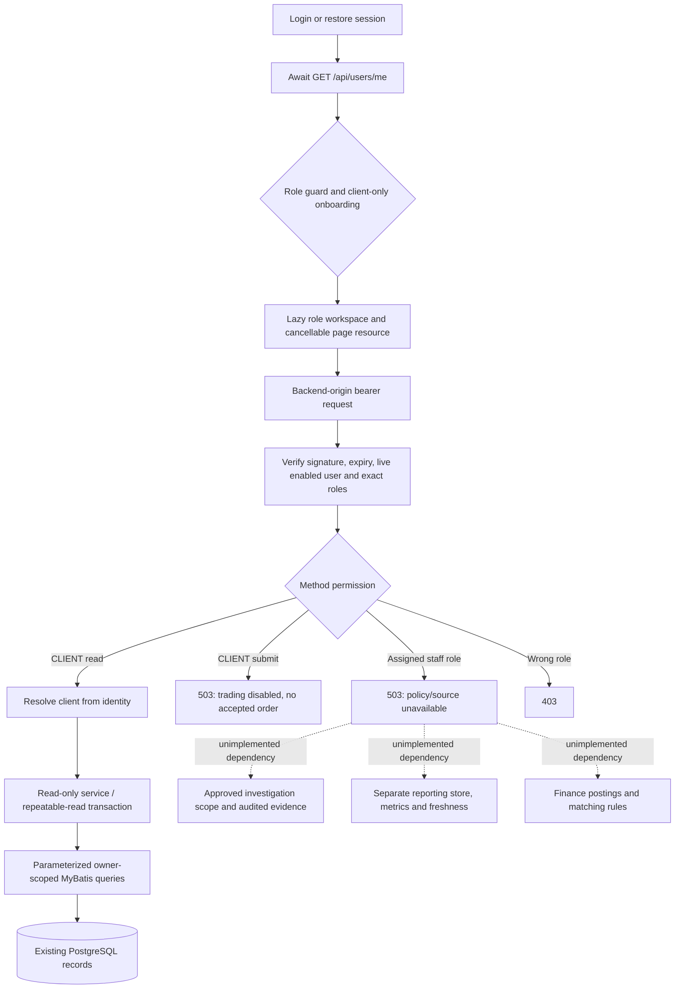
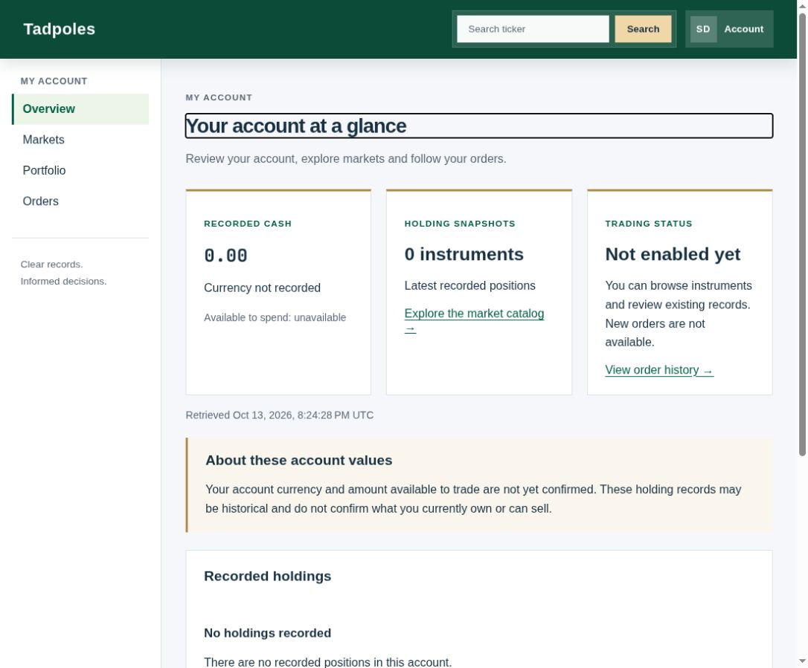
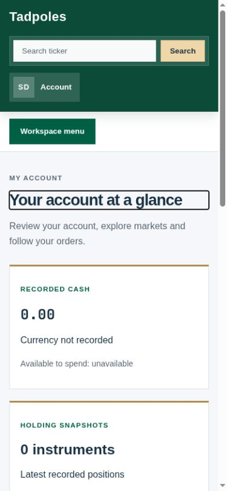

> **Current implementation:** See the [provider-backed USD trading guide](../ClientPageImplementation/ClientRefactorCrashCourse.MD) for startup, banking, execution, roles and recovery. The material below is historical implementation evidence and may describe retired behavior.

# Separate role workspaces — implementation record

## 1. Baseline — 13 October 2026

Read `RolePageFullInstruction.MD` in full before edits. Initial checkout has unrelated untracked `HailMary.md`, `RolePage.MD`, `RolePageFullInstruction.MD`, and `impDocs/FrontendFeatures/`; preserve these. No AGENTS.md was found. Source inspection confirms Angular 22 standalone/signals, Spring Boot 3.3.5/MyBatis/Java 17, PostgreSQL initialization, and separate H2/PostgreSQL tests.

| Area | Observed baseline | Required change/status |
|---|---|---|
| Identity | Login always fetches client profile; restored local session trusted | Authoritative `/api/users/me`, role collection, awaited restoration |
| Routes | One client shell, no staff guards | Five role groups, lazy pages, child guards, safe redirects |
| Client data | Dashboard/history sample values | Real identity-scoped reads and explicit currency limitations |
| API security | Authenticated non-client bypass; client writes accept financial fields | Positive read permissions; admin-only legacy mutations; mixed-role ownership |
| Sessions | JWT role claims valid for one hour | Check live enabled state/membership before privileged requests |
| Orders | Mutable legacy trades and transactional fill, no durable attempt contract | Trading disabled by user pending policies; do not claim acceptance/execution capability |
| Investigations | No scope/purpose policy | Deny data until user supplies policy; typed unavailable contract |
| Analytics | No OLAP store | Reporting boundary unavailable; never aggregate live records |
| Finance | No posting evidence/matching rules | Unavailable until genuine source/rules supplied |
| DB tests | Schema resolver names missing `tadpoles_schema.sql` | Reproduce and repair path; run isolated PostgreSQL |

Native Java/Maven/Node/npm absent. Docker exists but sandbox socket access requires escalation; approved Docker invocation works. Backend baseline and locked frontend install/test launched in disposable Maven/Node containers; results pending. Logs under `/tmp/tadpoles-test-logs/`.

## 2. Business decisions received

User explicitly selected **keep trading disabled until instrument, currency and execution policies are supplied**. No synthetic execution, currency assignment, venue rules or accepted receipts will be introduced. User will provide staff policies and reporting/reconciliation sources; requested precise scope/purpose/source/metric/matching inputs. Independent implementation continues, with unavailable boundaries pending those inputs. Exports remain disabled by default.

## 3. Policy reference and first regression test

Read HailMary role matrix (§2), data boundaries (§6), and decision register (§15). D-11 exact permissions, D-15 metrics/freshness, D-22 exports, and Finance-approved matching rules remain unresolved in that reference itself. Its proposals do not configure account scopes or a reporting datasource. User's trading-disabled instruction remains controlling.

Added `WorkspaceAuthorizationTest`: staff cannot read client records through legacy APIs; six workspace/legacy roles cannot post/patch financial records; a mixed CLIENT/FINANCE identity can read its own history but not another client's. Paired existing ADMIN tests preserve restricted legacy administration (not exposed by workspace navigation). Test run pending.

Frontend baseline: `npm ci && npm test -- --watch=false` under Node 22 container **64 tests passed**. Automatic approval review rejected Docker socket + host networking inside Maven. Safer alternative: dedicated disposable PostgreSQL database on a private Docker network, explicit isolated-test URL, no socket mount. Testcontainers remains default outside this restricted environment.

## 4. Authorization foundation and client read contracts

Changed old client/cash/holding/trade reads to positive CLIENT/ADMIN checks and writes to ADMIN without CLIENT. CLIENT ownership still applies to mixed identities. Removed ANALYST from identifiable advisor/subscription/suggestion APIs and legacy model portfolio routes. Existing pure ADMIN operational endpoints remain solely for backward compatibility, outside all five workspaces; this does not introduce staff trading privileges. Live JWT validation checks persisted enabled status and exact membership, rejecting obsolete role claims before method authorization. Role replacement is now transactional.

Added name-based TRADING_OPS/FINANCE seeds and repeatable migration `database/migrations/003_workspace_roles.sql`; OPERATIONS is not aliased. Added indexes for scoped chronological reads and latest snapshots. Run migration on existing volumes; clean initialization runs identical `database/schema/003_workspace_roles.sql`. Recovery: prefer a forward fix. Do not roll back the security hardening with active staff credentials: older code has a non-client bypass. If binary rollback is necessary, disable the new staff identities and rotate the JWT signing key before exposing the old application. Additive role metadata/indexes can remain; remove only unassigned new roles/indexes after verifying dependencies. Never reset real data.

New identity-bound `/api/orders`, `/api/orders/{id}`, `/api/workspace/client/portfolio`, catalog and trading-availability contracts use records, a service interface/implementation and parameterized MyBatis queries. Count and page apply identical owner/filter predicates; repeatable-read prevents count/page drift. Catalog and orders are server paginated (20 default, 100 maximum). All record IDs are database IDs. No browser-supplied client ID is accepted by these new reads.

Scalar cash remains currency-unknown, available values null. Latest snapshot selection uses date then ID, never a sum. Important legacy limitation: full-sale deletion can expose an older snapshot, so views label these recorded snapshots and do not certify current or sellable ownership. Trading remains disabled by both UI and POST /api/orders (503; no accepted order). Existing trades have INCOMPLETE_LEGACY provenance; no timestamps, fills or quotes are backfilled.

First authorization test attempt reached unconfigured service mocks (null DTO errors), demonstrating unexpected access but not clean assertion failures; it is not claimed as a valid TDD red result. Baseline backend failed 67 tests because required environment placeholders were absent. Added test-only application properties for deterministic port/provider configuration; no production settings weakened. Full regression result under investigation.

## 5. Identity and UI implementation

Auth now awaits `/api/users/me`, retains role collections, preserves username case, loads profile only on entering client context, and revalidates restored sessions. Old/expired/malformed storage is removed. Session generation/cancellation prevents prior-account requests repopulating identity/profile/page state. Profile PII is no longer persisted by new requests. Backend-origin interceptor handles 401 by reauthentication and leaves valid 403 sessions intact. Local sign-out does not revoke an issued access JWT; server expiry and membership checks apply, and full session revocation remains an enhancement.

Separate authenticated lazy routes cover all five workspaces; child guards enforce each navigation; CLIENT onboarding does not gate staff routes for mixed identities. Internal return URLs use supported route patterns and role permission. Protected routes are client-rendered. Shared role-filtered sidebar, mobile menu, page headings/focus, retry/error component and order table reuse existing design tokens, loading indicator and chart. Legacy symbol links resolve against catalog IDs before quote/candle rendering; unknown symbols show unsupported state.

Staff endpoints enforce their role and return 503 with a truthful setup explanation. They do not load client data or the trading datasource. These are tested availability boundaries, **not completed investigation/reporting/reconciliation capabilities**. No fake reports, counts, financial zeros or downloads.

## 6. Casual-trader usability review (initial design assessment)

The original all-in-one dashboard was unsuitable: sample financial values looked authoritative, alert-only submission implied success, and unrelated actions competed for attention. Chosen design: four clear client destinations (Overview, Markets, Portfolio, Orders), short summaries, explicit browsing-only state and instrument names next to symbols. Reasons:

1. Fewer simultaneous decisions and a predictable navigation path reduce cognitive load.
2. Recorded/unknown/available distinctions prevent users mistaking unverified money or positions for spending power.
3. Separate order references and detail explanations make outcomes easier to investigate without interpreting color or charts.
4. Plain-language unavailable states prevent repeated attempts at disabled trading; no dead password-reset/MFA controls.
5. Keyboard labels, visible focus, 44px controls, mobile navigation and horizontally scrollable tables support casual use across devices.

Alternatives considered: a dense trading terminal (too much detail for casual users); tabs on one dashboard (poor independent navigation and error isolation); hiding unavailable capabilities entirely (would conceal setup gaps). Chosen pages retain compact context and disclose limitations where decisions occur. Visual/browser verification still pending; no accessibility certification claimed.

## 7. Verification checkpoint and demo provisioning

Backend regression: **298 tests passed**, zero failures/errors/skips. Includes existing H2 transactional fill tests, new scoped mapper reads, current membership validation, direct staff/CLIENT write denials and staff 503 boundaries. PostgreSQL: **13 tests passed**, zero failures/errors/skips, including actual schema constraints/business-flow queries, repeatable upgrade preserving OPERATIONS assignments, and clean-init equivalence. This is real PostgreSQL 16 on an isolated Docker network; no socket is mounted in the Maven container. New execution/idempotency/concurrency behavior is not claimed because trading remains disabled and no new booking workflow was implemented.

Frontend production build passed with zero prerendered personal routes. First regression attempt caught a TypeScript error in a new test's platform argument, fixed by injecting PLATFORM_ID. Next run had 84 passing/7 failing tests: old app tests trusted unvalidated storage and expected the retired dashboard route, and market-service mocks lacked the new cancellation observable. Updated those mocks and expectations to the documented identity/bootstrap and catalog-ID contracts; preserved their original HTTP/quote assertions. Rerun pending.

Optional `database/demo/role_workspaces.sql` creates six local test accounts using BCrypt and role-name joins. It is intentionally outside automatic schema initialization and production migrations. A new, isolated `tadpoles_roles_demo` database was created and seeded for the browser walkthrough. Both client accounts begin with genuine zero posted cash and no fabricated history. Existing deployment volumes were not touched. Credentials are non-sensitive local test credentials only.

## 8. Browser and usability checkpoint

Real production-bundle browser walkthrough against the separate demo DB: Client login → overview → orders → reload passed; direct `/finance/overview` denied for CLIENT. Operations, Compliance, Analyst and Finance logins all reached their correct workspace, with staff ticker/profile/history controls absent. Compliance evidence navigation and browser Back passed. Finance → `/app/orders` denied. Switching Finance → second client showed **Second Demo Client**, without the old staff identity.

An apparent unresponsive login was traced to the Codex browser annotation overlay covering the page (`codex-browser-sidebar-comments-root`); Escape dismissed it and login worked. This was browser tooling interference, not an application failure. At narrow viewport, Finance menu opened using Enter, its Reconciliation link navigated and collapsed the menu, and document scroll width equaled viewport width (375 CSS px). Screenshot saved in `screenshots/finance-workspace.jpg`. Automated suites do not establish full WCAG compliance.

Visual review led to a further wording refinement: replace engineering language about snapshot deletion with plain language explaining that historical holdings do not confirm present ownership. Keep exact technical reasons in this record. Login button/link now use dark green for stronger text contrast. An additional cancellation guard prevents delayed profile errors/loading flags from repopulating a switched account. Added tests for actual signed-token expiry/role removal/disable and catalog error/retry/cancellation.

Demo catalog now optionally seeds two real instrument descriptions for browsing, explicitly not approved execution instruments. Demo cash/history remain empty, not synthetic booked trades. `scripts/test-role-workspaces.sh` provides repeatable container-only backend/PostgreSQL/frontend checks with a dedicated test DB, validated readiness, no socket mount, and cleanup of only its own newly created containers/network.

## 9. Final polish and verification investigation

Browser instrument inspection found two usability issues: duplicate page headings from the reused chart view, and a numeric database-ID filter unsuitable for casual traders. The embedded chart now omits its duplicate heading; instrument page headings exist during loading for focus. Replaced the numeric filter control with “Your orders for [symbol]” on instrument details and a clear-filter control in Orders, retaining the same scoped instrumentId API query. Fixed skip-to-content so the base URL cannot send the user back to root. Malformed role arrays with non-string members now fail closed.

The additional real-token test initially failed because StaticListableBeanFactory does not support the ObjectProvider lookup used by the production bean. This was a test fixture error; replaced it with DefaultListableBeanFactory and retained the signature/expiry/disabled/removed-role assertions. It was not counted as a successful final regression. Final rerun pending.

## 10. Final regression and contract map

The complete `./scripts/test-role-workspaces.sh` rerun exited successfully on 13 October 2026: **299 backend tests, 13 PostgreSQL tests, 95 frontend tests**, zero backend/database failures, errors or skips. Frontend style check and production build also passed; zero personal routes prerendered. Actual log: `/tmp/tadpoles-test-logs/final-suites-2.log`. `python3 scripts/smoke-role-workspaces.py` also passed **46 live HTTP assertions** against the isolated local demo: both clients, each staff login/identity, owned/cross-client reads, old financial mutation denial, new trading 503, unknown order and invalid filters. These are functional/security checks, not load, penetration or accessibility certification.

| Browser routes | Role | API / actual behavior |
|---|---|---|
| `/login`, `/signup`, `/register` | Public | `/auth/login`, `/auth/signup`; register aliases signup; public creation remains CLIENT only |
| `/onboarding`, `/profile` | CLIENT | Existing `/api/users/me/profile`, `/api/users/me/onboarding` |
| `/` | Authenticated | `/api/users/me` then deterministic CLIENT → TRADING_OPS → COMPLIANCE → ANALYST → FINANCE landing; no implicit ADMIN alias |
| `/unauthorized`, `/not-found`, `/session-error` | Shared | Denial, missing-route and identity retry/reauthentication states |
| `/app/overview`, `/app/portfolio` | CLIENT | `/api/workspace/client/portfolio`; real posted cash, unknown account currency/available cash, recorded holding snapshots |
| `/app/markets` | CLIENT | `/api/workspace/client/instruments`; paged/searchable catalog, not execution approval |
| `/app/instruments/:id` | CLIENT | `/api/instruments/:id`, trading-availability, existing quote/candle APIs |
| `/app/trade/:instrumentId` | CLIENT | Availability only; disabled Buy/Sell; `POST /api/orders` always 503 with no acceptance |
| `/app/orders`, `/app/orders/:id` | CLIENT | `GET /api/orders`, `/api/orders/:id`; identity-scoped paging/filtering and legacy evidence |
| `/trades`, `/trade/:symbol` | CLIENT | History redirect; exact catalog symbol resolution to database ID or unsupported state |
| `/operations/orders`, `/operations/orders/:id` | TRADING_OPS | Matching `/api/operations/orders` endpoints; authorized 503 until investigation policy exists |
| `/compliance/investigations`, `/compliance/investigations/:id`, `/compliance/evidence` | COMPLIANCE | `/api/compliance/investigations`, `/api/compliance/orders/:id/evidence`, `/api/compliance/evidence`; authorized 503, exports disabled |
| `/analytics/overview`, `/analytics/trends`, `/analytics/instruments` | ANALYST | `/api/analytics/summary`, `/trends`, `/instruments`; 503, no live-table aggregation. `/api/analytics/freshness` also unavailable |
| `/finance/overview`, `/finance/reconciliation` | FINANCE | `/api/finance/summary`, `/reconciliations`; 503 until genuine postings and matching rules exist |

Shared components: authenticated shell/navigation, `PageResource` request/session cancellation, `RequestStateComponent` error/retry/loading, `OrdersTableComponent`, staff availability page, recovery message page and existing quote/candle chart. All protected data calls use the shared API URL builder. Orders use `client_trades.trade_id` as `orderId`; this is a legacy record reference, not a new durable acceptance receipt. PENDING/APPROVED/REJECTED/EXECUTED remain exactly recorded statuses, not remapped to proven lifecycle events. Dates are displayed as recorded; legacy execution timestamps have no timezone. Currency is per instrument where known; scalar cash is never assigned a guessed currency. `docs/api.yaml` now describes actual `/api` controller paths and workspace contracts; removed previously advertised nonexistent dashboard/global-trade/reporting contracts. Parsed successfully with the existing SnakeYAML dependency (51 paths, 73 schemas).

## 11. Local access, setup and recovery

The demo is running at **http://localhost:4000/login**, API on loopback port **8082**. All accounts below use the non-sensitive, local-only password **`RoleDemo2026!`**:

| Username | Role | Default page |
|---|---|---|
| `demo.client` | CLIENT | `/app/overview` |
| `demo.client2` | CLIENT | `/app/overview` (separate client for isolation checks) |
| `demo.operations` | TRADING_OPS | `/operations/orders` |
| `demo.compliance` | COMPLIANCE | `/compliance/investigations` |
| `demo.analyst` | ANALYST | `/analytics/overview` |
| `demo.finance` | FINANCE | `/finance/overview` |

The optional seed is `database/demo/role_workspaces.sql`; apply only to a designated development database after schema initialization and role migration. It is repeatable and does not overwrite existing passwords. No real credentials, tokens or personal records are included here. Production staff provisioning uses existing controlled ADMIN APIs and approved roles, not public signup or this seed.

Current demo runs in `tadpoles-role-demo-frontend`, `tadpoles-role-demo-backend`, and `tadpoles-role-test-db` on private network `tadpoles-role-tests`. Database `tadpoles_roles_demo` is distinct from the disposable regression database and existing deployment data. Stop these exact demo containers with `docker stop tadpoles-role-demo-frontend tadpoles-role-demo-backend tadpoles-role-test-db`; resume DB first, then backend/frontend with `docker start`. Data persists in the DB container until it is removed. No external market-data provider is configured in this demo: quote/chart errors are intentional unavailable states, not sample prices.

For another local database: run the existing schema setup, then `psql -d YOUR_LOCAL_DEMO_DB -f database/migrations/003_workspace_roles.sql` and `psql -d YOUR_LOCAL_DEMO_DB -f database/demo/role_workspaces.sql`. Use existing backend DB/provider/JWT configuration and the shared frontend API configuration; do not copy demo signing keys into deployment. Clean installations already include the identical role migration in the schema folder. Native verification alternatives are `mvn -f backend/pom.xml test`, `mvn -f testing/pom.xml test` (Docker/Testcontainers), and from `frontend`, `npm ci`, `npm test -- --watch=false`, `npm run test:qof-styles`, `npm run build`.

## 12. Acceptance gaps and next required inputs

Separate pages, identity bootstrap, role navigation/guards, server permissions, safe client reads and tested migrations are implemented. **The full trading-platform business acceptance is not complete.** The following cannot be represented by these availability pages:

- **Product/market owner:** exact approved instruments, quantity/price rules, provider or simulation mode, market calendars, currencies and execution policy. User explicitly directed trading to remain disabled. Durable acceptance, idempotency/recovery, authoritative execution, atomic new-order booking and rejection evidence are unimplemented in this feature; old ADMIN fill compatibility is not their replacement.
- **Account/finance owner:** currency migration, reservations/available cash and reliable current positions. Historical snapshots cannot certify present ownership; no fabricated gains, portfolio value or buying power.
- **Operations/Compliance owner:** HailMary D-11 scopes, identifiable fields, approved purposes and auditable evidence access; D-22 export/redaction/retention rules. Until supplied, investigation and export capabilities remain unavailable.
- **Reporting owner:** HailMary D-15 separate reporting connection, metric/segment definitions, extraction pipeline and freshness target. No reporting source or freshness is configured; no live transactional fallback.
- **Finance owner:** posting source, reconciliation scope and approved matching/tolerance rules. No reconciled totals, exceptions, fees or journals are invented.
- **Session owner (enhancement):** lifetime/revocation policy. Current live-role/disabled-user checks and expiry work; browser logout does not revoke already issued access JWTs. Automatic order polling, enhanced quote freshness and optional impact preview remain unimplemented enhancements.

Casual-trader assessment: the revised navigation and language are usable for browsing and reviewing recorded data, but this is **not yet a usable trading journey** because of the explicitly disabled trading and unverified account amounts. After the policies are supplied, the next design should use a short instrument → side/quantity → review → receipt flow, show currency and quote time beside the amount, reveal fees/available funds before confirmation, and keep the stable receipt visible during delayed outcomes. These choices reduce recall, make financial consequences visible before action and avoid interpreting a spinner as acceptance. A compact “what needs attention” summary should replace dense charts on Overview; charts belong on instrument details. Do not add these financial summaries until their source contracts are authoritative.

## 13. Final browser handoff

Packaged the tested backend and restarted only the two demo application containers. Reload during backend startup correctly showed the identity retry screen; **Try again** returned to the originally requested instrument after startup, preserving the return URL. Verified the new plain-language account limitation on the live page. Both ticket buttons reported disabled. The “Your orders for AAPL” link navigated to `?instrumentId=1`, with clear-filter and genuine empty state. `/trade/AAPL` resolved to catalog ID 1; `/trade/ZZXX` displayed “Symbol not supported.” A malformed underscore-containing route was rejected by the route policy. Two browser wait checks initially used mistaken text selectors (“Your orders” and “Posted cash”); inspection confirmed the actual headings are “Orders” and “RECORDED CASH,” and the pages had loaded correctly.

Client phone layout measured **375px viewport and 375px document width**, with no document overflow. Reset the temporary viewport after saving `screenshots/client-mobile.jpg`. Saved desktop `screenshots/client-overview.jpg`; the visible heading outline is intentional keyboard/programmatic focus. The browser is left on the client Overview. Reran live HTTP smoke checks after restart: **46 passed**. Final `git diff --check` passed. No production data, unrelated Markdown files or existing deployment volumes were changed; no commit was created.

