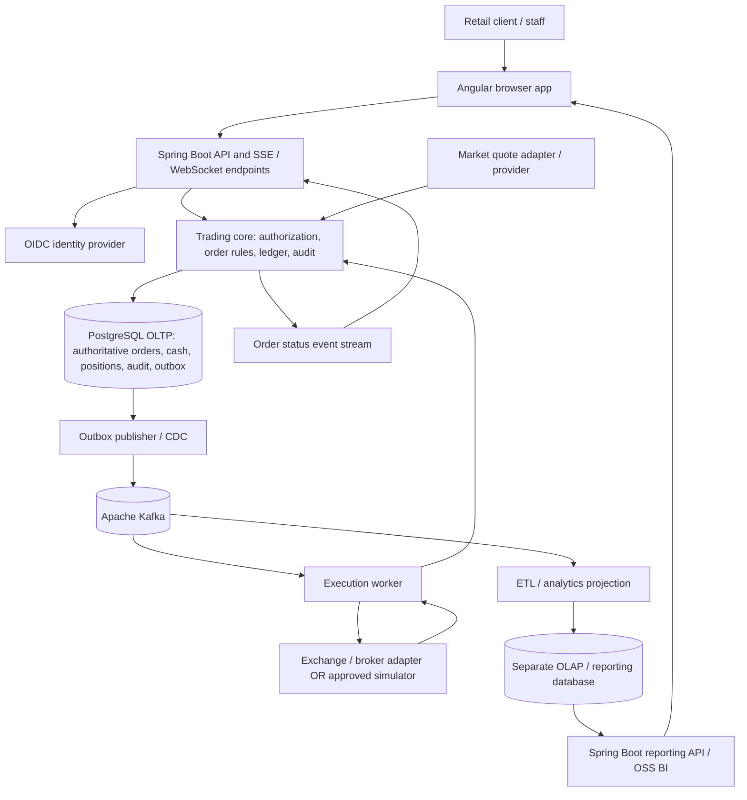
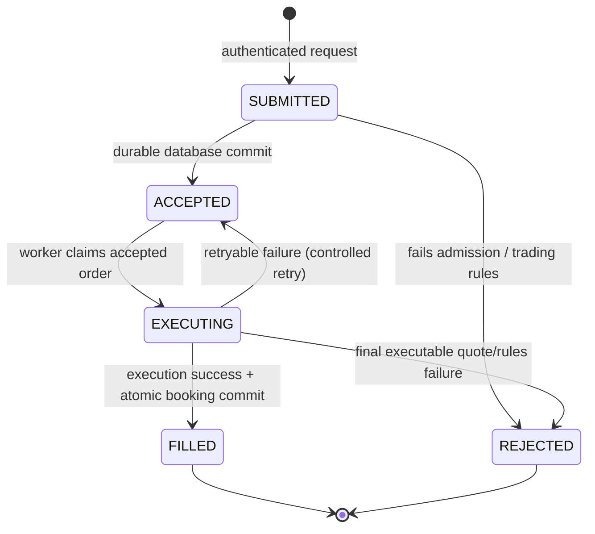
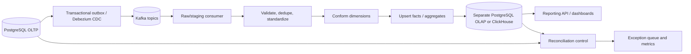

# LEAP — Comprehensive Requirements, Architecture and Implementation Guide

> **Project:** LEAP — Direct-to-Consumer Trading Platform  
> **Primary source:** *LEAP Project Business Requirements Specification*, `LEAP-BRS-2026-014`, version 0.9, draft for delivery partner response, 6 pages (the supplied PDF).  
> **Document purpose:** Turn the business brief into a sufficiently detailed, testable engineering and delivery reference while making assumptions, design recommendations and unanswered business questions visible.  
> **Technology baseline:** PostgreSQL, Java/Spring Boot and Angular. Existing supplements: Apache Kafka, Jenkins and SonarQube.  
> **Status:** Proposed implementation specification; **not** a substitute for sponsor sign-off, legal advice, trading-desk approval or the original business requirements.

---

## How to read this document

The PDF describes **what the firm needs**, deliberately leaving implementation to the delivery team. This guide therefore uses three labels consistently:

- **[SOURCE / Must, Should]** — explicitly requested by the supplied LEAP brief, keeping the original `BR-01` through `BR-18` identifiers and priorities. Source sections/pages are noted where useful.
- **[PROPOSAL]** — a recommended way to achieve the requirement, including architecture, screens, APIs, tables, safeguards, tests, deployment and additional roles. It is **not** an existing business mandate until approved.
- **[DECISION REQUIRED]** — the source does not supply enough detail; the trading desk, Risk/Compliance, sponsor or another named owner must choose a rule and record the choice before implementation/release.

**Source priority meanings:** **Must** = indispensable to business objectives; **Should** = expected unless omission is justified; **Could** = desirable if time allows. **Do not** quietly promote a proposed feature to a source requirement. A demo/simulator may prove architecture but must not be represented as live production market execution without approved providers, legal approvals, account arrangements and operational readiness.

### Navigation

1. [Project understanding and scope](#1-project-understanding-and-scope)
2. [Actors, roles, authorization and Angular screens](#2-actors-roles-authorization-and-angular-screens)
3. [Candidate system architecture](#3-candidate-system-architecture)
4. [All business requirements BR-01 to BR-18](#4-detailed-business-requirements-br-01-to-br-18)
5. [Buy/sell orders, execution and money/position integrity](#5-buy-sell-orders-execution-and-moneyposition-integrity)
6. [OLTP, OLAP and data architecture](#6-oltp-olap-and-data-architecture)
7. [ETL/ELT and reporting pipelines](#7-etlelt-and-reporting-pipelines)
8. [Audit, evidence and retention](#8-audit-evidence-and-retention)
9. [Security, operational service levels and usability](#9-security-operational-service-levels-and-usability)
10. [API and frontend implementation contracts](#10-api-and-frontend-implementation-contracts)
11. [Market data, pricing and supported instruments](#11-market-data-pricing-and-supported-instruments)
12. [Open-source technology choices and CI/CD](#12-open-source-technology-choices-and-cicd)
13. [Verification, test strategy and acceptance](#13-verification-test-strategy-and-acceptance)
14. [Delivery phases, deliverables and risks](#14-delivery-phases-deliverables-and-risks)
15. [Decisions, traceability and final readiness checklist](#15-decisions-traceability-and-final-readiness-checklist)
16. [Glossary and references](#16-glossary-and-references)

---

# 1. Project understanding and scope

## 1.1 Business situation and goal

**[SOURCE — PDF §§1–3, p.1]** The firm currently executes client trades through a telephone dealing desk and relationship managers. LEAP introduces **self-directed, direct-to-consumer trading**: a retail client signs in, places an order without staff intervention and sees the outcome in holdings and order history. There is **no existing direct-trading system to migrate**. The system must replace the pre-trade judgment formerly performed by a human dealer with explicit, reliable checks.

Four stated objectives govern design decisions:

1. A client can complete the register → sign-in → order → outcome journey without staff acting on their behalf.
2. Each order and outcome has a complete, trustworthy, independently inspectable history.
3. Trading activity can be analysed without analytics slowing down live orders.
4. New capabilities can be added without wholesale redesign.

**[SOURCE — PDF §6, p.3]** Key personas: **Joanna** (time-constrained self-directed investor who needs a fast, understandable trading experience), **David** (head of trading operations who investigates disputes without asking engineers to reconstruct logs) and **Priya** (commercial analyst who needs consistent monthly reporting away from production trading workloads).

## 1.2 In scope — original baseline

**[SOURCE — PDF §4.1, pp.1–2]**

- Client registration and secure sign-in.
- Buy/sell order submission, validation, execution-time pricing and execution for equities in the **UK, US and India**, **foreign exchange (FX)** and **crypto assets**.
- Current client holdings, cash balances and chronological order/fill history (the **blotter**).
- Durable, attributable, auditable records of orders, prices and outcomes.
- Internal historical trading reports separated from live trading.
- One additional, justified value-adding capability to be proposed and built by the delivery team (also `BR-18`, **Should**).

## 1.3 Explicitly out of scope for the initial phase

**[SOURCE — PDF §4.2, p.2]**

- **Advised or discretionary trading.** Existing phone dealing remains unchanged; a relationship manager placing client orders is **not** part of the self-service LEAP transaction flow.
- Full client onboarding/KYC/identity verification beyond working sign-in; a representative sign-in fixture will be provided. **This does not waive secure authentication or registration requirements**—the team must explain what is real, mocked and not production-ready.
- Real deposit/withdrawal, card, payment or bank connectivity. Cash movements are **modelled inside LEAP**; no real-money transfer integration is required at launch.
- Native iOS/Android apps; target is a **desktop-browser-first** web application. Responsive web layout is sensible, but native apps are not required.

**[PROPOSAL]** Treat deposits of test cash, initial positions and account setup as **controlled seed/setup processes**, never as an unrestricted client-facing “add money” button. Scope of live exchange/broker execution versus simulated execution is **not defined** in the PDF and must be explicitly agreed.

## 1.4 Stakeholders, ownership and governance

**[SOURCE — PDF §5, p.2]**

| Stakeholder | Source responsibility | Design/acceptance role proposed |
|---|---|---|
| Programme Sponsor / Head of Digital Distribution | Business case and final sign-off | Approves scope, trade-offs, additional feature and release |
| Retail Client | Places orders and views holdings | Usability testing, self-service journey acceptance |
| Trading Desk / Trading Operations | Defines trading rules | Approves accepted instruments, validations, market-hours and execution behaviour |
| Risk & Compliance | Audit, records and regulatory alignment | Signs off evidence, control design, permissions and retention policy |
| Finance | Reporting on trading and cash | Approves ledger/reconciliation/report definitions |
| Delivery Partner | Builds and presents the platform | Supplies design, roadmap, demonstrable system, tests, operational handover |
| Commercial Analyst (persona Priya) | Historical insight consumer | Signs off dimensions, metrics, quality and report usability |

Stakeholders listed in the source are **not automatically software login roles**. The exact separation is explained below.

## 1.5 Conditions for project success

**[SOURCE — PDF §§9, 11, pp.5–6]** Demonstrate end-to-end registration, sign-in, order and refreshed holdings/blotter; trace any trade without manual reconstruction; show reporting independent of live trading; give a business-grounded explanation of architecture. The system must remain correct during restarts, failed deployments and partial failures, remain available during market hours, feel responsive and protect confidential financial information. Records must not be lost, duplicated or edited after the fact.

**Important distinction:** “Order accepted” is **not** the same as “order filled”; “order filled” is **not automatically equivalent** to legal settlement at an exchange. The source glossary describes a fill as causing cash and position changes, but exchange settlement and clearing rules are unspecified. The implementation must name precisely which event LEAP treats as its internal booking/settlement event.

---

# 2. Actors, roles, authorization and Angular screens

## 2.1 Does LEAP actually need client, advisor, analyst and admin?

**Yes to clients, analysts and several kinds of internal oversight; not necessarily to advisors.** The brief explicitly requires **clients**, internal **Trading Operations**, **Risk/Compliance** and **Finance** interests, and an **analyst persona**. It does **not** specify an “advisor” user role. In fact, *advised/discretionary dealing is out of scope*. An **administrator** is a useful operational implementation role but not a source-stated user journey. Making every internal person an all-powerful “admin” would undermine the least-privilege requirement.

Use **RBAC** (role-based access control) for broad permissions and **object-level authorization** (the user’s identity/account ownership) for sensitive records. A role by itself does not establish which client records somebody can access.

## 2.2 Proposed roles — necessity, responsibilities and limits

### R1 — Retail Client **[REQUIRED, source-grounded]**

**Purpose:** Manage **their own** self-directed investments.

**Frontend:** Register, sign in/out; dashboard; available/held cash by currency; holdings; instrument search/details; indicative quote; buy/sell order ticket; order confirmation with unique ID; live order status; personal blotter and fill details; user session management; understandable empty/error/loading states.

**Backend:** May only create/read orders scoped to their authenticated account; read own balances, positions, order events and allowed quote data. No route accepts a client ID from the browser as proof of authorization. The account must be derived from the access token and verified against the resource owner.

**Disallowed:** View another client, edit fills, override risk checks, execute staff actions, read other accounts’ reports, change product tradability or alter audit records.

### R2 — Trading Operations / Trading Desk **[REQUIRED BUSINESS CAPABILITY; proposed login role]**

**Purpose:** Monitor the trading platform and independently explain any order outcome.

**Frontend:** Operational dashboard; filter orders by order ID, time, instrument, status and permitted account reference; order-lifecycle timeline; execution and quote decision detail; failed/rejected order queues; connector health; read-only reconciliation status; controlled export of evidence with reason for access.

**Backend:** Read designated operational views and approved client-level evidence; manage narrowly authorized instrument-trading controls only if business-approved. **No default ability** to place or silently change client orders or balances. If manual interventions ever become necessary, they require a separate, explicitly approved requirement, dual control and full audit.

**Out of scope:** Handling discretionary telephone orders through this new client UI.

### R3 — Risk & Compliance Officer / Auditor **[REQUIRED BUSINESS CAPABILITY; proposed login role]**

**Purpose:** Inspect immutable evidence and verify operational/regulatory controls.

**Frontend:** Investigation search by order ID, time and client reference; tamper-evident full event timeline; actor/time/price/quote evidence; access logs; reconciliation exception dashboard; permitted evidence export and verification manifest; policy/retention dashboard if approved.

**Backend:** Read audit and client-sensitive evidence strictly by authorization and documented purpose. No edit/delete of order history or ledger. May require dual approval for unusually broad exports. **An external regulator is not automatically an application user**; supervised evidence export may be safer and is a decision for Compliance.

### R4 — Commercial / Business Analyst **[REQUIRED BUSINESS CAPABILITY; proposed login role]**

**Purpose:** Analyse trading trends without touching the OLTP write path.

**Frontend:** Analytics dashboard with filters for date range, market, instrument type and approved client segment; volumes, activity over time, most-active instruments; chart/table views; permitted aggregate export; data freshness indicator.

**Backend:** Query **OLAP only** via a reporting API or approved BI tool; do not grant production PostgreSQL transactional access. Default to aggregate/pseudonymised data; client-level analysis needs separate policy.

### R5 — Finance / Reconciliation Analyst **[REQUIRED BUSINESS CAPABILITY; proposed login role]**

**Purpose:** Verify cash, fills, journals and reporting totals.

**Frontend:** Cash movement summaries by currency, fee totals (if fees exist), trial balance/reconciliation exceptions, booked fills, data-as-of information and permitted accounting exports.

**Backend:** Read the ledger and controlled reconciliation views; no ability to credit cash casually, modify a posted trade or reclassify records without a formal adjustment workflow.

### R6 — Platform / IAM Administrator **[PROPOSAL; not source-defined]**

**Purpose:** Operate the software and identity system without exercising trading authority.

**Frontend:** Service/health indicators, role assignment request and approval status, user session revocation, approved user enable/disable, integration configuration status; optionally a separate operator portal.

**Backend:** Manage users, application roles, deployment/configuration within assigned duties; **no blanket rights** to see client transactions, impersonate clients, initiate trades or edit ledgers. Protect privileged operations using strong authentication, separate staff identities and recorded approvals.

### R7 — Programme Sponsor / Executive **[OPTIONAL login; stakeholder is source-defined]**

May consume high-level aggregate dashboards and approve release decisions outside LEAP. A distinct application role is **not necessary** unless reporting access is requested.

### R8 — Customer Support / Service Desk **[OPTIONAL, requires approval]**

Potentially read a highly redacted order-status view to respond to support requests. No cash edits, delegated trading or unrestricted identity data. This is **not** an original requirement; omit from MVP until needed.

### R9 — Advisor / Relationship Manager **[NOT REQUIRED FOR PHASE 1]**

Relationship managers exist in the **current business**, but the document explicitly excludes advised dealing. Do **not** expose “trade on behalf of client,” client impersonation, delegated consent, advisor commissions, or discretionary portfolios as phase-one requirements. If someone wants advisor read-only visibility or future advisory trading, create a separately approved scope item with client consent, compliance and segregation controls.

### R10 — Execution Worker and ETL Worker **[TECHNICAL SERVICE IDENTITIES, NOT HUMAN FRONTEND ROLES]**

These are machine-to-machine principals with scoped database/topic access. They must not log in to Angular, share human passwords or possess general administrative privileges.

## 2.3 Access-control matrix (proposed default)

Legend: **Own** = current authenticated client/account only; **R** = allowed read; **A** = controlled admin/configuration; **—** = not granted; **Conditional** = requires documented purpose/approval. Server enforces all cells.

| Capability | Client | Trading Ops | Risk/Compliance | Business Analyst | Finance | Platform Admin | Advisor phase 1 |
|---|---|---|---|---|---|---|---|
| Registration/sign-in | Own | Staff login | Staff login | Staff login | Staff login | Staff login | — |
| Submit buy/sell order | Own | — | — | — | — | — | — |
| Own balances/positions/blotter | Own | Conditional R | Conditional R | — | Conditional R | — | — |
| All operational order statuses | — | R | R | — | Limited R | — | — |
| Full audit timeline and quote evidence | Own summary | R | R | — | Relevant R | — | — |
| Aggregate OLAP reports | — | Limited R | Limited R | R | R | — | — |
| Finance reconciliation | — | Read exceptions | Read exceptions | — | R | — | — |
| Instrument tradability configuration | — | Conditional A | Approval only | — | — | Technical deployment only | — |
| Create/revoke user access | Own session only | — | Review log | — | — | Controlled A | — |
| Read privileged access logs | — | — | R | — | — | Operational limited R | — |
| Rewrite booked trade/audit event | — | — | — | — | — | — | — |

**Segregation of duties:** No single normal UI role should both initiate an unauthorised correction and approve it. Production database break-glass operations, if any, must be tightly limited, time-bounded, monitored and independently reviewed; they must not bypass evidence collection silently.

## 2.4 Angular page map and navigation

| Route (illustrative) | Screen | Main capabilities | Guards |
|---|---|---|---|
| `/register`, `/login` | Identity | Register/sign in, feedback, password reset if identity provider supports it | Public |
| `/app/overview` | Client overview | Cash and holdings snapshots, last update time, recent orders | `CLIENT` plus ownership |
| `/app/markets` | Instrument directory | Search instrument symbol/name, market hours, status, quote freshness | Authenticated client |
| `/app/instruments/:id` | Instrument details | Indicative bid/ask and market context | Client; approved data entitlement |
| `/app/trade/:instrumentId` | Order ticket | Side, quantity, currency, quote/fees, preview, submit | Client; authoritative server validation |
| `/app/orders` | Client blotter | Own orders and fills, states, pagination/filtering | Client plus ownership |
| `/app/orders/:id` | Order details | Time-ordered status, execution quote, fills, reason for rejection | Client plus ownership |
| `/operations/orders` | Trading operations | Search/triage, details, redacted client identifiers | Trading Ops |
| `/compliance/investigations` | Audit investigations | Full timeline, chain verification, export | Compliance |
| `/finance/reconciliation` | Finance | Cash/fill reconciliation and exception queue | Finance |
| `/analytics` | Business analytics | OLAP-driven aggregated dashboards, freshness | Business Analyst (and specific approved readers) |
| `/admin/access` | User and access administration | Controlled role/session changes | Platform Admin |

**Client experience:** clearly distinguish `Submitted` / `Accepted` / `Executing` / `Filled` / `Rejected`. Show a receipt with order ID **immediately after durable acceptance**; do not say “Purchase successful” until a fill exists. On network timeouts show “Checking order status” and look up the submitted idempotency key instead of encouraging a second order. Default to desktop but use accessible, responsive layouts, informative errors and keyboard navigation. Route guards improve UX, **but do not secure the backend by themselves**.

## 2.5 Authentication, account ownership and staff onboarding

**[PROPOSAL]** Prefer an open-source OIDC/OAuth2 identity provider such as **Keycloak** with Angular OIDC Authorization Code + PKCE and Spring Security resource-server JWT validation. The supplied sign-in fixture can seed test users, but distinguish demonstration identities from production accounts. Configure short-lived tokens, refresh token rotation or appropriate session management, revocation of active sessions, staff MFA, lockout/rate limiting and auditable user/role changes. Avoid exposing tokens to URLs, logs or analytics systems; use secure browser storage patterns appropriate to the chosen identity architecture.

**Client registration vs KYC:** Client registration (`BR-01`) exists. Full regulated customer verification/onboarding is out of scope, so a demo may use verified fixture accounts. **[DECISION REQUIRED]** Who is allowed to place simulated versus real trades before actual onboarding/compliance integration? Do not enable a production live-trading path based solely on a mock KYC fixture.

---

# 3. Candidate system architecture

## 3.1 Recommended starting architecture: modular Spring Boot trading core

**[PROPOSAL]** Use **one carefully modularized Spring Boot trading application**, backed by a single authoritative **PostgreSQL OLTP database for account/order/ledger booking**, plus separately deployable asynchronous workers and a **physically separate reporting database**. This is usually safer than splitting every module into remote microservices on day one: `BR-09` explicitly needs holdings + cash + permanent fill record to commit **atomically**. Splitting those three writes across independently committed services makes that guarantee materially harder.

Domain modules within the core:

1. Identity/account mapping and authorization.
2. Instrument master and trading rules.
3. Quote capture and pricing/market-data adapter.
4. Order intake, validation and reservation.
5. Execution orchestration and connector adapter.
6. Cash/position journals and transactional booking.
7. Audit evidence, timeline and reconciliation.
8. Transactional outbox for reliable external events.

Separate applications or processes can run the **execution worker**, Kafka connectors/consumers, ETL jobs and analytics API/dashboard while respecting the OLTP transaction boundary.



**Diagram caveats:** arrows are logical responsibilities rather than promises about one specific transport. Execution requests can be published after the accepted order commits; when the execution worker returns an outcome, the **core** is the only component allowed to book the resulting cash/position/trade changes. Reporting does not query the live OLTP tables for dashboards.

## 3.2 Boundaries, data flow and service interfaces

- **Synchronous intake:** Angular → Spring API → authenticate and authorize → validate/pre-reserve → persist order + timeline + outbox in one transaction → respond with order ID and state.
- **Asynchronous execution:** transactional outbox → Kafka → execution worker → pricing/market execution provider → core booking method; retries must be idempotent.
- **Atomic execution booking:** one PostgreSQL transaction verifies expected state, records fill and executed quote, posts cash and holding journal entries, updates current balances/positions, changes order status, records audit and writes completion outbox event. If anything fails, **rollback all of it**.
- **Live status:** committed order events reach Angular through SSE or WebSocket, with HTTP polling as fallback. Disconnects do not affect order processing.
- **Analytics:** committed business facts flow through Kafka/CDC/ETL into a separate storage/compute path; slow reports cannot lock or exhaust trading database connections.

## 3.3 Kafka's purpose and its limits

Kafka is for **durable asynchronous messages and decoupled consumers**, not the legal source of truth for cash/holdings. PostgreSQL committed transactions remain authoritative. Publishing Kafka events directly inside a transaction without an outbox creates a “database committed but event not published” gap. A transactional outbox or log-based CDC closes that gap operationally.

Use **at-least-once delivery + idempotent consumers**. Do **not** equate Kafka “exactly once” marketing with automatically exactly-once writes across external brokers and PostgreSQL. The database must reject duplicates based on stable business keys and unique constraints. Partition order events by `order_id` where ordering per order matters, and record schema versions for event evolution.

## 3.4 Architecture principles

1. **Authoritative state lives in OLTP**; OLAP is derived and may lag.
2. **Cash/position/fill booking is one local ACID transaction**.
3. **Accepted intent exists before execution** and survives execution failure.
4. **Every network request and message retry is safe** through idempotency and deduplication.
5. **A completed trade cannot be silently rewritten**; corrections produce new compensating evidence.
6. **Screens read views governed by identity and account ownership**.
7. **Market integrations are adapters** so a fixture/simulator can be replaced without rewriting the order/ledger core.
8. **Failures are ordinary states**, not exceptions left for users to discover.

---

# 4. Detailed business requirements BR-01 to BR-18

This section covers **every requirement** in PDF §8 (pp.3–5), preserving exact IDs, source priorities and intent. Each includes an engineering interpretation, recommended implementation and measurable acceptance conditions. Proposed examples are subject to business approval.

## 4.1 Identity and access — PDF §8.1, p.3

### BR-01 — Register and securely sign in | **MUST**

**[SOURCE]** A prospective client can register and securely sign in on subsequent visits.

**Why:** This is the entry point to self-service trading and establishes a stable actor identity for every legally relevant event.

**[PROPOSAL — implementation]** Provide Angular registration/login screens; integrate OIDC identity provider or approved test fixture; create an internal `client_account` linked to the immutable identity-provider subject (`sub`); validate unique account creation; secure password processing through the provider, not the application database; expire tokens and provide sign-out. All authenticated requests must validate issuer, audience, signature and token lifetime. Audit registration, significant authentication events and access changes without collecting raw credentials.

**Acceptance evidence:** (1) New fixture-eligible user registers once; duplicate attempt cannot create another cash account. (2) User signs out and back in and sees the same account. (3) Wrong credentials and expired/tampered tokens are rejected; secrets are absent from logs. (4) A test fixture account is clearly labelled not production KYC-verified.

**Dependencies/questions:** Identity service vs sign-in fixture, email verification, account-state rules, MFA policy, jurisdiction-specific registration restrictions.

### BR-02 — Client-only access to own data/actions | **MUST**

**[SOURCE]** A client may only see and act on **their own** holdings, cash and orders.

**[PROPOSAL — implementation]** Resolve current account from trusted authentication context; enforce ownership on **every** endpoint and repository query (`WHERE account_id = authenticated_account_id`). Use row-level security as a possible second layer, not a substitute for authorization design. Separate internal privileged use cases and write explicit policy tests. Never assume Angular guards or hidden menu items provide authorization.

**Acceptance evidence:** Client A cannot enumerate/read/update Client B orders by changing IDs, query params, request body, search filters, WebSocket channel or export URL; all attempts receive non-disclosing failures and are security-audited where appropriate. Staff roles never inherit client write privileges by accident.

**Dependencies/questions:** Multi-account clients, joint accounts and delegated access are undefined; phase-one model should be one or more explicit owned accounts only if approved.

### BR-03 — Time-limited, revocable signed-in session | **SHOULD**

**[SOURCE]** Sessions should have a bounded lifetime and be revocable.

**[PROPOSAL — implementation]** Define idle timeout and absolute lifetime; support logout/session revocation; implement staff MFA and refresh-token controls; reject revoked sessions on protected APIs with an acceptable revocation delay approved by Security; display session expiry gracefully without losing an already accepted order.

**Acceptance evidence:** Expired session cannot read data/place order; revoked client session loses access; logging out during asynchronous execution does **not** cancel a persisted order; user gets a clear reauthentication prompt.

**[DECISION REQUIRED]** Actual idle/max session durations and revocation maximum delay.

## 4.2 Order placement and execution — PDF §8.2, pp.3–4

### BR-04 — Submit a buy or sell order | **MUST**

**[SOURCE]** Client can submit a buy or sell for a supported instrument.

**[PROPOSAL — implementation]** A single order ticket takes instrument, `BUY`/`SELL`, quantity and any approved order parameters; show quote/position context; submit a unique idempotency key; validate types and precision in UI for usability and **again on server for authority**. Return a unique order ID and durable state. Follow the state machine in §5.

**Acceptance evidence:** Valid buy and valid sell are recorded as distinct client-owned orders; duplicate click/retry does not produce two orders; invalid symbol/side/zero/negative quantity is rejected without moving money.

**[DECISION REQUIRED]** Supported order types (market-style only, limit, time-in-force), fractional-quantity rules, maximum order size, quantity/price tick precision, cancellation/amendment support.

### BR-05 — Enforce trading rules before acceptance | **MUST**

**[SOURCE]** Validate cash/holding sufficiency and instrument tradability **before accepting** an order.

**[PROPOSAL — implementation]** Build a centrally configured rule engine in Spring domain code, not duplicated as the decision maker in Angular. Check authenticated account status; asset allowed; market/session permitted; side/quantity/lot/tick limits; restricted instruments where applicable; available **unreserved** cash for buy; unreserved holdings for sell; asset/quote availability and any approved exposure/order limits. Lock or atomically reserve spendable resources so concurrent orders cannot double-spend the same cash or shares. Preserve each rule result and ruleset version for audit.

**Acceptance evidence:** Insufficient available cash rejects buy; insufficient available holdings rejects sell; disabled/closed instrument rejects or queues only according to approved policy; two simultaneous orders cannot reserve more than available; rejected attempts carry reason codes and do not create fills.

**[DECISION REQUIRED]** How to fund price movement between acceptance and execution, supported trading sessions/holidays, compliance/restriction rules and whether pre-acceptance rejection attempts must be retained (recommended: yes, separately from accepted-order legal history).

### BR-06 — Persist accepted commitment before asynchronous execution | **MUST**

**[SOURCE]** Accepted order must already be recorded as a firm commitment before execution; execution may later fail or be delayed.

**[PROPOSAL — implementation]** `POST /orders` transaction inserts order (`ACCEPTED`), accepted timestamp, full accepted instruction, validation decisions, reservations, audit timeline and Kafka outbox record. **Only after commit** can the worker execute. Return a status appropriate to asynchronously pending processing (e.g., HTTP `202` with `order_id` and `ACCEPTED`; exact REST choice is implementation detail). No external quote/broker call is relied on to make intent durable.

**Acceptance evidence:** Kill execution worker after acceptance: order is still queryable after restart. Failure to publish Kafka event is retried from outbox. Failure of database transaction creates **no accepted order** and **no execution request**. An accepted order exists regardless of final fill/reject.

### BR-07 — Push status changes without manual refresh | **SHOULD**

**[SOURCE]** Client can see `submitted`, `accepted`, `filled`, `rejected` transitions live.

**[PROPOSAL — implementation]** Publish status after each **committed** transition and stream to that client's authenticated Angular subscription via SSE or WebSocket. On reconnect, load current status and missing events by cursor/sequence; never trust volatile push notifications as the only state store. Display rejection explanation in plain language.

**Acceptance evidence:** Submit order with browser open; progress updates appear without refresh. Simulate connection drop and reconnect; screen converges to authoritative stored state. A client cannot subscribe to another user's stream.

### BR-08 — Execution-time current quote determines fill/rejection | **MUST**

**[SOURCE]** Re-price against a **current market quote at execution**, then fill or reject accordingly.

**[PROPOSAL — implementation]** Adapter obtains timestamped, source-identified executable/approved quote **when execution is attempted**; select correct buy (`ask`) / sell (`bid`) side; check age/staleness, spread, market session, tick/lot precision, configured max price movement and available reserved funds; record quote ID, provider, observed/provider times, currency, applied rules and result. Reject safely when a valid current quote cannot be obtained. Indicative prices are **not binding fills**.

**Acceptance evidence:** Price changes between order acceptance and execution; filled amount uses **execution quote**, not earlier indication. Stale/missing quote produces controlled non-fill state with evidence. Same quote facts can be retrieved during dispute investigation.

**[DECISION REQUIRED]** Market data and execution providers, quote validity windows by asset class, spread/slippage policy, supported currencies, exchange-tradability entitlement and whether partial fills exist.

### BR-09 — Atomic cash, holdings and trade-record update | **MUST**

**[SOURCE]** A successful fill must update holdings, client cash and permanent trade record **all together**, with no partial state even on failure.

**[PROPOSAL — implementation]** In a **single ACID PostgreSQL transaction**, conditionally transition order from valid pending state; persist fill and execution evidence; append cash and holdings journals; adjust authoritative balances/positions; consume/release reservations; append audit/outbox records. Enforce constraints, version checks and unique `external_execution_id`/`fill_id`. Keep any non-transactional broker/external side effect outside that transaction, then reconcile retry uncertainty with a stable external request reference. A saga alone does **not** satisfy this internal atomicity rule.

**Acceptance evidence:** Inject a crash after cash write but before position write → whole transaction rolls back; restart/retry yields one complete fill. Duplicate execution confirmation leaves exactly one fill/ledger posting. Holdings, cash and booked fill amounts reconcile for each currency and instrument.

### BR-10 — Accurate current holdings and cash | **MUST**

**[SOURCE — §8.3, p.4]** Client sees holdings and cash correct as of last executed trade.

**[PROPOSAL — implementation]** Read strongly consistent OLTP-derived balances (or materialized balances maintained **in same booking transaction**); show quantities held versus reserved and currencies explicitly. Include `as_of`/last-booked timestamp; calculate market valuation separately from owned quantity. A stale OLAP projection is **not** an acceptable source for the client’s authoritative available cash or shares.

**Acceptance evidence:** After fill response and refresh/restart, holdings/cash match journals exactly. Pending buy reserves **available** cash without falsely claiming holdings increased before fill. Pending sell reduces available-to-sell holdings but not yet settled/owned quantity unless booked under approved rules.

### BR-11 — Chronological own order and fill history | **MUST**

**[SOURCE — §8.3, p.4]** Client sees a chronological blotter of own orders and fills.

**[PROPOSAL — implementation]** Query OLTP for paginated orders, status, timestamps, execution result and linked fills. Default newest first, with stable `created_at, order_id` ordering and separate accepted/fill timestamps. Allow detail timeline drill-down, controlled filtering and timezone-display clarity. Preserve rejected orders and distinguish them from cancelled/expired only if those states are supported.

**Acceptance evidence:** Every client accepted order, including failures, appears once and is searchable; a filled order has a linked fill; Client B history is invisible to Client A; dates remain correctly ordered across time zones and restarts.

## 4.3 Market data and pricing — PDF §8.4, p.4

### BR-12 — Execution quotes across supported instruments | **MUST**

**[SOURCE]** Quote supported launch instruments: **UK equities, US equities, Indian equities, FX pairs, crypto assets**.

**[PROPOSAL — implementation]** Use a normalized instrument master (`asset_class`, market/MIC, symbol, base/quote currency, trade precision, exchange calendar, status). Implement asset/provider adapters under a common quote interface; validate real-time entitlements, provider error handling, quote timestamp, currency and tick precision. Avoid treating all symbols as globally unique or all markets as open 24/7. Use decimal arithmetic; do not conflate indicative and executable prices.

**Acceptance evidence:** Configured representative instrument from each requested group can pass the quote → acceptance → execution-time quote → fill/reject flow in a demonstrable approved environment. Negative tests cover unavailable markets, stale data, incompatible precision and unavailable currency balance.

**[DECISION REQUIRED]** Approved exchanges/venues, exact instrument list, market-data licenses, price/execution vendors, whether FX is a conversion or tradeable position, crypto asset regulatory eligibility and custody/execution assumptions.

### BR-13 — Indicative price before submission | **SHOULD**

**[SOURCE]** Client sees a price indication prior to placing an order.

**[PROPOSAL — implementation]** Show bid/ask, currency, last quote time, applicable spread/fees if approved, estimated consideration and an explicit **“Indicative only; execution price can change”** message. Auto-refresh while instrument screen is open; halt submission or warn when quote age exceeds approved threshold. Always repeat pricing and business checks server-side.

**Acceptance evidence:** Client can see price prior to submit, quote age and currency are understandable; price change after submit correctly affects final execution; no guarantee of an earlier quote is falsely implied.

## 4.4 Record-keeping and audit — PDF §8.5, p.4

### BR-14 — Permanent, attributed trade/pricing/cash/holding evidence | **MUST**

**[SOURCE]** Every accepted order, pricing decision and cash/holdings outcome is permanently recorded with client and time; records survive restart and failed deployment; regarded as firm's legal position.

**[PROPOSAL — implementation]** Maintain append-only domain event/audit tables, durable fill and financial journals in PostgreSQL; store immutable identifiers, accountable actor/service, event and recording timestamps, correlation IDs, validation/ruleset versions, quote provenance, old/new outcome references and transaction references. Protect logs from routine mutation; take encrypted recoverable backups, protect access to backup/evidence and verify recovery. Consider hash chaining, signed export manifests and immutable/offline backup retention as **additional safeguards**, not a substitute for storage control or legal retention decisions.

**Acceptance evidence:** Every accepted order and each fill/reject can be linked to immutable timeline entries and quote evidence. After disaster-recovery exercise, no acknowledged accepted order or posted fill disappears/duplicates. Privileged operators cannot silently edit prior legal records through application APIs.

**[DECISION REQUIRED]** Jurisdictions, record retention duration, evidentiary standard and authorized exceptional correction process are absent from source.

### BR-15 — Reconstruct full lifecycle on demand | **MUST**

**[SOURCE]** Any trade can be reconstructed from placement through pricing and settlement/outcome, without relying on human memory.

**[PROPOSAL — implementation]** Provide Trading Operations and Compliance investigation views returning ordered facts: original client instruction → validation outcomes → acceptance/reservation → execution request IDs → exact execution quote → execution decision/fill/reject → booked cash/position effects → retries/reconciliation actions. Index by order, client reference, timestamps, quote/execution IDs. Show when events occurred vs when received, with explicit time zones and actor provenance. Give authorized export a record count and digest/manifest.

**Acceptance evidence:** Choose any filled and any rejected order; authorized user reconstructs exact outcomes and amounts via UI/API without engineering-only log access. Audit evidence persists independently of a transient Kafka consumer or browser connection.

## 4.5 Reporting and insight — PDF §8.6, p.4

### BR-16 — Historical analytics isolated from live trading | **MUST**

**[SOURCE]** Analyse trading by instrument, time and client segment without performance contention with live trading.

**[PROPOSAL — implementation]** Build a **separate physical reporting database** and ETL/ELT pipeline; never run exploratory analyst joins against transaction-primary PostgreSQL. Publish committed facts via outbox/CDC; perform incremental upserts/aggregations in OLAP; control data masking/segment entitlements. Include data freshness/reconciliation and limit large queries in reporting service.

**Acceptance evidence:** Run heavy analyst reports concurrently with trading load and show no material degradation of core order processing against approved performance criteria. Aggregated fill/quantity/cash measures reconcile with OLTP for a selected period, allowing documented pipeline lag.

### BR-17 — Useful internal business insights | **SHOULD**

**[SOURCE]** Show a small set of business metrics: volumes, most-active instruments, activity trends.

**[PROPOSAL — implementation]** Deliver dashboard(s) showing number of submitted/accepted/filled/rejected orders, notional traded by asset class/currency, top instruments by fill count/quantity, active client count by period and trends. Clearly distinguish **count of orders** from **count of fills**, counts from notional amounts, base currency from quote currency, and trading time from data-load time. Use anonymized segments where possible. Only define client segments that have a legitimate approved source.

**Acceptance evidence:** Stakeholder can filter report over selected periods and instrument/segment; totals match agreed definitions; `data_as_of` is visible; no analyst can access arbitrary client PII.

## 4.6 Additional platform value — PDF §8.7, p.5

### BR-18 — Propose, justify and deliver one added capability | **SHOULD**

**[SOURCE]** Team should choose and build **one** additional capability that benefits clients or business, and justify the choice against alternatives.

**[PROPOSAL — recommended selection] “Pre-trade impact preview.”** Before final order submission, show the estimated impact on **available cash**, **projected post-fill holdings**, estimated fees/spread if configured, quote time and warnings such as insufficient headroom or market closure. This goes beyond `BR-13` (a price indication) by showing *account impact*, reducing avoidable retail mistakes in a dealer-free flow. All values are labelled **illustrative until execution**, with live server validation authoritative.

**Why over alternatives:** A watchlist/price alerts feature adds notification infrastructure but contributes less to safe execution; complex portfolio risk scoring introduces suitability/model governance; advisor delegated access conflicts with phase-one scope. The preview reuses existing quotes, balances and validation logic and can be demonstrated without banking connections.

**Acceptance evidence:** Preview displays instrument/side/quantity, indicative price, estimated consideration, estimated remaining available cash and/or available-to-sell shares, fee assumptions and timestamp; warns when a pre-check fails; actual fill can differ and is always displayed using execution-time quote. Show written alternatives considered and sponsor approval. **Sponsor may select a different capability.**

---

## 4.7 Complete BR traceability summary

| BR | Priority | Business outcome | Primary implementation component | Essential evidence |
|---|---|---|---|---|
| BR-01 | Must | Register/sign in | IAM, Angular, account mapping | Identity journey/security tests |
| BR-02 | Must | Client data isolation | AuthZ, account-scoped queries | IDOR/negative access tests |
| BR-03 | Should | Expirable/revocable sessions | OIDC/session service | Expiration/revocation test |
| BR-04 | Must | Submit buy/sell | Order ticket / API | Valid and invalid orders |
| BR-05 | Must | Pre-acceptance rules | Trading rules/reservations | Cash, holdings, session, race tests |
| BR-06 | Must | Durable intent before execution | OLTP order + outbox | Kill-worker/outbox recovery tests |
| BR-07 | Should | Live order status | Events/SSE or WebSocket | Reconnect and ownership test |
| BR-08 | Must | Execution-time quote | Pricing/worker | Changed/stale quote test |
| BR-09 | Must | Atomic fill/cash/holding | OLTP ledger transaction | Crash, rollback, duplicate tests |
| BR-10 | Must | Correct balances/positions | OLTP read models | Ledger reconciliation tests |
| BR-11 | Must | Personal blotter | Order history API | Chronology, permissions, failure history |
| BR-12 | Must | Multi-asset current quotes | Instruments/provider adapters | UK, US, India, FX, crypto scenarios |
| BR-13 | Should | Pre-trade price | Quote UI/API | Indicative label and freshness test |
| BR-14 | Must | Permanent audit | Append-only evidence, backup | Restart/recovery/tamper control |
| BR-15 | Must | Trade reconstruction | Investigation timeline | Filled and rejected dispute trace |
| BR-16 | Must | Isolated analysis | Kafka/ETL/separate OLAP | Load isolation and reconciliation |
| BR-17 | Should | Useful dashboards | Reporting API/Angular or OSS BI | KPI definitions and filter tests |
| BR-18 | Should | Justified extra capability | Pre-trade impact preview (proposed) | Sponsor rationale + working demo |

# 5. Buy/sell orders, execution and money/position integrity

This section is the technical core of LEAP. **The order ticket itself is the easy part; the hard part is preventing an inaccurate, duplicate or irreproducible trade while prices change, requests time out, services crash and clients place concurrent orders.**

## 5.1 Define the lifecycle explicitly

The PDF uses `submitted`, `accepted`, `filled` and `rejected` as user-visible states. The following expands these into a **proposed** implementable state machine:



**Important model refinement:** A syntactically received `SUBMITTED` request may fail before a legally **accepted** order exists. If the product promises an order ID/history for rejected pre-checks, persist a separate **submission attempt** or rejected `order` record with an explicit `accepted_at = NULL`, without mislabelling it a firm commitment. `SUBMITTED` is a UX/request-received state and `ACCEPTED` is the legal commitment state. A timeout or worker retry must not send the order backward in a misleading way. The optional `EXECUTING` state is internal/user-visible only if useful.

If a real execution venue can partially fill, introduce `PARTIALLY_FILLED`, cumulative executed quantity, open quantity, average execution price, per-fill journals and expiry/cancel rules **only after Trading Operations approves the semantics**. The PDF does not require partial fills. A smaller initial vertical slice can explicitly support **all-or-nothing single fill or reject** in its simulator while still designing for future multi-fill support.

### State invariants

- Only authorized client can create the order for that account.
- Accepted orders have immutable original instruction and acceptance time.
- A terminal order cannot transition to another terminal state by an ordinary retry.
- Every fill has exactly one unique booking identifier and balanced journal effect.
- No filled order exists without booked cash, holdings and quote evidence.
- No rejected, unfilled order can consume spendable cash/holdings permanently.
- `available_cash = posted_cash - active_cash_reservations` (adjust only for explicitly approved account-specific rules).
- `available_quantity = posted_quantity - active_sell_reservations`.
- A client cannot spend/unwind more units than policy allows through races between multiple orders.
- Audit and outbox events describe **committed** facts, not wishes or half-written transactions.

## 5.2 Proposed detailed buy-order journey

1. **Instrument selection:** Angular shows approved instrument, currency, trading availability, quote and quote age.
2. **Order draft:** Client selects `BUY` and enters quantity. UI validates basic input and offers indicative total/impact (`BR-13`, proposed `BR-18`).
3. **User confirmation:** Client sees that the quote is indicative, the actual execution price may differ and the order may be rejected. Avoid needless multi-step friction for Joanna, but show key financial facts before committing.
4. **Idempotent command:** Angular generates one stable `Idempotency-Key` for this user-initiated attempt. Retries reuse it, and pressing “Buy” twice must not generate two accepted trades.
5. **Identity and ownership check:** Spring Boot verifies user, account state and account access. Use server-side account ID.
6. **Validate domain rules:** Check instrument tradability, market session, minimum/maximum sizes, decimal precision, buying-power and other Trading Desk-approved restrictions.
7. **Reserve purchasing power:** Under database lock/optimistic version with correct conflict handling, reserve a policy-approved amount of cash in the correct currency. **An estimated current quote is not a guaranteed future fill price.** Accept only if a safe maximum spend/limit or agreed reserve policy exists; otherwise implement an explicit at-execution recheck with possible price-based rejection. Never let a market-style order silently create negative cash.
8. **Commit accepted intent:** Insert order, accepted instruction, reservation, decisions, audit and outbox **together**. Return order ID and accepted state.
9. **Dispatch asynchronously:** Outbox publishes execution request to Kafka. Worker may be retried and must preserve stable external execution request ID.
10. **Obtain executable quote:** The execution adapter takes current buy-side price (`ask` or approved execution pricing rule), validates source/time and calculates final consideration/fees.
11. **Determine fillability:** Re-evaluate hard account/exposure constraints and available reservation; if price or market policy blocks fill, record rejected outcome and release unused reservation. If transient failure, retry according to documented policy with a bounded retry window; do not endlessly leave an order ambiguous.
12. **Book successful fill atomically:** One PostgreSQL transaction records fill and quote, debits applicable currency cash, credits instrument quantity, updates read-model balances, consumes reservation, changes order to `FILLED`, writes audit evidence/outbox. If booking fails, rollback entirely and retry/reconcile using the same fill key.
13. **Notify and display:** Angular receives event or polls, then re-reads authoritative order/holdings/cash. User sees actual price and cash change, not the initial estimate.
14. **Reconcile:** Internal background control verifies every filled order has complete postings and all accepted nonterminal orders either progress or are flagged after allowed timeout.

**Illustrative example (NOT a price/fee policy):** A client with **USD 1,000** posted cash considers buying **10 units** shown indicatively at **USD 50** each. The screen might estimate **USD 500**, excluding unknown fees. By execution the executable ask may be **USD 51**, making the trade **USD 510** before fees. LEAP must use the **USD 51 execution price**, only fill if the approved buying-power/reservation/slippage rules allow it, and book holdings **+10 units** and cash **−USD 510 − approved fees** in one transaction. If no valid execution can occur, **do not** debit or add holdings, and release the reservation. The firm must decide the reserve and permitted price deviation rules.

## 5.3 Proposed detailed sell-order journey

1. Client selects owned instrument and `SELL`, enters quantity, sees latest indicative bid and **available-to-sell** quantity.
2. Server validates instrument, market, allowed lot size and available **unreserved** holdings.
3. Server reserves the requested quantity atomically with accepting and recording the order; two parallel sell orders cannot sell the same units twice.
4. Worker obtains execution-time sell-side quote (`bid` or approved price), applies execution controls and either fills or rejects.
5. On fill, one transaction **decreases holdings**, **increases cash by proceeds minus applicable fees**, writes fill and quote evidence, updates balances, releases reservation and changes status.
6. On rejection, holding reservation is released; historical rejected order and evidence remain.

**[DECISION REQUIRED]** Short selling/margin is **not described** in the source. Default proposal: forbid negative holdings and negative available cash. Do not implement leverage, shorting or borrowing implicitly. Asset disposition tax/lot accounting, capital gains and custodial settlement are likewise **not specified**.

## 5.4 Pricing, reservation and price movement: an important unresolved business rule

`BR-05` requires enough cash **before acceptance** while `BR-08` requires the **current** quote **at execution**. These two rules can conflict when a buy's price increases between those moments. Implementation must avoid hand-waving:

| Strategy | Benefit | Trade-off | Recommendation |
|---|---|---|---|
| Approved max-notional/limit price | A mathematically bounded reservation; no unexpected overdraft | Requires limit/order semantics and policy | Strong option if business approves |
| Market-style order with conservative buffer/slippage cap | Familiar UX, bounds max spend | Buffer/calculation policy must be set by Trading Desk | Possible if documented |
| Market-style order with no fixed cap and recheck | Simple intake | At-execution rejections possible even after acceptance | Acceptable only if explained and approved; no negative balance |

The PDF does **not** choose among these. Configure values centrally with versioned rules, show meaningful user expectations and test boundary conditions. **Do not fabricate percentages or monetary thresholds in code** merely to get demos passing.

## 5.5 Persistence, concurrency and correctness safeguards

**[PROPOSAL — normalized OLTP entities]**

| Entity/table | Core fields (illustrative, not exhaustive) | Invariant |
|---|---|---|
| `users` / `client_accounts` | `id`, `identity_subject`, `status`, `created_at` | Identity subject uniquely mapped; non-client roles separate |
| `account_permissions` | `subject_id`, `role`, optional scope | Least privilege; role changes audited |
| `instruments` | `id`, `symbol`, `venue`, `asset_class`, `base_currency`, `quote_currency`, `quantity_scale`, `tick_size`, `tradable` | Stable instrument identity, no symbol-only assumption |
| `orders` | `id`, `account_id`, `instrument_id`, `side`, `quantity`, `order_type`, `currency`, `status`, `submitted_at`, `accepted_at`, `version`, `idempotency_key` | Immutable original intent after acceptance; unique `(account_id, idempotency_key)` |
| `submission_attempts` | `id`, `actor`, `payload_hash`, `outcome`, `reason`, `recorded_at` | Pre-accept rejects can be investigated without claiming acceptance |
| `order_status_events` | `event_id`, `order_id`, `sequence`, `from_status`, `to_status`, `occurred_at`, `recorded_at`, `actor` | Append-only, ordered per order |
| `rule_decisions` | `id`, `order_id/attempt_id`, `rule_id`, `rule_version`, `outcome`, `context_ref` | Explains why system accepted or rejected |
| `quote_observations` | `id`, `provider`, `provider_quote_id`, `instrument_id`, `bid`, `ask`, `currency`, `provider_time`, `received_at`, `validity` | Quote/price provenance retained |
| `execution_attempts` | `id`, `order_id`, `external_request_id`, `attempt_no`, `state`, `quote_id`, `started_at`, `finished_at` | Controlled retry trace; unique external key |
| `fills` | `id`, `order_id`, `execution_id`, `quote_id`, `quantity`, `price`, `gross`, `fees`, `currency`, `filled_at` | Unique fill/execution reference; no phantom fill |
| `cash_accounts` | `id`, `client_account_id`, `currency`, `posted_balance`, `version` | One authoritative account/currency view; updates atomic |
| `cash_reservations` | `id`, `order_id`, `currency`, `amount`, `state` | No over-reservation; release/consume once |
| `cash_journal` | `id`, `account_id`, `currency`, `delta`, `reason`, `fill_id`, `posting_group`, `recorded_at` | Append-only postings; posting groups reconcilable |
| `positions` | `account_id`, `instrument_id`, `quantity`, `version` | Unique account/instrument position; nonnegative unless approved |
| `position_reservations` | `id`, `order_id`, `instrument_id`, `quantity`, `state` | Prevent same holdings sold twice |
| `position_journal` | `id`, `account_id`, `instrument_id`, `quantity_delta`, `fill_id`, `posting_group` | Append-only holding changes |
| `audit_events` | `event_id`, `action`, `actor`, `actor_type`, `subject_ref`, `order_id`, `occurred_at`, `recorded_at`, `schema_version`, `payload_digest` | No UPDATE/DELETE from app paths |
| `outbox_events` | `event_id`, `aggregate_id`, `type`, `version`, `payload`, `created_at`, `published_at` | In same OLTP commit as source event |
| `processed_messages` | `consumer_name`, `message_id`, `processed_at` | Deduplicate retries per consumer |
| `reconciliation_exceptions` | `id`, `type`, `reference`, `detected_at`, `severity`, `resolved_at`, `resolution_ref` | Exceptions trackable and reviewable |

**Financial data type rule:** Use `NUMERIC(p,s)` / `BigDecimal` with explicitly defined rounding and currency/instrument precision; **never** binary float/double for money, FX rates or quantities that require exact decimal representation. Define rounding **per calculation** (quote, gross consideration, fees, posting) with the Trading Desk/Finance. Timestamps stored as UTC instants (PostgreSQL `timestamptz`), preserve original provider timezone/context, render client locale clearly. Use UUID/UUIDv7 or another robust identifier; exact identifier family is a design choice.

**Ledger terminology:** An append-only delta journal tied to postings is the minimum proposed evidence for movement. Finance should decide whether LEAP needs a **true double-entry cash accounting ledger** with balancing debit/credit accounts (recommended for financial integrity and reconciliation) rather than just a `balance` column and a change log. If double entry is adopted, every posting group must sum to zero **per currency**, with clearing/counterparty/reservation/fee accounts defined and tested. Securities quantity journals should likewise reconcile against booked fills. Do not claim a simple `cash_journal` is a complete general ledger without these controls.

### Illustrative transaction boundaries — pseudocode

```text
createOrder(authenticatedUser, request, idempotencyKey):
    BEGIN DATABASE TRANSACTION
      resolve owned account from auth context
      if (account, idempotencyKey) already exists:
          return prior order/result IF request payload hash matches
          otherwise reject key reuse with different payload
      lock relevant cash account or position and reservations
      evaluate versioned trading rules
      if invalid: persist controlled submission/rejection evidence; commit; return rejected
      create reservation and immutable ACCEPTED order
      append status/audit/rule evidence
      insert ExecutionRequested outbox event
    COMMIT
    return accepted order ID

bookFill(confirmedExecution):
    BEGIN DATABASE TRANSACTION
      locate order FOR UPDATE; ensure it is in an executable state
      if confirmedExecution.execution_id already posted: return existing fill
      validate quote / price / quantity / fill rules and reservation
      insert fill with unique execution_id
      append balanced cash and quantity journal entries
      update cash and position views; consume reservations
      transition order to FILLED (or approved partial-fill state)
      append audit event and OrderFilled outbox event
    COMMIT
    return committed fill
```

A real external broker may acknowledge an execution **before** LEAP successfully books it. In that case LEAP must **not blindly execute again**. Query/reconcile the external execution ID, retry **local idempotent booking** and expose a reconciliation exception if uncertain. This distinction is critical for any future live-trading rollout.

## 5.6 Handling different kinds of failures

| Failure | Correct behaviour | Verification scenario |
|---|---|---|
| User double-clicks Buy | Same idempotent order/result | Parallel duplicate POST requests |
| HTTP response lost after acceptance | Order remains accepted and discoverable; safe retry | Timeout after DB commit |
| Worker unavailable | Accepted intent retained; outbox retries | Stop worker for several minutes |
| Kafka broker unavailable | Accepted intent stays durable; unsent outbox backlog visible | Disable Kafka during order acceptance |
| Quote provider down/stale | Retry if policy permits; otherwise record final non-fill with reason | Inject quote timeout/staleness |
| Concurrent buys overspend same currency | At most reservable funds accepted | Parallel requests with tight balance |
| Concurrent sells reuse same holdings | At most available holdings reserved | Parallel same-instrument sells |
| Crash mid-booking | All posting changes roll back | Inject exception after first posting |
| Duplicate execution callback | One fill and booking; duplicate observed/audited | Replay external execution message |
| Kafka replays `OrderFilled` | OLAP idempotently incorporates once | Redeliver and compare metrics |
| Recovery from backup | Committed evidence intact within approved loss objective | Timed restore/reconcile exercise |
| Status SSE disconnected | Backfilled timeline upon reconnect | Network interruption/reload |
| External execution uncertain | Query venue by stable request ID; reconcile, do not resend blindly | Lose external response then retry |

## 5.7 Controls not specified — do not assume them

Cancellation, order replacement, stop/limit orders, partial fills, dealing fees, commissions, tax, corporate actions, dividends, wash-sale controls, margin, short selling, staking, wallets, crypto custody, payment rails, cross-currency conversion for funding, FX contract types, suitability, sanctions, trading holidays, exchange circuit breakers and live broker routing are **not fully defined** by the six-page brief. Design extensibility points, but obtain requirements before claiming these behaviours are part of LEAP phase one.

---

# 6. OLTP, OLAP and data architecture

## 6.1 What is OLTP? Why LEAP needs it

**OLTP = Online Transaction Processing.** It supports many short, concurrent reads/writes with strict correctness. For LEAP, OLTP is the **authoritative transactional PostgreSQL database** that records identity/account mapping, accepted orders, quotes used in decisions, fills, balances, holding reservations, ledgers, rules and audit events.

**OLTP requirements [SOURCE-derived + PROPOSAL]:**

- **Atomicity:** BR-09 fill and cash/position/journal update as one commit.
- **Consistency:** no negative availability or unsupported state transitions; enforced via validated business rules and constraints.
- **Isolation:** overlapping orders cannot spend the same value; use suitable row locks/optimistic concurrency and test isolation anomalies under the selected PostgreSQL transaction isolation level.
- **Durability:** accepted intent and posted fills survive restarts and failed deployments; tested WAL, backups and recovery.
- **Fast narrow operations:** indexing for `(account_id, created_at)`, order ID, event lookups, instrument and state; bounded transactions, connection pools and query budgets.
- **Security:** row/record ownership, separate write credentials, access logging, encryption, backups and secrets management.
- **Auditability:** append-only business journals; reconstructable quote/rules decisions; separation between business evidence and mutable derived caches.
- **Reliability:** migrations compatible with rolling deployment, replay-safe outbox publishing and reconciliation.

**Proposed schema organization:** `identity`, `reference`, `trading`, `ledger`, `audit`, `integration` PostgreSQL schemas (or logical modules) with service-specific DB roles. Avoid premature database-per-microservice separation for the cash/position/fill transaction boundary.

## 6.2 What is OLAP? Why LEAP needs it

**OLAP = Online Analytical Processing.** It supports large historical scans, grouped summaries, time trends, comparative slicing and dashboard queries. Priya must analyse months of activity without competing with Joanna's trade. **BR-16 therefore calls for isolated reporting compute/storage**, not merely a reporting screen connected to production transaction tables.

**OLAP requirements [SOURCE-derived + PROPOSAL]:**

- Independent database/server/container resources and credentials from the trading OLTP primary.
- Read-oriented analytic model with facts, dimensions, aggregates and historical semantics.
- Reporting by **instrument**, **period** and **client segment**, plus BR-17 dashboards.
- Historical accuracy, clear metric definitions and provenance linked to source order/fill IDs.
- Incremental updates and backfills with a displayed freshness watermark.
- Controlled access to client-sensitive columns and appropriate pseudonymization.
- Idempotent data loads, correction/reversal propagation and repeatable reconciliation against OLTP.
- Separate resource limits so a report cannot starve a trading service.
- Documented business timestamp vs ingestion timestamp and timezone treatment.

### Comparison

| Dimension | OLTP — live PostgreSQL | OLAP — separate reporting store |
|---|---|---|
| Primary users | Client order service, booking service | Analyst, Finance, authorized business reports |
| Typical queries | Insert order, check available balance, book fill, own-history page | Monthly volumes, top instruments, segmentation, trends |
| Integrity goal | ACID commit and exact account state | Accurate derived history, reproducible metrics |
| Data layout | Normalized references and transaction/journal records | Star schema / columnar/aggregate tables |
| Recency | Must reflect last committed fill | May lag; show `data_as_of` |
| Query workload | Short, selective, latency-sensitive | Broad scans, joins, grouping |
| Isolation | Primary OLTP write-path resources | Independent service and database resources |
| Failure semantics | Accepted intent/booking cannot disappear | Rebuildable from committed source events and snapshots |
| Source of truth | Yes for trade/legal state | No; a derived projection |

## 6.3 Which OLAP technology should we use?

**Phase-one baseline [PROPOSAL]:** Run a **second PostgreSQL instance/database with dedicated compute/storage and a star/aggregate schema**. This respects the existing skill set and stays fully free/open source. **Merely creating another schema on the OLTP primary does not meet resource isolation.** A read replica can reduce read contention, but an independent analytics database designed for transformations/backfills is generally cleaner when ingestion requirements grow.

**Growth option [PROPOSAL]:** Use **self-hosted open-source ClickHouse** (Apache-2.0) for large event/fill analytics or high-concurrency aggregate workloads. Do not introduce it just for novelty; adopt based on measured report load and operational readiness. Either PostgreSQL or ClickHouse analytics remains **non-authoritative** for balance/order acceptance.

## 6.4 Proposed star schema for reporting

**Grain is essential:** state precisely what one fact row means, otherwise counting orders and fills produces double counting.

**Dimensions:**

- `dim_date`: calendar date, ISO week, month, quarter, year, holiday/calendar flags as approved.
- `dim_time`: optionally hour/minute, timezone handling for trading/exchange time.
- `dim_instrument`: stable instrument ID, asset class, symbol, exchange, region, quote currency, validity period; a historical dimension may need **SCD Type 2** if classifications change.
- `dim_client_segment`: *approved* coarse segment key, definition and effective date, with no unnecessary PII. Do not invent a segment taxonomy.
- `dim_currency`: ISO code, decimals and valuation/reporting rules.
- `dim_order_status`: business status definitions.
- `dim_market` / `dim_venue`: exchange/venue identifiers and region.

**Fact tables (separate grains):**

| Table | Grain | Measures / keys | Important caveat |
|---|---|---|---|
| `fact_order` | One accepted order (or separate fact for rejected submission attempt) | order ID, client segment, instrument, submitted/accepted dates, side, order quantity, latest outcome | Do not count each status event as a new order |
| `fact_order_status_event` | One committed status transition | event ID, order ID, transition time, from/to state | Used for funnel and processing-delay analysis |
| `fact_fill` | One uniquely identified booked fill | fill ID, order/instrument/date/segment IDs, execution quantity, price, currency, gross notional, fees | One order could have multiple fills if future policy allows |
| `fact_cash_posting` | One posted cash ledger entry | posting ID, currency, delta, reason, related fill | Not a deposit/withdrawal source without banking integration |
| `fact_position_posting` | One booked holding change | posting ID, instrument, quantity delta, fill | Valuation requires separate market prices |
| `fact_daily_activity` | One date × approved dimensions aggregate | accepted/filled/rejected counts, volume and activity | Derived, rebuildable summary |
| `fact_quote_quality` (optional) | One execution quote/decision | age, valid/rejected flag, source, market | Careful not to expose licensed market data unnecessarily |

**Metric definitions [PROPOSAL; business approval needed]:**

- **Submitted order count** = distinct received client order attempts per period, including pre-accept rejections if that is the agreed definition. Name separately from accepted count.
- **Accepted order count** = distinct orders with acceptance timestamp during the chosen period.
- **Filled order count** = distinct orders attaining filled outcome during period; distinct from total fill events.
- **Execution count** = distinct booked fills.
- **Traded quantity** = sum of executed instrument quantities, **only comparable within the same instrument/unit**.
- **Traded notional** = `executed_quantity × execution_price` in **trade currency**, not an unlabelled sum of USD, GBP, INR and crypto quote currencies. For firmwide total, apply a documented FX conversion rate and conversion timestamp; display raw currency and normalized currency.
- **Active clients** = distinct pseudonymous clients with the agreed qualifying activity (accepted order or booked fill; choose one).
- **Acceptance-to-fill time** = `fill_time − accepted_time`, with percentile, market/provider context and retry behaviour identified.
- **Rejection rate** = explicitly state denominator and whether it includes pre-acceptance failures.

## 6.5 Data correctness, changes and confidentiality

**Historical changes:** Some metadata/segments may change after a trade. Preserve the dimension membership **as it was on the relevant event date** or explicitly document an always-current reinterpretation. SCD Type 2 can preserve valid-from/valid-to history. Trade source identifiers must remain immutable even when descriptive attributes evolve.

**Corrections:** An erroneous booked trade is not repaired by editing yesterday's OLAP fact or legal source record invisibly. Introduce an authorised adjustment/reversal event and apply a traceable analytics correction/backfill. A replay should produce the same derived result.

**Confidentiality:** Keep client contact details/credentials out of analytics. Use a stable pseudonymous client key where permitted. Apply role-based reporting views, row/column restrictions as appropriate, encryption, export controls and data minimization. Confirm whether client-segment data itself could re-identify someone in small cohorts.

**Sizing and SLAs:** The source specifies no users, daily order volume, ingest volume, concurrency, quote frequency, reporting latency or retention horizon. Capacity targets and infrastructure sizing therefore require estimates, load tests and stakeholder approval rather than invented business obligations.

---

# 7. ETL/ELT and reporting pipelines

## 7.1 What is ETL?

**ETL = Extract → Transform → Load.** It is the process that copies useful committed operational information into a separate reporting model:

1. **Extract:** Capture only committed order, fill, journal and approved client-segmentation data from OLTP, with stable IDs and transactional ordering metadata.
2. **Transform:** Validate schemas; deduplicate; link orders to fills; standardize UTC dates, instruments, currencies, side/status codes; enrich with approved reference dimensions; handle corrections; calculate business measures; protect/mask PII.
3. **Load:** Upsert facts and dimensions into the **separate OLAP database**, build aggregates, record checkpoints and expose data freshness.

**ELT = Extract → Load → Transform:** Raw/near-raw committed data lands in an analytics staging area **before** heavier transformations inside the reporting system. ETL and ELT are patterns, not brand names. Either can meet the requirement; choose based on operational maturity, volumes, reproducibility and governance.

**Crucial:** ETL **does not create the original legal record**. That record is committed to OLTP during order/booking. Kafka and the analytical warehouse are downstream consumers. A pipeline outage can make reports stale but **must not make a client trade disappear**.

## 7.2 Recommended logical pipeline



**Implementation options:**

- **Simpler MVP:** Spring Boot outbox publisher writes Kafka events and a Spring Boot analytics consumer reads Kafka and loads an independent PostgreSQL reporting store. Use Kafka consumer offsets **alongside idempotent write keys and checkpoints**; never assume offset commits are automatically atomic with separate database writes.
- **More scalable/automatic CDC:** **Debezium** (Apache-2.0) captures PostgreSQL transaction-log changes, often outbox-table changes, into Kafka. It reduces manual polling but adds connector deployment, WAL/replication-slot management, schema-evolution discipline and monitoring. Capture **approved change streams only**, not broad confidential client tables by default.
- **Batch backfill:** Periodic controlled historical extract loads committed records for an initial warehouse or reprocessing. Batch and stream must apply the **same transformation rules** and business keys.

Both use the baseline technologies. **Do not** require proprietary managed streaming, paid ETL SaaS or premium warehouse services.

## 7.3 ETL components, contracts and ownership

| Component | Should contain | Failure/recovery requirement |
|---|---|---|
| Source contract | Versioned event name, IDs, committed time, source sequence, schema version, minimal necessary facts | No invented/missing fields; backward-compatible evolution |
| Outbox/CDC | Atomic source capture, publisher progress, backlog metrics | No loss if Kafka down; restart from durable offset |
| Kafka topics | Topic ownership, retention, partitions/order key, access policy, event formats | Controlled retries, schema compatibility, retention sized for repair window |
| Staging | Raw event reference, ingestion timestamp, checksum, parse status | Reprocess without duplicating facts |
| Validation | Required columns, types, allowed values, IDs, referential checks | Quarantine invalid data rather than dropping silently |
| Transformation | Currency and timezone standardization, metric rules, approved segment history, joins | Deterministic/reproducible versioned logic |
| Dimension/fact loader | Idempotent upsert using source `event_id`/`fill_id`/posting ID; batch checkpoints | Restart exactly same batch without double counts |
| Materialized aggregates | Versioned business definitions, refresh strategy | Rebuild from fact tables after bug fix |
| Monitoring/lineage | Latest event processed, source-to-target counts, lag, error count, code version | Detect stalled pipeline and route alerts |
| Reconciliation | Counts/totals by currency, instrument, business day and source sequence | Investigate differences without touching live booking |

### Event contract example (illustrative only)

```json
{
  "event_id": "opaque-event-uuid",
  "event_type": "OrderFilled",
  "schema_version": 1,
  "order_id": "opaque-order-uuid",
  "fill_id": "opaque-fill-uuid",
  "instrument_id": "opaque-instrument-uuid",
  "account_reporting_key": "pseudonymous-key",
  "executed_quantity": "10.000000",
  "execution_price": "51.00",
  "trade_currency": "USD",
  "gross_notional": "510.00",
  "fee_amount": "0.00",
  "occurred_at": "2026-01-01T12:00:00Z",
  "source_commit_sequence": "database-controlled-sequence"
}
```

This is a **design illustration, not a production contract**. `account_reporting_key` must be generated securely by policy; placeholders must not be copied verbatim into production. Include additional asset/pricing fields only when needed. Source transaction ordering and deduplication should use a tested monotonic commit sequence or CDC metadata; a naïve timestamp alone is insufficient for exact ordering.

## 7.4 Incremental capture, replays and late data

- Start with a documented **consistent initial snapshot** and bookmark/LSN/event cursor so rows committed during the snapshot are not missed or copied twice.
- Ensure a failed transformation **does not acknowledge** unprocessed events permanently. Retry a bounded number of times, then place event in a quarantine/DLQ with cause, alert and controlled replay procedure.
- Implement **idempotent writes**. Unique constraints on `event_id` or `fill_id` prevent counts doubling when Kafka redelivers the same event.
- Handle **out-of-order** events using per-order sequence or version; never overwrite a more recent order state with an older `ACCEPTED` event.
- Handle **late-arriving facts** and market-calendar boundaries by upserting correct daily/monthly aggregates from event dates rather than ingestion dates.
- Support **schema versioning** and migration, including old events in retained Kafka/replay files. A consumer should reject incompatible data visibly, not silently coerce values.
- Backfill from authoritative source transactions or preserved event history under controlled load limits; historical extraction should not block client trading.
- Recompute/correct aggregate facts after a detected bug while retaining a versioned correction history.
- Separate an ETL service principal from trading write credentials; it should not have permission to place orders or mutate ledger records.

## 7.5 Data quality checks and data SLAs

**[PROPOSAL]** Set measurable controls:

- **Completeness:** accepted/fill IDs found in reporting match the authoritative source up to the acknowledged watermark.
- **Uniqueness:** every source `fill_id` appears at most once at `fact_fill` grain.
- **Referential integrity:** every fill links to a known instrument and order; unresolved lookup goes into tracked exception path.
- **Validity:** price and quantity are positive for fills; timestamp parsing works; currency codes valid; asset precision respected.
- **Financial reconciliation:** report-derived postings reconcile with authoritative OLTP per currency and period, using explicit treatment for reversals and fees.
- **Freshness:** monitoring exposes newest committed source event versus newest loaded event; user dashboards display `data_as_of`.
- **Latency and availability:** set provisional pipeline freshness and restoration targets after a load exercise; the source sets none.
- **Privacy:** prove ETL does not copy password hashes, tokens, unrestricted addresses or identity documents to reporting.

## 7.6 What happens when ETL is down?

Trading must continue (unless the shared OLTP/outbox storage itself is impaired), order audit must still be written, OLAP dashboards show **“data delayed”** with last successful load, and the backlog must be observable. Recovery replays retained events and reconciles with OLTP. Alerts should distinguish “analytics lag” from “order booking outage”; never silently serve stale metrics as current.

---

# 8. Audit, evidence and retention

## 8.1 Audit is a business feature, not just application logging

**[SOURCE — BR-14, BR-15; PDF §9.4]** The firm's legal trade position must be durable, attributed, unalterable after the fact and reconstructable without asking developers to piece logs together. **Logging to stdout, Kafka or Elasticsearch is not sufficient.** There must be queryable, validated, protected **domain evidence** produced as part of business transactions.

### Four different record types should be distinguished

1. **Accepted instruction:** Exactly what the client instructed, when and under whose authenticated account. Immutable once accepted.
2. **Business decision evidence:** Rule checks, versioned policy, quote source/age/price, attempt and outcome, reason for rejection.
3. **Financial books and records:** Fills, posting groups, cash and position journals, resulting current-state versions.
4. **Security/operations audit:** Sign-in, role changes, evidence access/export, privilege escalation, deployment/configuration changes, failed accesses, service/operator actions.

Application **diagnostic logs**, traces and metrics provide additional troubleshooting context, but they are not the legal substitute for the first three.

## 8.2 Suggested audit event envelope

| Field | Meaning |
|---|---|
| `event_id` | Immutable unique audit record identifier |
| `order_id`, `account_id`, `fill_id` | Domain linkage; absent when irrelevant |
| `event_type` | `OrderAccepted`, `QuoteValidated`, `ExecutionRejected`, `OrderFilled`, `CashPosted`, etc. |
| `actor_type`, `actor_subject` | Client/staff/service responsible; no password or token value |
| `effective_identity` / `on_behalf_of` | Only if future delegation is approved; otherwise no impersonation |
| `occurred_at` | Time of originating business/market action |
| `recorded_at` | Time of committed LEAP record |
| `correlation_id`, `causation_id` | Connects request, order, execution and resulting event |
| `source`, `provider_event_id` | Originating connector/quote/external execution reference |
| `rule_version`, `schema_version` | Makes historical interpretation reproducible |
| `before_state_ref`, `after_state_ref` | Allowed references to values/outcomes; do not overwrite originals |
| `payload_digest`, optional `previous_digest` | Tamper-evidence support for verified event chain |
| `reason_code`, `human_reason` | Understandable explanation for rejection/adjustment |
| `producer_service`, `software_version` | Context for troubleshooting and regulatory explanation |

Prefer durable canonical domain records with **small audit payloads referencing them** where copying full PII into a second store is unnecessary. However, ensure all referenced records are retained long enough to reconstruct historical orders. An audit row pointing at a deleted quote does **not** satisfy the legal evidence requirement.

## 8.3 Write-once semantics, immutability and tamper evidence

**[PROPOSAL]**

- Business service DB role can **INSERT** audit/journal rows but must not have routine `UPDATE`/`DELETE` privileges on immutable tables. Operational status projections can be mutable while historical status events remain append-only.
- Provide no normal REST endpoint to modify/delete accepted orders, fills, posted journals or historical rule decisions.
- Use database constraints, restrictive permissions, migration reviews and independent backup controls. Audit changes to database grants and privileged access outside application tables as well.
- Optionally implement a cryptographic **hash chain** by stable ordered audit batch/stream or sign exported manifests. Store independent checkpoints in a separately controlled location. A digest alone does **not** stop privileged database operators from rewriting all rows and hashes unless anchored or independently verified.
- Use encrypted backups and offline/immutable retention options where feasible. Immutable storage claims must be validated against the chosen open-source deployment and storage controls.
- Corrections should create explicit **reversal/adjustment/compensation events** with references and authorisation; avoid rewriting the original.
- Secure clocks (NTP) and preserve UTC instants, with observable drift. Do not infer order from timestamp precision alone; use sequence/commit metadata.
- Restrict evidence queries and exports, record purpose, actor, time, query scope, export hash and approval where applicable.

**[DECISION REQUIRED]** Regulatory record permanence may conflict with privacy erasure requests. Actual data-retention schedules, lawful basis, subject rights, permitted pseudonymization and destruction policy must come from qualified Risk/Compliance/Legal by jurisdiction. **“Permanent” in the business brief is not a license to pick an arbitrary infinite PII retention period**. Separately define immutable trade evidence vs deletable user preferences/unnecessary personal data.

## 8.4 End-to-end investigation example

For an accepted buy that eventually fills, an authorized investigator should retrieve:

1. Client/account identifier, authenticated `subject`, request correlation and original order instructions.
2. Registration/account state and active ruleset version at acceptance.
3. Sufficient-cash, instrument and market validations; reservation and its posting reference.
4. `OrderAccepted` committed time and order version.
5. Outbox/event ID and execution worker attempt(s), including retries.
6. Quote request and execution-time bid/ask/price source, timestamp, staleness decision and quote identifier.
7. Execution provider/simulator response and unambiguous external execution reference.
8. Final fill quantity, price, gross amount, fees/currency and fill ID.
9. Corresponding cash/position journal entries and their single atomic posting group.
10. New balances/position references and client-visible status event.
11. Reconciliation result and any adjustment/exception.
12. Signed or verifiable export manifest when producing a dispute/regulatory evidence package.

For a rejected order, the trail must similarly explain **which stage rejected it** (pre-acceptance vs execution), what rule/quote caused rejection, and that no incorrectly posted cash/position change remains.

## 8.5 Audit security, retention and operational controls

- **Storage:** Main audit/legal records in OLTP transaction domain; replicated/protected backups; optional separate independently controlled archive, not a replacement for transactional consistency.
- **Permissions:** read only to authorized Trading Operations/Compliance/Finance per need; no general public/client access to internal sensitive metadata; client order detail can show an appropriate redacted summary.
- **Integrity monitoring:** reconciliation of accepted orders, fills, journals, audit events and outbox states; alert on missing lifecycle link and illegal state transition.
- **Retention:** configurable, approved data classes and durations; differentiate trade record, security log, diagnostic log and warehouse copy; test read/recovery over full retention horizon.
- **Recovery:** restore from backup and WAL/PITR where deployed; verify journal/order counts, hashes/anchors where used and re-run outbox/reconciliation safely.
- **Investigation UX:** searchable without SQL/manual log archaeology; operator can export time-ordered case package with data classification and audit of the export itself.

## 8.6 Required audit acceptance tests

1. `BR-06`: accepted order persists when worker crashes.
2. `BR-08`: execution-time quote is retrievable, including provider and time.
3. `BR-09`: mid-transaction failure leaves **zero partial cash/holding/fill effects**.
4. `BR-14`: ordinary application/admin endpoint cannot edit a booked fill or audit event.
5. `BR-15`: investigator exports both rejected and filled order timelines without engineers.
6. Replayed execution confirmation produces neither duplicate fill nor duplicate postings.
7. Time/correlation/causation references allow deterministic linkage even after Kafka retention expires.
8. Role-restricted user cannot access another client evidence by guessing order IDs.
9. Backup restoration retains complete accepted and booked histories and audit access permissions.
10. Corrections preserve original and compensating evidence; report history can explain the net effect.

---

# 9. Security, operational service levels and usability

This section expands the **cross-cutting service expectations** in PDF §9 (p.5), which apply even when not repeated in a specific BR row. Requirements whose measurable values are missing are explicitly marked as decisions rather than quietly invented.

## 9.1 Trust and continuity — PDF §9.1

**[SOURCE]** A client's balance must remain correct after restart, failed deployment or partial system failure; no trade record may be lost or duplicated; trading should remain available during market hours.

**[PROPOSAL — controls]**

- One atomic cash/position/fill transaction as specified in `BR-09`.
- Durable PostgreSQL storage with transaction logs, regular backups, tested restore procedures and appropriate replication/failover if required by service targets.
- Outbox and idempotent processing to recover safely from Kafka/worker/restart failures.
- No destructive schema migration without restore plan; use expand/migrate/contract migrations and version-compatible event contracts.
- Deployment readiness checks, controlled rollouts, database connection pool monitoring and rollback strategy. **Code rollback does not automatically roll back database writes**; reversible migration design is essential.
- Support normal market-specific calendars, daylight-saving changes, overnight markets and 24/7 crypto operation where product/regulatory policy permits.
- Graceful degradation: if analytics fails, client trading can continue; if pricing fails, reject/hold execution according to approved rules rather than using stale prices; if the booking database is unavailable, do not claim orders were accepted.
- Operational reconciliation detects stuck accepted orders, duplicate execution notifications and unmatched cash/position postings.

**[DECISION REQUIRED]** Define availability target, load envelope, recovery time objective (RTO), recoverable data-loss objective (RPO), expected regional/system failure scenarios and who may declare a market-wide trading halt. “No trade record may be lost” demands a recovery strategy appropriate to acknowledged commits. A zero-loss claim across site failure requires appropriate durable replication/acknowledgement design, not just nightly backups.

## 9.2 Responsiveness — PDF §9.2

**[SOURCE]** Order receipt, status updates, positions and blotter should feel close to immediate. Client must know that an action was registered.

**[PROPOSAL — measurable initial SLO discussion points; NOT source-set thresholds]**

| User journey / technical measure | Suggested initial evaluation target | Caveat / measurement |
|---|---|---|
| Order submission → durable accepted/rejected response | e.g., p95 **≤ 2 seconds** in a defined test environment | Excludes external execution time; must prove database commit occurred |
| Committed order transition → visible browser update | e.g., p95 **≤ 2 seconds** on healthy active connection | SSE/WebSocket delivery; recoverable via polling |
| Displayed own positions after committed fill | e.g., p95 **≤ 2 seconds** to reflect committed state in connected UI | Source is OLTP, not lagging OLAP |
| Own-order blotter retrieval | e.g., p95 **≤ 1 second** for bounded/paginated query | Define history size and concurrency |
| Reporting freshness | e.g., **≤ 5 minutes** in normal conditions | Source allows historical analytics; this is an optional initial ETL target |
| Order/trading availability | e.g., **99.9% in agreed supported trading windows** | Multiple jurisdictions and 24/7 crypto change calendar math |
| Recovery objectives | Sponsor/Operations to specify RTO and RPO | Must align with immutable committed-record requirement |

These figures are **proposals for stakeholder negotiation**, not promises already contained in the PDF. Measure server commit latency separately from eventual execution latency (external market/provider can delay fills), and instrument p50/p95/p99 rather than only averages. Define workload assumptions before accepting numeric SLAs.

## 9.3 Security and confidentiality — PDF §9.3

**[SOURCE]** Protect credentials, personal and financial data; prohibit client cross-access; constrain internal data access to role need.

### Security architecture [PROPOSAL]

- **Identity:** OIDC/OAuth2; MFA for staff/administrators; scoped service identities; no passwords or private keys in source code.
- **Authentication/authorization:** JWT issuer/audience/signature/expiration checks; ownership from trusted claims; staff roles with fine-grained data policies and mandatory server-side authorization. Consider PostgreSQL RLS as defense-in-depth.
- **Transport:** TLS for browser/API and service-to-service flows as required; TLS to database/Kafka in deployed environment.
- **At rest:** encryption of backup/media and storage where supported, with protected keys; never assume disk encryption makes exports/logs safe.
- **Secrets:** rotate identity/DB/Kafka/market provider credentials; keep away from Angular bundles and Jenkins console logs. Deployment-specific vault solution must be reviewed for genuinely free/open-source license.
- **Browser:** Angular escapes interpolated content; avoid bypassing sanitization; protect against XSS; choose CSRF protection if cookie-based session architecture; set appropriate CSP, Secure/HttpOnly/SameSite cookie policies where relevant, origin controls and rate limits.
- **API:** validate inputs/limits and content types; use standardized error codes with no PII leakage; enforce pagination; prevent IDOR, replay, rate abuse, mass assignment and excessive data export.
- **Staff separation:** production access requires privileged audit, just-in-time access where feasible, independent approval for sensitive exports, and no ad-hoc developer DB permissions for business investigations.
- **Privacy:** minimize data collected; classification, purpose limitation, retention and redaction in logs; don't publish account PII in general Kafka streams or browser error monitoring.
- **Dependencies:** maintain software bill of materials (SBOM), dependency/license scans and patch policy; vulnerability response runbook and scheduled penetration testing appropriate to scope.

### Threat cases that must be tested

| Threat | Example | Prevent/verify |
|---|---|---|
| Cross-account data leak / IDOR | Client changes order UUID in URL | Object ownership enforced on API and streaming channel |
| Duplicate trade via replay | Browser/network retries same POST | Account-scoped idempotency key and payload hash check |
| Double-spend race | Two buys in parallel for same cash | Transactional reservations/locking |
| Fraudulent staff privileges | Role edit gives analyst trading API access | RBAC policy tests, role-change audit, separation of duties |
| Tampering with trade evidence | Operator tries changing posted fill | Append-only permissions, controlled migrations, independent verification |
| Sensitive event leakage | Kafka contains names/email and vendor credentials | Minimal event schema, topic ACLs, token redaction |
| Stale/poisoned quotes | Provider emits old or wrong-currency price | Source/time/currency validation, halts, audit and monitoring |
| Denial of service via reports | Analyst launches full table scan on OLTP | Separate reporting DB and bounded APIs |
| Secrets leak in pipeline | Jenkins logs token or credentials | Jenkins credentials, masking, narrow scopes, rotation |

## 9.4 Data retention and regulatory alignment — PDF §9.4

**[SOURCE]** Records retained, not alterable after the fact, and inspectable unexpectedly by Risk/Compliance/regulator. The full legal/regulatory scope is **not included** in the source and is explicitly to be clarified (PDF §10, p.6).

**[PROPOSAL]** Define a retention/data-class matrix before production: accepted orders, execution evidence, ledgers, audit trail, security events, user personal data, market-data snapshots, OLAP copies, backups and exports; for each specify lawful purpose, source of policy, retention trigger/duration, permitted erasure, location/region, access and verification. Confirm market-data vendors allow retention/reproduction of quote evidence and analytics fields. Do not simply choose a statutory period from an unrelated country: supported assets include UK, US, India, FX and crypto, but user jurisdiction and regulated legal entity are not specified.

## 9.5 Usability and accessibility — PDF §9.5

**[SOURCE]** First-time retail investor can place an order and understand outcome without training or specialist trading vocabulary.

**[PROPOSAL]**

- Use **Buy**, **Sell**, **Available cash**, **Pending**, **Filled**, **Rejected** with plain-language tooltips explaining terms such as “indicative” and “blotter.”
- Avoid implying an accepted order is an executed trade; show accepted receipt and clear post-execution status.
- Display quantity, symbol/name, market, side, unit, currency, price source/age, estimated versus actual totals, fees if applicable and final balance/holding effects.
- Use accessible typography, labels, errors near fields, focus management and keyboard interactions; aim for WCAG 2.2 AA as a **proposed** standard to validate with business stakeholders.
- Do not rely on color alone to communicate success/error. Use semantic text/icons and timestamps.
- Show loading/timeout state and idempotent retry/recovery options. Preserve order ID for support/investigation.
- Include meaningful empty states (no positions yet/no orders/no market quote) and planned/unscheduled market downtime states.
- Provide desktop-browser tests for approved browsers; native mobile apps are excluded. Web accessibility and some responsive behaviour remain good engineering practice.

## 9.6 Operational monitoring, alerts and runbooks

**[PROPOSAL]** Instrument Spring Boot and workers with OpenTelemetry/Prometheus-compatible metrics and structured, redacted logs. Dashboards/alerts should include:

- accepted/rejected/filled count by approved dimensions; acceptance p95/p99; unexpected error rate;
- orders stuck in accepted/executing beyond approved age;
- rejected rules by code, stale quotes and provider failures;
- reservation age/leaks and booking/ledger reconciliation mismatches;
- outbox publish backlog and age; Kafka consumer lag and dead-letter depth;
- OLAP load lag, incomplete source watermark and reconciliation exceptions;
- database connections, locks, replication/WAL storage, backups and restore test age;
- privileged access/export events, authentication anomalies and repeated forbidden attempts;
- per-region market session configuration and service availability.

Every critical alert needs an **owner, threshold, severity, responder instructions, escalation path and recovery playbook**. Protect operations dashboards from leaking client data. Periodically practice restarting services, replaying events, restoring backups and investigating orders without engineer intervention.

---

# 10. API and frontend implementation contracts

The following are **proposed REST contracts**, not endpoints dictated by the business PDF. Generate an OpenAPI description and consumer/contract tests before integrating Angular and Spring Boot.

## 10.1 Core API surface

| Method + endpoint (illustrative) | Purpose | Authorization / consistency |
|---|---|---|
| `POST /api/v1/clients/register` | Register/associate approved client identity | Identity-provider workflow, protect against duplicates |
| `GET /api/v1/me` | Current authenticated account/roles | Self only |
| `GET /api/v1/me/balances` | Posted and available balances by currency | Client, OLTP authoritative |
| `GET /api/v1/me/positions` | Posted and available holdings | Client, OLTP authoritative |
| `GET /api/v1/instruments` | Search listed/approved instruments | Client, filtered eligible list |
| `GET /api/v1/instruments/{id}/quote` | Most recent permitted indicative quote + freshness | Client; entitlement checks |
| `POST /api/v1/orders/preflight` | Non-binding preview/validation for BR-18 | Client; not a firm commitment |
| `POST /api/v1/orders` | Idempotent, durable order acceptance/rejection | Client; mandatory ownership and validation |
| `GET /api/v1/orders` | Paginated own blotter | Client; account derived from auth |
| `GET /api/v1/orders/{id}` | Own order + fills/summary | Client ownership; staff via distinct endpoint |
| `GET /api/v1/orders/{id}/events` | Own order status timeline | Client ownership |
| `GET /api/v1/me/order-events/stream` | SSE for own order status | Client scoped; reconnect cursor |
| `GET /api/v1/operations/orders` | Limited operational search | Trading Ops |
| `GET /api/v1/compliance/orders/{id}/evidence` | Full authorised audit package | Compliance + purpose/access audit |
| `GET /api/v1/finance/reconciliations` | Exceptions and totals | Finance |
| `GET /api/v1/analytics/summary` | OLAP aggregate KPI data | Analyst or specifically entitled role; separate DB |
| `GET /api/v1/analytics/freshness` | Latest ingestion watermark | Entitled internal users |
| `POST /api/v1/admin/sessions/{id}/revoke` | Controlled revocation | Platform admin / appropriate self-service endpoint |

Do not expose an arbitrary `account_id` mutation parameter on client endpoints. For internal searches, check both role and approved data scope; don't reuse client endpoints with a hidden `?admin=true` flag.

## 10.2 Example request and response

```http
POST /api/v1/orders HTTP/1.1
Authorization: Bearer <access-token>
Idempotency-Key: <unique-key-reused-for-this-attempt>
Content-Type: application/json

{
  "instrument_id": "instrument-reference",
  "side": "BUY",
  "quantity": "10.000000",
  "order_type": "MARKET"
}
```

The example `MARKET` value is **conditional**: market-style order semantics, spend limits and time-in-force need Trading Desk approval. Reject unapproved `order_type` values rather than silently interpreting them.

```json
{
  "order_id": "opaque-order-uuid",
  "status": "ACCEPTED",
  "accepted_at": "2026-01-01T12:00:00Z",
  "status_url": "/api/v1/orders/opaque-order-uuid",
  "message": "Order accepted for processing. Execution is not yet confirmed."
}
```

Return a structured response for pre-acceptance rejection with stable `reason_code`, human-readable `message` and correlation ID; avoid revealing internal market-provider secrets or another client's data.

### API error semantics [PROPOSAL]

| Situation | Behaviour |
|---|---|
| Token missing/invalid | `401` with no private data |
| Caller not permitted | `403` or non-disclosing `404` per selected IDOR policy |
| Domain rule failed | Specific documented validation/conflict response and reason code |
| Idempotency key reused with different payload | `409 Conflict` / documented error; **never** create new order |
| Temporary external quote/execution issue | Persist pending/retry or final reject according to approved state policy |
| Accepted order but response timed out | Client GET/retry with same key recovers existing order |
| Server error before DB acceptance commit | No accepted order; correlation logged and safe retry possible |

## 10.3 Spring Boot implementation guidance

Organize code by **domain modules**, with API controllers thin and trade invariants centralized in application/domain services. Example packages:

```text
com.leap
  identity/          (account mapping, security policy)
  instrument/        (instrument metadata, markets, calendars)
  quotes/            (provider adapters, validity, price policy)
  orders/            (commands, order state machine, validations)
  reservations/      (cash/position availability)
  executions/        (attempts, provider/simulator adapter)
  ledger/            (booking, financial journals, positions)
  audit/             (recording, queries, evidence manifests)
  outbox/            (reliable event publishing)
  reconciliation/    (integrity controls and exceptions)
  reporting/         (separate analytics API datasource)
  shared/            (IDs, clock, error types, correlation)
```

**Recommended Spring practices:** use `@Transactional` only on correctly defined transactional service boundaries; avoid external HTTP/Kafka calls inside long-lived critical booking DB transactions; apply explicit locking where necessary; map decimal types carefully; validate payload constraints; create migrations through a reviewed tool; expose health/readiness endpoints without revealing PII; apply dependency injection to quote/execution adapters so a simulator cannot accidentally be used as production execution.

## 10.4 Angular implementation guidance

- Separate feature areas: `auth`, `client-portfolio`, `markets`, `trading`, `order-history`, `operations`, `compliance`, `finance`, `analytics`, `admin`.
- Prefer typed request/response models generated/validated against OpenAPI; do not independently encode financial business rules as “truth” in the browser.
- Keep an explicit order UI state (`draft`, `validating`, `submitting`, `accepted`, `executing`, `filled`, `rejected`, `unknown/recovering`) and account for disconnects.
- Use Angular Router guards and interceptors to improve navigation/auth UX, paired with **real backend authorization**.
- Never expose provider credentials, PostgreSQL endpoints, Kafka brokers or personally identifying payloads in front-end source/configuration.
- Update positions and order details from returned authoritative data; do not create fictitious optimistic filled positions while execution is pending.
- Scope streaming connection to the authenticated client, handle reauthorization/expiry/reconnection, sequence gaps and duplicate events.
- Establish loading, empty, error, offline and recovery states for each journey.
- Build components so controls can be tested with simulated delays, rejected quotes, duplicate clicks and screen-reader workflows.

## 10.5 Suggested end-to-end frontend scenarios

1. Register/login; view initially seeded available cash and no positions.
2. Search US equity; get current indicative quote; preview purchase; place buy; show accepted receipt; show executed fill; see cash debit/quantity credit.
3. Sell a portion of holding; display updated available-to-sell and realized sale proceeds (not tax gain unless approved).
4. Place another buy with insufficient cash; show clear rejection without changing posted balances.
5. Switch to another client and confirm no previously viewed account data leaks through caches, URLs or event subscriptions.
6. Browse blotter and explain individual order from acceptance through outcome; use keyboard only.
7. Log in as analyst; see independent report and freshness, but no client order-entry UI or unauthorized API ability.
8. Log in as Compliance; investigate a filled and rejected order and generate protected evidence export.
9. Restart backend; reload client's holdings, check no duplicate transactions and reconnect live status.

---

# 11. Market data, pricing and supported instruments

## 11.1 Instrument taxonomy

**[SOURCE — BR-12]** LEAP must support prices for these **launch classes/markets**:

| Instrument family | Required launch coverage | Design implications / unresolved rules |
|---|---|---|
| Equities | UK | Exchange code, GBP or pence quotation conventions, trading calendar/holidays, local market data entitlements |
| Equities | US | Exchange/market venue, USD, US sessions/holidays, symbol disambiguation and quote entitlement |
| Equities | India | Exchange/venue, INR, calendar, market-data access and jurisdictional eligibility |
| Foreign exchange | FX pairs | Base/quote currencies, side conventions, executable bid/ask, deal/settlement model, eligible pair universe |
| Crypto assets | Crypto | Asset/pair identity, 24/7 market behaviour (if enabled), venue/provider risk, precision, eligibility, custody/execution policies |

A representative example list may be seeded for tests, but a handful of hard-coded ticker prices does not by itself prove real-world execution with **current market quotes**. Declare in demos whether quote feeds are **live, delayed, licensed, sandbox or simulated**.

## 11.2 Instrument reference/master-data requirements

Proposed fields: immutable instrument ID; asset class; symbol and ISIN/FIGI/other identifier **where applicable**; exchange/MIC or execution venue; quote/settlement currencies; currency/quantity precision; tick/lot/minimum; market-timezone/calendar; tradability state; instrument effective dates; provider mapping; compliance classification where approved. A symbol may repeat across exchanges; use **instrument ID + venue identity** rather than naked ticker as the permanent key.

**[DECISION REQUIRED]** Which equities/FX pairs/crypto assets are enabled, and whether every displayed market instrument is actually **tradable** or only priced. Client eligibility can vary by jurisdiction and account; the PDF does not define residency, investor classification or restrictions.

## 11.3 Market price policy

- Each quote has **provider/venue**, unique provider quote reference if available, bid, ask, quote currency, provider event time, LEAP receive time and validity status.
- UI `BR-13` price is **indicative**; execution `BR-08` price must be from a valid quote observed at execution according to approved policy.
- Buy and sell may use different sides of the spread. Net consideration includes only approved fees/rounding.
- No implicit conversion between INR, GBP, USD, FX and crypto without an explicitly designed FX funding/conversion business rule.
- Reject/trade-halt on missing, stale, inconsistent, forbidden or out-of-session quote as dictated by versioned rules.
- Manage provider rate limits, outages, retry policies and response mapping in adapters rather than controller logic.
- Historical quote evidence used to price trades needs appropriate retention rights and sufficient precision.
- Expose user-facing “market closed,” “quote temporarily unavailable,” “order accepted, awaiting execution” and “rejected due to price change” messages as supported by the chosen order model.

## 11.4 Execution adapter types

**Adapter interface [PROPOSAL]:** `quote(instrument, side)`, `submitOrExecute(order, stableExternalRequestId)`, `lookupExecution(stableExternalRequestId)`, optionally `cancel` only if approved. Returned events should carry provider message ID, status, executed quantity, price, fees/commissions if applicable and event timestamp. The adapter must not mutate posted cash or holdings itself.

- **Simulation adapter:** deterministic fixture-driven quotes/executions for automated testing and a clearly labelled demonstration environment. Useful to prove BR-06/BR-09/BR-14/BR-16 without external brokerage dependencies.
- **Production market-data adapter:** requires approved source, entitlement, data contract, uptime/quote-freshness monitoring and licensing.
- **Production execution adapter:** requires approved venue/broker, account/market access, pre-trade eligibility, external idempotency/reconciliation and regulatory review. The source does not specify one; procurement/integration cannot be assumed complete.

**Release gate:** A simulator-backed solution can satisfy a **prototype/architecture proof** but is **not** evidence that the platform can actually execute genuine market orders. Sponsor and Trading Desk must explicitly mark the intended delivery tier.

---

# 12. Open-source technology choices and CI/CD

All new technology below is intended to be **free to self-host and open-source**, not proprietary cloud offerings. Verify license, release edition, extension licenses, support obligations and organizational approval at dependency-pinning time; software being “free to try” or “source-available” alone does not satisfy the user's constraint. Service hosting, market-data feeds, securities connectivity and compliance work may still cost money even when software is open source.

## 12.1 Mandatory baseline and current supplements

| Layer | Technology | Role and rationale |
|---|---|---|
| Frontend | **Angular** (MIT) | Typed component-based desktop browser application, client and internal feature areas |
| Application core | **Java + Spring Boot** (Apache-2.0) | Domain rules, secure APIs, transaction boundaries, background application logic |
| OLTP | **PostgreSQL** (PostgreSQL License) | Durable ACID orders, reservations, fills, cash/holdings, outbox and audit |
| Async/event streaming | **Apache Kafka** (Apache-2.0) | Reliable asynchronous execution requests, status/reporting events; use idempotent consumers |
| CI/CD | **Jenkins** (MIT) | Build/test/scan/package/deploy workflow and approval gates |
| Static analysis | **SonarQube Community Build** (LGPL-3.0) | Self-hosted free/open-source code quality baseline; verify edition and built-in capabilities |

**SonarQube Community Build caution:** The free/open-source Community Build is not equivalent to paid SonarQube Server features; **do not design a delivery process that silently depends on paid pull-request/branch analysis, premium security analysis or commercial extras**. Use Jenkins, tests and other OSS scans for missing controls. Official SonarQube project documentation distinguishes the editions (see references).

## 12.2 Optional FOSS supplements — choose only if needed

| Tool | Free/open-source license | Proposed purpose | MVP priority |
|---|---|---|---|
| **Keycloak** | Apache-2.0 | OIDC identity, roles, session management and staff MFA | Strongly recommended if fixture does not cover secure auth |
| **Liquibase Community** | Apache-2.0 | Versioned reviewable database migrations | Strongly recommended |
| **Debezium** | Apache-2.0 | PostgreSQL CDC/outbox relay into Kafka | Add when polling publisher/backfills grow |
| **ClickHouse OSS** | Apache-2.0 | Columnar OLAP beyond second PostgreSQL instance | Only after analytics scaling evidence |
| **Metabase OSS** | AGPL-3.0 | Self-hosted internal BI dashboards; review AGPL obligations | Optional, if custom Angular reports are insufficient |
| **Apache ECharts** | Apache-2.0 | Charts in Angular analyst screens | Optional, lightweight alternative to dedicated BI |
| **Prometheus** | Apache-2.0 | Metrics collection and alert inputs | Recommended for operations |
| **Grafana OSS** | AGPL-3.0 | Operational visualizations | Optional; review AGPL compliance |
| **OpenTelemetry** | Apache-2.0 | Standards-based tracing/metrics instrumentation | Recommended |
| **Jaeger** | Apache-2.0 | Trace visualization for incident diagnostics | Optional |
| **JUnit 5** | EPL-2.0 | Unit/integration testing | Recommended |
| **Testcontainers for Java** | MIT | Reproducible PostgreSQL/Kafka integration tests | Recommended |
| **Playwright** | Apache-2.0 | Browser E2E tests | Recommended |
| **Trivy** | Apache-2.0 | Container/filesystem/SBOM vulnerability scans | Recommended security gate |
| **OWASP ZAP** | Apache-2.0 | Automated web security tests | Recommended in test environment |
| **Podman** | Apache-2.0 | Optional open-source container runtime | Optional deployment tooling |

**Do not introduce everything at once.** The least-complex credible initial stack is Angular + Spring Boot + OLTP PostgreSQL + Kafka/outbox + separate PostgreSQL reporting + Jenkins + SonarQube Community Build, plus an identity provider and a small test/observability toolset. Component versions must be selected for compatibility, security maintenance and firm policy; no arbitrary version pin is prescribed here.

## 12.3 Jenkins pipeline — suggested quality gates

```mermaid
flowchart LR
    C[Commit / reviewed change] --> L[Formatting, lint, license + secrets scan]
    L --> U[Java + Angular unit tests]
    U --> I[Postgres/Kafka integration tests]
    I --> A[SonarQube Community Build quality checks]
    A --> S[OSS security / dependency / image checks]
    S --> P[Package signed/versioned artifact]
    P --> T[Deploy to isolated test environment]
    T --> E[Browser E2E + API + failure-injection tests]
    E --> G[Approval and evidence gate]
    G --> D[Controlled deployment]
    D --> V[Smoke tests, reconciliation and monitoring]
```



**Pipeline details [PROPOSAL]:**

1. Trigger on branch/pull request and mainline per repository governance; verify tests even when SonarQube Community does not have all paid branch features.
2. Lint Angular/TypeScript; compile Java with pinned supported JDK; run unit tests and quality checks.
3. Use Testcontainers or equivalent to test PostgreSQL constraints, transactions, Kafka delivery/replay and outbox recovery.
4. Run code quality and free/open-source dependency/security tools. Track findings and explicitly approve risk exceptions rather than only generating reports.
5. Package versioned builds, immutable image digest, dependency manifest/SBOM and migration plan; record the deployment version in audit operational metadata.
6. Deploy to test environment with **synthetic client data** and licensed/simulated quote sources appropriate for that environment.
7. Execute contract, browser, load, concurrency, disaster/retry, authorization and reconciliation checks.
8. Require human approvals for production (Sponsor/business gate; Security/Compliance/Operations when applicable) with change documentation.
9. Apply backward-compatible schema migrations; deploy; run smoke checks, ledger reconciliation, liveness/readiness checks and staged/rollback monitoring.
10. Preserve CI build logs/artifacts securely; no credentials or client financial information in build output.

## 12.4 Repository and environment layout

Illustrative monorepo or coordinated repos (either acceptable):

```text
leap/
  frontend-angular/
  backend-spring/
  execution-worker/
  analytics-consumer/
  database/
    oltp-migrations/
    analytics-migrations/
  api-contracts/
    openapi.yaml
    events/
  infra/
    local-development/
    deployment/
  tests/
    e2e/
    load/
    resilience/
    security/
  docs/
    architecture/
    adr/
    business-rules/
    data-dictionary/
    runbooks/
    traceability/
  Jenkinsfile
```

Environments: `local` (fixture/mock), `integration` (real PostgreSQL/Kafka semantics), `staging` (production-like topology using non-live or approved sandbox execution), `production` only after legal/integration controls approved. Use distinct identity realms/accounts, DB/Kafka credentials, market-data keys, client datasets and network boundaries. Never accidentally allow simulator routing in live production, or real broker routing in automated tests.

---

# 13. Verification, test strategy and acceptance

## 13.1 Definition of done for a requirement

A BR is not finished because a UI exists. Each must have:

- Implemented backend logic and appropriate Angular/internals experience.
- Source-to-code/API/database/event mapping and documented assumptions.
- Server-side authorization, input validation, instrument/currency precision and error handling.
- Positive, negative, race/retry and failure tests relevant to the feature.
- Durable audit evidence and reconciliation where money/positions/orders are affected.
- Observability (metrics/errors) and operational response where applicable.
- Security/privacy assessment and stakeholder-approved acceptance results.
- No hidden dependence on external paid/proprietary software for the agreed technology stack.

## 13.2 Test layers and exact responsibilities

| Layer | Required focus | Examples |
|---|---|---|
| Unit/domain | Deterministic price/rule calculations, order-state transitions, rounding | zero quantity, market closed, quote stale, wrong asset scale |
| Repository/database | Constraints, locking, ACID and rollback | cash/holding/fill all roll back on injected exception |
| Contract/API | Request/response schema, status codes, authorization, idempotency | same key+payload returns same order; altered payload rejected |
| Kafka/CDC | Ordering, outbox recovery, duplicate/late events, schema version | kill publisher; replay event; consumer resumes |
| Frontend component | Form rules, accessible errors, loading/state transitions | double click while sending, rejected price, screen-reader labels |
| End to end | Real Angular→Spring→PostgreSQL→worker→booking→UI | register/trade/holdings/blotter success and failure |
| Reporting/ETL | Completeness, freshness, historical correctness, data privacy | source-versus-OLAP reconciliation under replay/backfill |
| Security | Cross-account IDOR, role bypass, authentication, PII redaction | analyst cannot place order or query raw client data |
| Concurrency/load | Parallel order acceptance and analytic isolation | simultaneous buys; concurrent report stress |
| Resilience/recovery | Restart, partial outage, backup restore, deployment rollback | fail during booking, recover without losing acknowledged order |
| UAT/business | Trading rules, audit investigation, data meaning, usability | Joanna/David/Priya journeys and sponsor demonstration |

## 13.3 Non-negotiable end-to-end acceptance scenarios

**E2E-01 — Registration, session and authorization (`BR-01/02/03`):** New fixture-eligible client registers, logs in, sees only their account, logs out and loses active access; another client cannot view any record by ID tampering.

**E2E-02 — Buy fill (`BR-04/05/06/08/09/10/11/14`):** Client begins with seeded cash, buys supported instrument, sees accepted receipt before execution, then filled order with executable quote and exact cash/holding journals; UI and DB reconcile.

**E2E-03 — Sell fill:** Client sells existing available holdings; sell quantity is reserved at acceptance and removed only upon fill, with proceeds credited in same commit.

**E2E-04 — Insufficient balance:** Attempt to buy beyond permitted cash is rejected at correct stage; no incorrect posted balance/holdings and complete rejection evidence.

**E2E-05 — Oversell and concurrency:** Two simultaneous sells for same quantity cannot both reserve/fill beyond owned units; repeat analogous cash test for buys.

**E2E-06 — Price changes before execution:** Preview quote differs from execution-time quote. Fill uses latter, or order is rejected if approved limits violated, with precise reason and captured evidence.

**E2E-07 — Restart after acceptance:** Kill execution worker and restart after order commits. Accepted order still exists, is subsequently processed once, and user status catches up.

**E2E-08 — Crash during booking:** Inject crash after first financial write. No partial fill/cash/position commit; safe retry produces exactly one complete posting.

**E2E-09 — Duplicate submission/callback:** Repeat identical POST with same key and replay external execution event. Exactly one legal order/fill/booking results under defined semantics.

**E2E-10 — Audit investigation (`BR-14/15`):** Trading Ops/Compliance retrieves original order, rule outcome, quote reference, fill, posting group, all times and actor from UI; evidence remains through restart.

**E2E-11 — Supported market coverage (`BR-12`):** Demonstrate representative UK, US, India, FX and crypto instrument workflows with correct unit/currency/market rules; mark synthetic providers clearly.

**E2E-12 — Reporting isolation (`BR-16/17`):** Generate trades, load independent OLAP, query instrument/date/segment dashboard and compare totals to OLTP. Concurrent heavy reports do not degrade orders beyond approved SLO.

**E2E-13 — Reporting outage/replay:** Disable ETL/warehouse, continue trade booking, surface stale-report warning, restore ETL, replay backlog and reconcile without duplicates.

**E2E-14 — Extra feature (`BR-18`):** Demonstrate and explain pre-trade impact preview, including difference between indicative and actual values; obtain sponsor acceptance of rationale.

**E2E-15 — Partial deployment failure:** Deploy incompatible worker/consumer version in test, verify protective schema/event compatibility/rejection and reversible rollout without corrupting accepted/booked data.

## 13.4 Traceability from requirements to evidence

Maintain a **living traceability file/table** linking each source BR and service requirement to architecture decisions, use cases, Angular screens, Spring methods/modules, SQL tables, Kafka event contracts, tests, risks and stakeholder sign-offs. The §4.7 matrix is the starting point, **not** a complete engineering traceability record. Assign one delivery owner and acceptance owner per requirement.

## 13.5 Performance and resilience test plan

Define realistic workloads after sizing is agreed: concurrent client submissions, market-specific peak hours, quote update rates, order histories per account, OLAP data history and reporting concurrency. Run baseline p50/p95/p99 order acceptance tests; add analytics contention, Kafka/backlog, slow market provider, database failover, regional clock/daylight-saving changes and restore exercises. Test idempotency under faults **after database commit but before HTTP response**—a commonly missed real-world failure window.

**Security release checks:** AuthZ negative tests for every client and staff route; OWASP ZAP/other OSS dynamic scans in test; dependency/container scanning; secrets detection; key rotation and export/access audit. Test snapshots and seed fixtures must not include real confidential client information.

---

# 14. Delivery phases, deliverables and risks

## 14.1 Source constraints and what the delivery partner must submit

**[SOURCE — PDF §10, p.5–6]** Delivery is **incremental** and early work should prove core mechanics. Architecture/technology are for the delivery partner to select and justify. A representative sign-in fixture will be supplied. Sponsor/stakeholders are available at checkpoints. Budget and full regulatory scope live **outside this document** and need clarification.

**[SOURCE — PDF §12, p.6]** Before detailed work, the delivery partner must provide and present **(1) candidate architecture and technology rationale, (2) initial sequenced delivery plan, (3) foreseeable risks and proposed mitigations**, for the Programme Sponsor and stakeholders. This guide provides inputs to all three but the team still needs a concise sponsor presentation/proposal tailored to the agreed delivery tier.

## 14.2 Recommended implementation phases (not contractual dates)

### Phase 0 — Discovery, decisions and prototype boundaries

**Goal:** Remove the most dangerous ambiguities before coding financial state.

- Confirm what “execution” means for the delivery: demonstrator, sandbox or production market integration.
- Obtain Trading Desk market/order rules, quote sources, instrument universe, currencies, execution policies, limits and holiday calendars.
- Get Risk/Compliance scope, audit evidence, retention and controls; Finance ledger/accounting expectations.
- Specify identity fixture, client-account model, internal roles and data entitlement.
- Confirm initial volume/performance assumptions, SLO proposal and budget constraints.
- Create architecture diagram, threat model, financial invariants, API/event contracts, data model and test plan.

**Exit gate:** Approved ADRs for trading state machine, booking atomicity, quote policy, source/derived data separation and simulator/real market status.

### Phase 1 — Correct transactional vertical slice

**Goal:** Prove one complete trade **safely** before scaling breadth.

- Angular login/client holdings/order form; Spring Boot core; PostgreSQL migrations.
- Instrument fixture with realistic quote metadata.
- Buy/sell rules, reservations, idempotency, accepted order, outbox and asynchronous simulator.
- One-transaction fill + journals + state + audit; client blotter and current holdings/cash.
- Core concurrency/failure/restore tests and basic operational metrics.

**Exit gate:** `BR-01/02/04/05/06/08/09/10/11/14/15` demonstrated for vertical slice; high-severity correctness defects resolved. **Do not mark BR-12 complete** until all required instrument classes are demonstrated under the agreed delivery tier.

### Phase 2 — Market breadth, status and frontend experience

**Goal:** Expand safely to UK/US/India equities, FX and crypto under agreed provider/fixture contracts.

- Instrument catalog, price adapters, calendars, currency precision and quote staleness rules.
- Live status push and reconnection, clearer price/fee/availability messaging.
- Client usable quote previews, error handling, accessibility and responsive desktop UI.
- Trading Operations investigation screens and Compliance views.
- Session revocation as approved.

**Exit gate:** `BR-03/07/12/13` and full cross-market validation tested; no synthetic/live execution ambiguity in release notes.

### Phase 3 — ETL, OLAP and internal reporting

**Goal:** Prove noninterfering analytics and business insight.

- Kafka event versioning and initial snapshot/backfill; consumer/CDC as chosen.
- Independent PostgreSQL reporting database with facts/dimensions and agreed definitions.
- Business/Finance dashboards; OLAP privacy and filters; freshness and reconciliation.
- Heavy report load tests while client trading continues; runbook for backlog/replays.

**Exit gate:** `BR-16` must and `BR-17` should accepted by Priya/business, Finance and Sponsor; data quality and query isolation demonstrated.

### Phase 4 — Extra capability, hardening and handover

**Goal:** Finish business value, resilience, observability and formal release gates.

- Approved `BR-18` value-add; final UX refinements.
- Recovery tests, penetration/testing remediation, high availability as budget/SLO require.
- Audit export and evidence integrity testing, separation of duties, access certification.
- Deployment/backup/on-call/reconciliation runbooks, CI/CD and documentation.
- UAT with personas; sponsor architecture explanation and sign-off.

**Exit gate:** All **Must** criteria pass for the agreed environment; each omitted **Should** has a written justification/approval; prototype restrictions are prominently recorded.

## 14.3 Required delivery artifacts

At minimum deliver:

1. **Sponsor outline proposal:** concise architecture and rationale; phased roadmap; top risks/mitigation; decision requests.
2. **Solution architecture:** context/container/module diagrams; data/control flows; execution-time boundaries; Kafka/outbox/event contracts; OLTP/OLAP separation.
3. **Approved business rules catalogue:** order validation, pricing, market hours, reservations, limits, statuses, fee/rounding and rejected-order rules, versioned with Trading Desk approval.
4. **Permissions specification:** frontend page matrix, backend policy matrix, staff approval workflow, role tests and service identity ACLs.
5. **Data model/dictionary:** tables, PK/FK, constraints, decimal precision, currencies, fact grains, dimension histories and retention class.
6. **API/event contracts:** OpenAPI, event schemas/versions, idempotency and error codes, authenticated-stream behaviour.
7. **Security/Compliance package:** threat model, audit fields, event timeline examples, privilege logs, privacy classification, retention/market-data decisions.
8. **Testing evidence:** unit/integration/end-to-end, crash injection, concurrency, permission, quote, OLAP isolation, recovery, reconciliation and performance reports.
9. **Operational package:** Jenkins/SonarQube pipeline, deployment/migration/rollback process, monitoring dashboards, on-call runbooks, backup/restore and ETL replay procedures.
10. **Demonstration and acceptance pack:** Joanna/David/Priya scenarios, BR coverage matrix, unresolved scope and sponsor/stakeholder sign-off.

## 14.4 Risk register (starter set)

| Risk | Why important | Proposed mitigation | Accountable review |
|---|---|---|---|
| Unclear real broker/exchange access | Can't equate simulated fills with actual executable trading | Define delivery tier and vendor/interface contract immediately | Sponsor + Trading Desk |
| Current market data unavailable/costly | BR-08/12 require current execution quote | Approved provider, licensed scope, sandbox plan and explicit limits | Trading Desk + Sponsor |
| Cash/holdings become inconsistent | Direct financial integrity failure, BR-09 | Single transactional booking core, journals, constraints, fault tests | Tech Lead + Finance |
| Double execution on retry | Client may be charged or booked twice | Idempotency keys, external execution lookup, unique booking IDs, reconciliation | Tech Lead + Trading Ops |
| Concurrent orders overcommit | No human dealer checking overdrafts | Transactional reservations/locking, concurrency tests | Trading Desk + Tech Lead |
| Regulatory retention unspecified | Audit/legal evidence may be noncompliant | Jurisdiction-specific Compliance decisions before production | Risk/Compliance |
| Identity fixture mistaken for KYC | Unverified identity used for live trades | Clear phase labelling and production onboarding gate | Sponsor + Compliance |
| Multiple markets differ in rules/timezones | Wrong trading availability or prices | Instrument/venue rules, market calendars, precision tests | Trading Desk |
| Analyst query affects live orders | Violates BR-16 and responsiveness | Physically separate OLAP/reporting infrastructure | Data Lead + Ops |
| ETL silently misses/duplicates fills | Management metrics wrong | Outbox, deduplication, checkpoints, quality gates, source reconciliation | Data Lead + Finance |
| Internal role overprivilege | Confidential client exposure or unauthorized trades | Least-privilege matrix, staff reviews, authorization tests | Security + Compliance |
| Database/backup recovery untested | Durable legal records may be lost | Scheduled restore tests and agreed RTO/RPO topology | Operations + Compliance |
| Too many microservices too soon | Distributed commit complexity/operational overhead | Modular core + async boundaries only where justified | Architecture Lead |
| OSS edition/license assumption wrong | Depends on unavailable proprietary capability | Pin free OSS editions; maintain license/SBOM review | Tech Lead + Security |
| Scope expands to advisers/banking/KYC | Delays Must requirements | Trace scope exclusions and require sponsor change approval | Project Manager + Sponsor |
| Feature UX confuses accepted with filled | Client interprets pending trade incorrectly | Explicit statuses, receipt and plain-language testing | Product/UX + Trading Ops |

---

# 15. Decisions, traceability and final readiness checklist

## 15.1 Open decisions — do not invent answers

The source intentionally does not define these. Owners below are proposed for resolution; a decision should be documented in an **Architecture Decision Record (ADR)** or an approved business-rules register with date, rationale and affected BRs.

| ID | Question requiring decision | Suggested owner | Affects |
|---|---|---|---|
| D-01 | Is intended release a prototype/simulator, broker sandbox or actual client-live execution? | Sponsor + Trading Desk | BR-04/08/12; delivery acceptance |
| D-02 | Which approved quote and execution providers/venues are available, with what licenses? | Trading Desk + Procurement/Legal | BR-08/12/14 |
| D-03 | Allowed instruments and eligible client jurisdictions for UK/US/India equities, FX, crypto? | Trading Desk + Compliance | BR-05/12 |
| D-04 | Exact order types, market order semantics, lot sizes, tick sizes, limits, partial fills and time-in-force? | Trading Desk | BR-04/05/06/08 |
| D-05 | Buy price-move/slippage cap, cash reservation/buffer, at-execution insufficiency rules? | Trading Desk + Risk | BR-05/08/09 |
| D-06 | Is shorting, margin, leverage, negative cash or cross-currency funding allowed? (proposed: no) | Trading Desk + Risk | BR-05/09/10 |
| D-07 | Fee, spread, tax, consideration rounding and currency precision policy? | Trading Desk + Finance | BR-08/09/12/13 |
| D-08 | What exactly does internal “fill/settled” mean, and is post-trade clearing needed? | Trading Desk + Finance/Legal | BR-09/14/15 |
| D-09 | Which client identity/KYC and registration data are fixtures vs production-grade? | Sponsor + Compliance + IAM | BR-01/02 |
| D-10 | Session duration, MFA scope and revocation delay? | Security + Product | BR-01/03 |
| D-11 | Approval and exact permissions for Trading Ops, Compliance, Finance, Analysts and Admin? | Sponsor + Security + Compliance | BR-02/14/15/16/17 |
| D-12 | Are customer support/advisor read-only or delegated roles requested? (proposed: no MVP) | Sponsor + Compliance | Scope; roles |
| D-13 | Legal retention periods, tamper-evident controls and permitted corrections by jurisdiction? | Risk/Compliance + Legal | BR-14/15, §9.4 |
| D-14 | Expected client count, orders/sec, peak concurrency, trading hours, availability/RTO/RPO? | Sponsor + Operations | §9.1/9.2; sizing |
| D-15 | OLAP freshness target, reporting dimensions, metric definitions and client segments? | Analyst + Finance + Compliance | BR-16/17 |
| D-16 | Is second PostgreSQL adequate for OLAP, or measured data volume justifies ClickHouse? | Data Lead + Operations | BR-16/17 |
| D-17 | What is permitted market quote evidence storage/reporting under provider rights? | Legal + Trading Desk | BR-08/12/14 |
| D-18 | Which additional feature is approved for BR-18 and why over alternatives? | Sponsor + Product | BR-18 |
| D-19 | Who authorizes/carries out correction/reversal if a booked trade is disputed? | Trading Ops + Finance + Compliance | BR-09/14/15 |
| D-20 | How are initial test cash, opening positions, clients and segments seeded/control-approved? | Sponsor + Finance + IAM | BR-01/05/10/16 |
| D-21 | Which browsers, accessibility level and client UX constraints define acceptance? | Product + Sponsor | §9.5 |
| D-22 | What constitutes compliant evidence export and who may access client-level records? | Compliance + Legal | BR-14/15 |
| D-23 | How are weekend/holiday/24-hour instruments serviced and trading halted? | Trading Desk + Operations | BR-05/08/12; availability |
| D-24 | Which deployment model, geographic region and operational support arrangements are approved? | Sponsor + Security + Operations | Continuity/confidentiality |

### Decision record template

```markdown
## ADR-XXX — <title>
- Status: Proposed / Accepted / Superseded
- Date / approvers:
- Source requirement(s):
- Context and constraints:
- Decision:
- Options considered:
- Impact on correctness, audit, security, cost and UX:
- Reversibility / migration:
- Acceptance tests and owners:
```

## 15.2 Release readiness — source coverage and completeness audit

**Check all boxes with actual evidence; a checked box in a document is not a substitute for a passing test.**

### Business/feature completeness

- [ ] BR-01 register/sign in and fixture/production identity boundary documented.
- [ ] BR-02 account-level data isolation on all APIs, streams and exports.
- [ ] BR-03 session expiry/revocation implemented or omission explicitly approved.
- [ ] BR-04 buy/sell end to end for agreed instrument universe.
- [ ] BR-05 rule decisions + concurrent reservation correctness proven.
- [ ] BR-06 order commitment persisted **before** asynchronous execution.
- [ ] BR-07 live status and reconnect semantics implemented or omission justified.
- [ ] BR-08 actual execution-time quote evidence and stale-price policy tested.
- [ ] BR-09 single-transaction fill/cash/holdings/record tests pass under crash/duplicates.
- [ ] BR-10 posted and available cash/holdings correct after every booked fill/restart.
- [ ] BR-11 secure chronological personal blotter and fills available.
- [ ] BR-12 UK, US, India equities, FX and crypto demonstrably covered per agreed delivery tier.
- [ ] BR-13 indicative price and quote-time disclaimers implemented or omission justified.
- [ ] BR-14 permanent attributed audit/evidence and recovery verified.
- [ ] BR-15 authorized staff can reconstruct filled and rejected order lifecycle.
- [ ] BR-16 separate analytics compute/store and load-isolation evidence.
- [ ] BR-17 dashboards with approved measures/freshness or omission justified.
- [ ] BR-18 additional capability built, alternatives/rationale documented or omission justified.

### Service, operational and scope completeness

- [ ] Cross-cutting continuity, response time, security, retention and usability objectives have agreed testable acceptance criteria (PDF §9).
- [ ] Every source **Must** accepted; every missing **Should** has documented business justification.
- [ ] Correct permissions exist for actual client, operations, risk/compliance, finance, analyst and technical admin responsibilities; advisor trading remains excluded unless formally changed.
- [ ] Sign-in fixture and real KYC/banking/market integrations are not represented as equivalent capabilities.
- [ ] No bank deposit/withdrawal or native mobile-app claim has been silently added to launch scope.
- [ ] Kafka backlog/replay and OLAP downtime leave OLTP trade/audit integrity intact.
- [ ] All supported currency and market timezone/precision conventions are reviewed.
- [ ] Finance-approved reconciliation and cash/position accounting rules have passing tests.
- [ ] Audit access/exports, backup restoration and retention decisions have Compliance sign-off.
- [ ] New optional tools are free/open-source **in the exact selected edition**, with licenses documented.
- [ ] Jenkins CI/CD gates, SonarQube Community limits and security test alternatives are documented.
- [ ] Operations has runbooks, monitoring, alerts, owners and tested restores.
- [ ] Sponsor received candidate architecture, technology rationale, phased plan and risk mitigation proposal, and saw a demonstration (PDF §12).
- [ ] Source document reference/version and all unresolved decisions are recorded in the release package.

## 15.3 Project success demonstration script

**[SOURCE — PDF §11, p.6]** The original success criteria require end-to-end self-directed trading, traceable orders, independent internal reporting and a sponsor-explainable architecture. The demonstration below operationalizes those outcomes.

A compelling **but truthful** demonstration to the Sponsor and stakeholders:

1. Explain the scope and whether the execution adapter is simulator, sandbox or production; show architecture, OLTP transaction boundary and separated OLAP.
2. As **Joanna**, sign in, see cash and holdings, browse instrument, view indicative quote and proposed impact preview, buy, receive an accepted order ID immediately, see live status/actual execution quote and updated holdings/cash, then sell.
3. Simulate insufficient cash and a changing/stale quote. Show rejection rationale and the absence of incorrect postings.
4. Kill the execution worker after acceptance; restore it, and prove that the original order survived and was processed once.
5. Replay an execution notification and inject a DB failure mid-fill; prove no double booking or half-booked trade.
6. As **David (Trading Ops)**, retrieve the order timeline, rule evaluation, execution quote and linked postings without database log hunting.
7. As **Compliance**, view authorized immutable evidence and access/export logging; discuss actual retention policy questions rather than claiming unsupported regulatory compliance.
8. As **Priya (Analyst)**, view instrument/period/segment trading trends from the independent reporting database, show freshness and data reconciliation, and run reporting load while placing a client trade.
9. Show Jenkins tests, SonarQube Community quality checks, security scans, recovery runbooks and `BR-01`–`BR-18` coverage with the status of all open decisions.
10. Explain why the architecture meets source §9 standards, what remains out of scope, the risks and the next incremental delivery steps.

---

# 16. Glossary and references

## 16.1 Business terms — preserving source vocabulary

**[SOURCE — PDF §13, p.6]**

| Term | Meaning for LEAP |
|---|---|
| **Order** | Client's instruction to buy or sell a specified quantity of an instrument |
| **Fill** | Outcome of execution at a price that results in cash and holding change |
| **Position** | Client's current holding in an instrument |
| **Blotter** | Chronological order and outcome view |
| **Quote** | Current price at which the instrument can be bought or sold |
| **Instrument** | Tradable equity, FX pair or crypto asset |
| **Audit trail** | Permanent record of an order from submission to final outcome |

**[EXPLANATORY / PROPOSAL]**

| Term | Explanation |
|---|---|
| **Accepted order** | Persisted legal intent/commitment; **not** proof of successful fill |
| **Execution** | The process attempting to trade an accepted instruction against an approved provider/quote; precise live semantics require decision |
| **Reservation** | Temporary hold on buying power or available holdings so other orders cannot overcommit resources |
| **Posted balance** | Account/position quantity updated by committed bookings; distinct from available after pending reservations |
| **OLTP** | Online Transaction Processing; exact live transactional records and ACID updates |
| **OLAP** | Online Analytical Processing; independent historical analytics/reporting |
| **ETL/ELT** | Extract/Transform/Load or Extract/Load/Transform pipeline; creates reporting projections from committed facts |
| **CDC** | Change Data Capture; incremental reading of committed changes from source database logs |
| **Outbox** | DB table written in same transaction as source fact so eventual Kafka publication can be retried |
| **Idempotency** | Repeating the same submitted command/event does not duplicate the business effect |
| **ACID** | Atomicity, Consistency, Isolation and Durability guarantees for database transactions |
| **SCD Type 2** | Slowly changing dimension technique preserving effective-dated history |
| **SLO / RTO / RPO** | Target service level / recovery time objective / recovery point objective |
| **OIDC / RBAC** | OpenID Connect identity protocol / role-based access control |
| **PII** | Personally identifiable information; requires data minimization and controlled access |
| **Reconciliation** | Proving orders, fills, journals and reports are mutually complete and consistent |
| **Posting group** | Unique ID linking cash and quantity/accounting entries from one atomic booked event |
| **Market-data entitlement** | Legal/licensed right to retrieve, display, store and possibly redistribute selected price data |

## 16.2 Primary source: exact coverage by page

The uploaded six-page source is **LEAP-BRS-2026-014, version 0.9**. The following mapping makes this guide auditable against it:

| Source PDF location | What it establishes | Covered here |
|---|---|---|
| §1, p.1 | Purpose: business outcomes, not prescribed architecture | Header/readme, §§1, 3 |
| §2, p.1 | Advised-channel background; new direct platform, not a migration | §§1.1, 1.3 |
| §3, p.1 | Four business objectives | §1.1, §1.5 |
| §4.1, pp.1–2 | Scope: identity, trading, views, audit, reporting, one added capability | §§1.2, 4, 5–8 |
| §4.2, p.2 | Exclusions: advised dealing, full KYC, banking, native apps | §§1.3, 2.1, 5.7, 11.4, 15 |
| §5, p.2 | Stakeholders | §§1.4, 2 |
| §6, p.3 | Joanna, David, Priya personas | §§1.1, 2, 15.3 |
| §7, p.3 | Must/Should/Could priority scale | How to read this document |
| §8.1, p.3 | BR-01–BR-03 | §4.1 |
| §8.2, pp.3–4 | BR-04–BR-09 | §4.2, §5 |
| §8.3, p.4 | BR-10–BR-11 | §4.2, §§5–6 |
| §8.4, p.4 | BR-12–BR-13 | §4.3, §11 |
| §8.5, p.4 | BR-14–BR-15 | §4.4, §8 |
| §8.6, p.4 | BR-16–BR-17 | §4.5, §§6–7 |
| §8.7, p.5 | BR-18 | §4.6 |
| §9.1–9.5, p.5 | Continuity, responsiveness, security, retention, usability | §9 |
| §10, pp.5–6 | Incremental delivery, fixture, architecture freedom, external regulatory/budget scope | §§1, 14, 15 |
| §11, p.6 | End-to-end/business success criteria | §§1.5, 13, 15.3 |
| §12, p.6 | Architecture/rationale, delivery plan, risks proposal/presentation | §14 |
| §13, p.6 | Order, fill, position, blotter, quote, instrument, audit glossary | §16.1 |

## 16.3 Open-source license/reference links

These references are for verifying **technology license and edition choices**; they do **not** add obligations to the LEAP business specification. Re-check at installation/version pinning and with your organization’s legal/security process.

- PostgreSQL license — <https://www.postgresql.org/about/licence/>
- Spring Boot / Spring Framework repositories — <https://github.com/spring-projects/spring-boot>
- Angular repository — <https://github.com/angular/angular>
- Apache Kafka — <https://kafka.apache.org/>
- Jenkins — <https://github.com/jenkinsci/jenkins>
- SonarQube **Community Build** and edition distinction — <https://github.com/SonarSource/sonarqube>
- Keycloak (Apache-2.0) — <https://github.com/keycloak/keycloak>
- Liquibase Community — <https://github.com/liquibase/liquibase>
- Debezium license (Apache-2.0) — <https://debezium.io/license/>
- ClickHouse repository (Apache-2.0) — <https://github.com/ClickHouse/ClickHouse>
- Metabase open-source AGPL edition — <https://www.metabase.com/license>
- Apache ECharts — <https://github.com/apache/echarts>
- Prometheus — <https://github.com/prometheus/prometheus>
- Grafana OSS — <https://github.com/grafana/grafana>
- OpenTelemetry — <https://opentelemetry.io/>
- Jaeger — <https://github.com/jaegertracing/jaeger>
- Testcontainers Java — <https://github.com/testcontainers/testcontainers-java>
- Playwright — <https://github.com/microsoft/playwright>
- Trivy — <https://github.com/aquasecurity/trivy>
- OWASP ZAP — <https://github.com/zaproxy/zaproxy>

---

## Final internal review: did this guide fully explain the requirements?

**Coverage review:** The guide explicitly interprets **all 18 original business requirements**, both **Must** and **Should**; all five cross-cutting service expectations; source scope **and exclusions**; each source stakeholder and persona; original assumptions/constraints; success criteria; required delivery-partner architecture/plan/risk proposal; and the source glossary. It also includes dedicated sections on **frontend roles**, **ETL/ELT**, **OLTP/OLAP**, **buy/sell execution**, **audit/legal evidence**, **pricing**, **open-source technologies**, **CI/CD**, **tests**, **failure/recovery**, **risk** and **approvals**.

**What remains intentionally unresolved:** The original six-page specification does not define actual live broker/exchange/vendor integrations, market-data licenses, detailed trading/fees/settlement rules, regulated jurisdiction and retention schedule, exact volumes/SLOs, partial fills, KYC production integration, cash funding, advisor delegation or delivery dates. These are **real specification gaps**, not material to make up. They have been converted into owned **[DECISION REQUIRED]** items with explicit implications and safe proposed defaults.

**Engineering quality criterion:** The resulting system is complete **only** when its accepted intent is durable, its execution-time price can be justified, its holdings/cash/fill posting cannot split or duplicate, its client-data boundaries survive adversarial tests, its audit history can be reconstructed independently and its reports operate without burdening live trading. A polished frontend or impressive analytics dashboard **alone** cannot satisfy LEAP.
